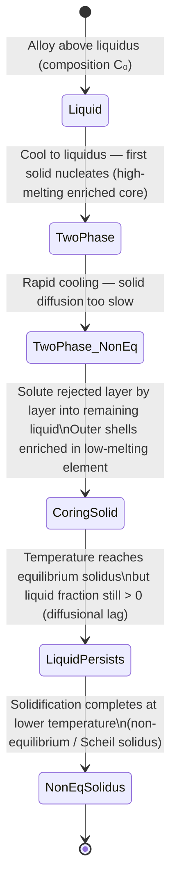
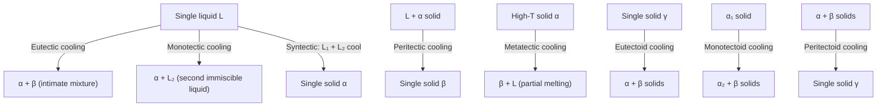
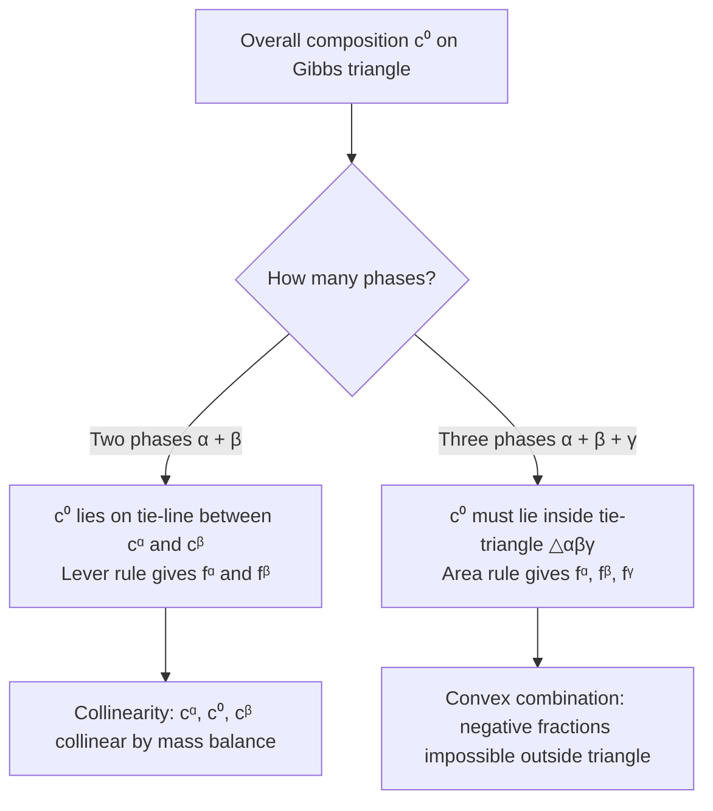
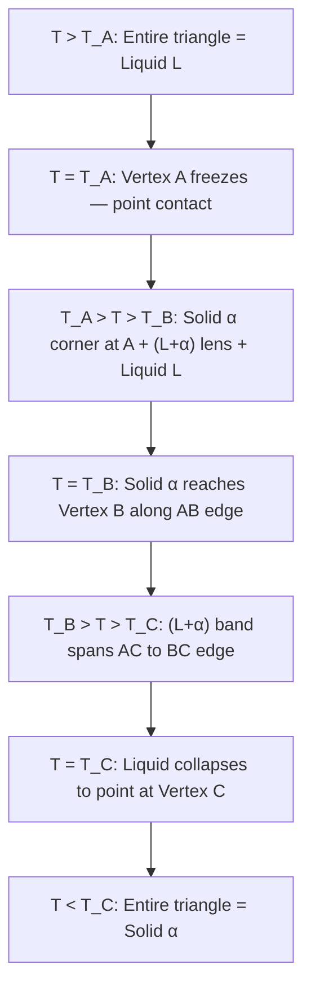
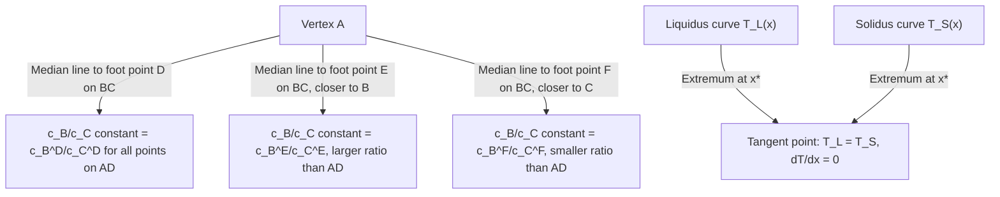
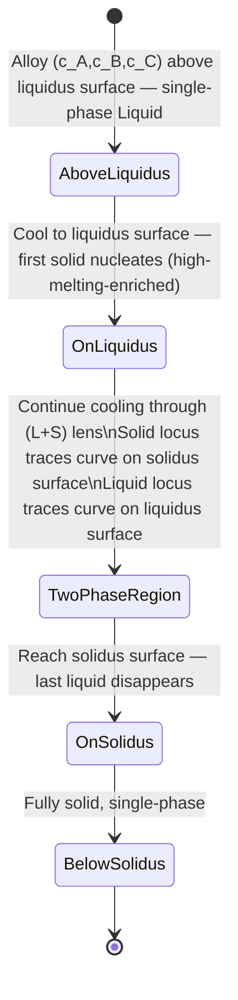

## Lecture 2: Heterogeneous Nucleation, Coring, and Non-Equilibrium Solidification

### 1. Underlying Theory & Foundations

#### A. Thermodynamic & Kinetic Principles

- **Heterogeneous nucleation** occurs on foreign substrates (mould walls, grain boundaries, impurity particles), lowering the activation energy barrier relative to homogeneous nucleation by reducing the volume of new solid–liquid interface that must be created.
- The contact angle $\theta$ is set by the balance of three interfacial tensions at the contact line, described by **Young's Equation**:
  $$\gamma_{\text{matrix-boundary}} = \gamma_{\text{precipitate-boundary}} + \gamma_{\text{precipitate-matrix}} \cos\theta$$
- The **wetting shape factor** $S(\theta)$ scales both the activation energy barrier and the critical volume for heterogeneous nucleation; it satisfies $0 \le S(\theta) \le 1$ for all physical contact angles $\theta \in [0^\circ, 180^\circ]$.
- **Coring** is a non-equilibrium microstructural phenomenon arising from diffusional asymmetry: liquid diffusion is rapid (liquid stays compositionally uniform) while solid-state diffusion is extremely slow, especially at lower temperatures.
- Under **continuous (non-equilibrium) cooling**, the average solid composition lags behind the equilibrium solidus. This **diffusional lag** shifts the effective solidus to lower temperatures and higher solute concentrations, causing liquid to persist below the equilibrium solidus line (**liquid persistence**).
- The **Scheil equation** models the limiting case of non-equilibrium solidification under the conditions: (1) no diffusion in the solid ($D_S = 0$), (2) complete mixing in the liquid, and (3) local equilibrium at the solid–liquid interface. Under these conditions the solute concentration in the solid increases continuously until a non-equilibrium eutectic or terminal phase forms.

#### B. Governing Formulations & Derivations

- **Critical radius of curvature** (identical for heterogeneous and homogeneous nucleation):
  $$r^*_{\text{het}}(\theta) = r^*_{\text{hom}} = -\frac{2\gamma_{SL}}{\Delta G_v}$$
  where $\gamma_{SL}$ is the solid–liquid interfacial free energy and $\Delta G_v$ is the volumetric free energy change driving solidification.

- **Activation energy barriers**:
  $$\Delta G^*_{\text{het}} = \Delta G^*_{\text{hom}} \cdot S(\theta), \qquad S(\theta) = \frac{(2+\cos\theta)(1-\cos\theta)^2}{4}$$

- **Parameter definitions**:
  - $\gamma_{SL}$ (precipitate–matrix interfacial energy): free energy per unit area of the boundary between the newly formed solid ($\beta$) and the parent liquid/matrix ($\alpha$).
  - $\gamma_{SI}$ / $\gamma_{\beta B}$ (precipitate–boundary interfacial energy): free energy per unit area between the precipitate and the foreign substrate or grain boundary.
  - $\gamma_{IL}$ / $\gamma_{\alpha B}$ (matrix–boundary interfacial energy): free energy per unit area of the original interface between the parent matrix and the substrate. When the precipitate nucleates, this area is destroyed and the energy is recovered as a credit.
  - Partition coefficient: $k = C_S / C_L$ (ratio of solid to liquid composition at the interface under local equilibrium).
  - Assumption for Scheil: $D_S = 0$ (zero diffusion in solid).

#### C. Determining Nucleation Type from Interfacial Energies

To determine whether homogeneous or heterogeneous nucleation dominates, evaluate the balance of interfacial tensions at the substrate using **Young's equation** and assess the resulting thermodynamic barrier.

##### General Step-by-Step Method

1. **Identify the phases and interfaces:**
    - Matrix / Parent phase: $\beta$
    - Nucleating phase: $\alpha$
    - Substrate: $\text{wall}$ ($w$)
    - Interfacial energies: $\gamma_{\alpha\beta}$ ($\alpha/\beta$ interphase boundary), $\gamma_{\alpha w}$ (new interface formed on wall), $\gamma_{\beta w}$ (existing interface destroyed on wall).

2. **Compute the apparent contact parameter:** Set up Young's force balance along the plane of the wall:
    $$\cos\theta = \frac{\gamma_{\beta w} - \gamma_{\alpha w}}{\gamma_{\alpha\beta}}$$

3. **Classify into the 3 thermodynamic regimes:**
    - **Regime 1: Partial Wetting** ($-1 < \cos\theta < 1$)
        - A stable physical contact angle exists ($0^\circ < \theta < 180^\circ$).
        - The shape factor is strictly between 0 and 1:
            $$S(\theta) = \frac{(2 + \cos\theta)(1 - \cos\theta)^2}{4} < 1$$
        - Because the activation barrier is scaled down ($\Delta G^*_{\text{het}} = \Delta G^*_{\text{hom}} \cdot S(\theta) < \Delta G^*_{\text{hom}}$), **heterogeneous nucleation is more likely**. The exponential kinetic factor $\exp(-\Delta G^*/kT)$ heavily favors the wall over the bulk, even with fewer wall sites.
    
    - **Regime 2: Complete Wetting / Barrierless Nucleation** ($\cos\theta \ge 1$)
        - Arises when $\gamma_{\beta w} - \gamma_{\alpha w} \ge \gamma_{\alpha\beta}$.
        - Replacing the $\beta/\text{wall}$ interface with $\alpha/\text{wall}$ plus $\alpha/\beta$ results in a net negative interfacial energy change:
            $$\Delta\gamma = \gamma_{\alpha w} + \gamma_{\alpha\beta} - \gamma_{\beta w} \le 0$$
        - In this regime, $\theta \to 0^\circ$ and $S(\theta) = 0 \implies \Delta G^*_{\text{het}} = 0$.
        - **Heterogeneous nucleation is overwhelmingly favored** because it occurs spontaneously and barrier-free on the wall.
    
    - **Regime 3: Complete Non-Wetting** ($\cos\theta \le -1$)
        - Arises when $\gamma_{\alpha w} - \gamma_{\beta w} \ge \gamma_{\alpha\beta}$.
        - The wall strongly repels $\alpha$; $\theta \to 180^\circ$ and $S(\theta) \to 1$.
        - The barrier on the wall is identical to the homogeneous barrier ($\Delta G^*_{\text{het}} \approx \Delta G^*_{\text{hom}}$).
        - With equal energy barriers, the outcome is decided by site density: bulk container sites ($N_v \sim 10^{28}\text{ m}^{-3}$) vastly outnumber surface wall sites ($N_s \sim 10^{19}\text{ m}^{-2}$).
        - **Homogeneous nucleation is more likely**.

##### Worked Example: Partial Wetting

Consider the following arbitrary values:
- $\gamma_{\alpha\beta} = 0.20\text{ J/m}^2$
- $\gamma_{\alpha w} = 0.35\text{ J/m}^2$
- $\gamma_{\beta w} = 0.45\text{ J/m}^2$

**Step 1: Calculate $\cos\theta$**
$$\cos\theta = \frac{0.45 - 0.35}{0.20} = \frac{0.10}{0.20} = 0.50$$

**Step 2: Determine $\theta$ and $S(\theta)$**
- $\theta = \arccos(0.50) = 60^\circ$
- Calculate the shape factor:
    $$S(60^\circ) = \frac{(2 + 0.50)(1 - 0.50)^2}{4} = \frac{2.50 \times 0.25}{4} = \frac{0.625}{4} = 0.15625$$

**Step 3: Conclusion**
- The activation barrier on the wall is only $\approx 15.6\%$ of the homogeneous barrier ($\Delta G^*_{\text{het}} \approx 0.156 \, \Delta G^*_{\text{hom}}$).
- Because the nucleation rate depends exponentially on $-\Delta G^*/kT$, this reduction in barrier height vastly outweighs the lower number of wall surface sites.
- **Heterogeneous nucleation is far more likely to occur.**

#### C. Phase & Microstructural Evolution

#### D. Literature References

- [[A Prince2.pdf]]
- [[P Gordon.pdf]]
- [[Phase Transformations in met...pdf]]

---

### 2. Professor's Summarizing Questions & Solutions

> [!question] Q1: Draw the graph of critical radius pertaining to heterogeneous nucleation as a function of the contact angle.
> > [!success]- Solution (Click to expand)
> > **Verdict / Core Takeaway:** The critical radius of curvature $r^*_{\text{het}}$ is **completely independent of the contact angle** $\theta$ — it is a horizontal line equal to $r^*_{\text{hom}}$ across all $\theta \in [0^\circ, 180^\circ]$.
> >
> > **Theoretical Justification:**
> > - Local equilibrium across the curved solid–liquid interface is governed solely by the balance between interfacial tension and bulk thermodynamic driving force, expressed as $r^* = -2\gamma_{SL}/\Delta G_v$.
> > - This expression contains no $\theta$ dependence; therefore the physical radius of curvature required for a stable nucleus is fixed regardless of substrate geometry.
> > - What **does** vary with $\theta$ is the **thermodynamic barrier factor** $S(\theta) = \frac{(2+\cos\theta)(1-\cos\theta)^2}{4}$, which scales both $\Delta G^*_{\text{het}}$ and the critical volume $V^*_{\text{het}}$.
> > - A two-panel graph therefore shows: (Left) $r^*_{\text{het}}/r^*_{\text{hom}} = 1.0$ — a flat horizontal line for all $\theta$. (Right) $S(\theta)$ — a smooth curve rising from $0$ at $\theta = 0^\circ$ to $1$ at $\theta = 180^\circ$.
> > - **Exam trap:** Do not confuse the invariance of the radius of curvature with the invariance of the activation energy barrier; the barrier does depend strongly on $\theta$ through $S(\theta)$.

> [!question] Q2: Are there ever three values of the precipitate-boundary, precipitate-matrix, and matrix-boundary interfacial energies for which heterogeneous nucleation is energetically less favourable than homogeneous nucleation?
> > [!success]- Solution (Click to expand)
> > **Verdict / Core Takeaway:** **No.** Heterogeneous nucleation is **never** energetically less favorable than homogeneous nucleation; $\Delta G^*_{\text{het}} \le \Delta G^*_{\text{hom}}$ always holds.
> >
> > **Theoretical Justification:**
> > - For any real, physical contact angle $\theta \in [0^\circ, 180^\circ]$ defined by Young's equation, the shape factor satisfies $0 \le S(\theta) \le 1$.
> > - **Complete wetting** ($\theta = 0^\circ$): $S(0^\circ) = 0$, so $\Delta G^*_{\text{het}} = 0$ — no activation barrier at all.
> > - **Complete non-wetting** ($\theta = 180^\circ$): $S(180^\circ) = 1$, so $\Delta G^*_{\text{het}} = \Delta G^*_{\text{hom}}$ — the worst case merely equals homogeneous nucleation.
> > - If the three interfacial energies were chosen such that $\gamma_{SI} > \gamma_{IL} + \gamma_{SL}$ (mathematically implying $\cos\theta < -1$, which is unphysical), the nucleus simply cannot contact the substrate and forms in the bulk instead — i.e., the system nucleates homogeneously. The activation barrier is capped at $\Delta G^*_{\text{hom}}$, not exceeded.
> > - Foreign surfaces can therefore only lower the energy barrier or, at worst, leave it unchanged; they can **never** raise it above the homogeneous value.
> > - **Exam trap:** The question invites you to imagine a pathological set of interfacial energies that "penalize" the substrate. The physical answer is that no such penalty exists — the nucleus detaches from the substrate and nucleates homogeneously instead.

> [!question] Q3: What is coring? Explain the detailed mechanism.
> > [!success]- Solution (Click to expand)
> > **Verdict / Core Takeaway:** Coring is a **non-equilibrium microstructural phenomenon** producing radial concentration gradients within individual solid grains of an isomorphous binary alloy, caused by insufficient solid-state diffusion during rapid cooling.
> >
> > ![[coring.png]]
> >
> > **Theoretical Justification:**
> > 1. **Initial nucleation at the liquidus:** When liquid of bulk composition $C_0$ is cooled to its liquidus, the first solid nuclei are **enriched in the higher-melting element** (as dictated by the equilibrium tie-line).
> > 2. **Diffusional asymmetry:** As cooling continues into the two-phase ($\alpha + L$) region, equilibrium requires both phases to track the solidus and liquidus curves. Liquid diffusion is rapid (effectively complete mixing), but **solid-state diffusion is extremely slow** — the early-frozen core cannot re-equilibrate its composition.
> > 3. **Layer-by-layer solute rejection:** Each new shell of solid that crystallizes onto the existing core rejects the low-melting solute into the remaining liquid, progressively enriching it.
> > 4. **Radial gradient formation:** Successive shells deposited at lower temperatures contain increasing amounts of the low-melting element, producing a continuous radial gradient: the **grain center (core)** is rich in the high-melting element; the **grain boundaries (perimeter)** are rich in the low-melting element.
> > 5. **Consequences:**
> >    - **Incipient melting:** Reheating a cored casting causes grain boundary regions (enriched in the lower-melting component) to melt well below the equilibrium solidus, forming thin liquid films that destroy mechanical integrity.
> >    - **Homogenization heat treatment:** Coring can be eliminated by holding the alloy just below the solidus for an extended period to allow solid-state diffusion to produce compositionally uniform grains.
> > - **Exam trap:** Coring is distinct from macrosegregation; it occurs within individual grains and is driven by the slow solid-state diffusivity, not by bulk fluid flow.

> [!question] Q4: Say true or false: In a binary system whose phase diagram is isomorphous, if an alloy from above the liquidus is continuously cooled, no liquid remains as soon as the temperature falls below the solidus line.
> > [!success]- Solution (Click to expand)
> > **Verdict / Core Takeaway:** **FALSE.**
> >
> > **Theoretical Justification:**
> > - **Diffusional lag and non-equilibrium solidus shift:** Continuous (rapid) cooling prevents complete diffusional readjustment within the solid. Early-formed solid retains its high-melting composition, and solute is progressively rejected into the remaining liquid. As a result, the **average solid composition lags behind the equilibrium solidus curve**.
> > - **Shift to lower temperatures and higher solute concentrations:** This lag effectively shifts the non-equilibrium solidus to lower temperatures relative to the equilibrium diagram.
> > - **Liquid persistence below equilibrium solidus:** When the temperature drops to or just below the equilibrium solidus line, a **significant fraction of liquid still remains**. Complete solidification is delayed and finishes only at the non-equilibrium (Scheil) solidus, which lies below the equilibrium solidus.
> > - **Condition for the statement to be true:** Only under **ideal equilibrium cooling** (infinitely slow cooling, complete atomic diffusion in the solid at every temperature step) would no liquid remain at the equilibrium solidus.
> > - **Exam trap:** Students often assume the equilibrium phase diagram describes behavior under any cooling rate. Continuous cooling is inherently non-equilibrium; the equilibrium solidus marks where solidification would complete only if cooling were infinitely slow.

## Lecture 3: Invariant Reactions, Gibbs Phase Rule & Phase Diagram Construction

### 1. Underlying Theory & Foundations

#### A. Thermodynamic & Kinetic Principles

- At constant pressure a binary system has **zero degrees of freedom** ($F = 0$) wherever three phases coexist simultaneously. These points or isotherms are called **invariant reactions** and appear as horizontal lines on the phase diagram at fixed temperature and fixed phase compositions.
- **Liquid-involving (_-tectic_) reactions** all feature liquid as one of the three coexisting phases; **solid-state (_-tectoid_) reactions** involve only solid phases.
- The **Gibbs Phase Rule** quantifies the variance of a heterogeneous system at equilibrium: $F = C - P + 2$ (general), reduced to $F = C - P + 1$ at constant pressure (condensed systems).
- Phase diagram construction is constrained by four strict topological rules: the rule of neighboring phase regions, Konovalov's extrema tangency rule, Schreinemakers' extension rule, and the non-zero solubility limit.

#### B. Governing Formulations & Derivations

- **Derivation of the Gibbs Phase Rule:**
  - Total intensive variables: $n = P(C - 1) + 2$ (compositional variables across $P$ phases plus $T$ and $P_\text{sys}$).
  - Thermodynamic equilibrium constraints (chemical potential equality for each component across all phases): $m = C(P - 1)$.
  - Degrees of freedom:
    $$F = n - m = [P(C-1) + 2] - [C(P-1)] = C - P + 2$$
  - **Condensed (isobaric) form** (pressure fixed at 1 atm):
    $$P + F = C + 1$$
- **Parameter definitions:**
  - $C$ = number of independent chemical components.
  - $P$ = number of coexisting phases.
  - $F$ = degrees of freedom (variance).
  - $\mu_i^\phi$ = chemical potential of component $i$ in phase $\phi$; equilibrium requires $\mu_i^\alpha = \mu_i^\beta = \cdots$ for all $i$.
  - $\Delta S_m = -R[X_A \ln X_A + X_B \ln X_B]$ = configurational entropy of mixing; its derivative diverges as $X_B \to 0$, enforcing non-zero solubility at all temperatures.

#### C. Phase & Microstructural Evolution

#### D. Literature References

- [[A Prince2.pdf]]
- [[P Gordon.pdf]]
- [[Phase Transformations in met...pdf]]

---

### 2. Professor's Summarizing Questions & Solutions

> [!question] Q1: List and describe all liquid-involving invariant reactions (_-tectic_ reactions) in binary systems, with reaction equations and textbook references.
> > [!success]- Solution (Click to expand)
> > **Verdict / Core Takeaway:** There are five liquid-involving invariant reactions in binary systems: eutectic, monotectic, metatectic, peritectic, and syntectic.
> >
> > **Theoretical Justification:**
> >
> > **A. Eutectic Reaction**
> > - **Reaction:** $L \underset{\text{heating}}{\overset{\text{cooling}}{\rightleftharpoons}} \alpha + \beta$
> > - A single liquid transforms upon cooling into two intimately mixed solid phases simultaneously. The word _eutectic_ derives from the Greek for "easily melted".
> > - **References:** Paul Gordon, Section 6.2, pp. 135–138, Figs. 6.4 & 6.5; A. Prince, Section 4.2, pp. 66–67, Fig. 46; Callister, Section 9.11, pp. 268–269, Figs. 9.7 & 9.8.
> >
> > **B. Monotectic Reaction**
> > - **Reaction:** $L_1 \underset{\text{heating}}{\overset{\text{cooling}}{\rightleftharpoons}} \alpha + L_2$
> > - A liquid $L_1$ decomposes upon cooling into a solid $\alpha$ and a second, immiscible liquid $L_2$ of different composition.
> > - **References:** Paul Gordon, pp. 163–168, Figs. 6.19(a) & 6.23; A. Prince, Section 5.2, pp. 98–100, Fig. 86.
> >
> > **C. Metatectic Reaction**
> > - **Reaction:** $\alpha \underset{\text{heating}}{\overset{\text{cooling}}{\rightleftharpoons}} \beta + L$
> > - A high-temperature solid $\alpha$ decomposes upon cooling into a new solid $\beta$ and a liquid $L$. Alloys undergoing this reaction partially melt upon cooling.
> > - **References:** Paul Gordon, p. 163, p. 165, Fig. 6.19(c); A. Prince, Chapter 7, p. 116, Figs. 103 & 104.
> >
> > **D. Peritectic Reaction**
> > - **Reaction:** $L + \alpha \underset{\text{heating}}{\overset{\text{cooling}}{\rightleftharpoons}} \beta$
> > - A liquid reacts with a pre-existing solid $\alpha$ upon cooling to form a single new solid $\beta$.
> > - **References:** Paul Gordon, Section 7.1, pp. 175–177, Figs. 7.1 & 7.3; A. Prince, Section 4.3, pp. 82–85, Figs. 65, 66 & 68; Callister, Section 9.14, p. 282, Fig. 9.21.
> >
> > **E. Syntectic Reaction**
> > - **Reaction:** $L_1 + L_2 \underset{\text{heating}}{\overset{\text{cooling}}{\rightleftharpoons}} \alpha$
> > - Two immiscible liquids react upon cooling to form a single solid $\alpha$. Rare; occurs in K–Zn, Na–Zn, and Pb–U systems.
> > - **References:** Paul Gordon, Section 7.4, pp. 183–184, Figs. 7.8(a) & (b); A. Prince, Section 5.3, p. 100, Figs. 87(a) & (b).

> [!question] Q2: List and describe all solid-state invariant reactions (_-tectoid_ reactions) in binary systems, with reaction equations and textbook references.
> > [!success]- Solution (Click to expand)
> > **Verdict / Core Takeaway:** There are three solid-state invariant reactions: eutectoid, monotectoid, and peritectoid.
> >
> > **Theoretical Justification:**
> >
> > **A. Eutectoid Reaction**
> > - **Reaction:** $\gamma \underset{\text{heating}}{\overset{\text{cooling}}{\rightleftharpoons}} \alpha + \beta$
> > - A single homogeneous solid $\gamma$ decomposes upon cooling into two distinct solid phases simultaneously. Classic example: austenite ($\gamma$) → pearlite ($\alpha + \text{Fe}_3\text{C}$) at 723–727 °C in steels.
> > - **References:** Paul Gordon, Section 6.3, pp. 163–168, Figs. 6.19(b), 6.21 & 6.23; A. Prince, Section 6.2, pp. 105–107, Fig. 90; Callister, Section 9.14, p. 282, Fig. 9.21; Section 9.18, pp. 291–294, Fig. 9.24.
> >
> > **B. Monotectoid Reaction**
> > - **Reaction:** $\alpha_1 \underset{\text{heating}}{\overset{\text{cooling}}{\rightleftharpoons}} \alpha_2 + \beta$
> > - A solid solution $\alpha_1$ decomposes upon cooling into a solid solution of the same crystal structure but different composition ($\alpha_2$) and another distinct solid phase ($\beta$). Geometric form mirrors the monotectic but all three phases are solid.
> > - **References:** Paul Gordon, p. 165; A. Prince, Section 6.3, p. 110, Fig. 94b (Al–Zn system, $\alpha'$ decomposition at 340 °C).
> >
> > **C. Peritectoid Reaction**
> > - **Reaction:** $\alpha + \beta \underset{\text{heating}}{\overset{\text{cooling}}{\rightleftharpoons}} \gamma$
> > - Two distinct solid phases react upon cooling to form a single new solid $\gamma$. Typically very sluggish due to slow solid-state diffusion.
> > - **References:** Paul Gordon, Section 7.4, p. 183, Fig. 7.7; A. Prince, Section 6.4, pp. 110–111, Figs. 95 & 96.
> >
> > **Summary Table:**
> >
> > | Reaction | Form (Cooling) | P. Gordon | A. Prince | Callister |
> > |:--|:--|:--|:--|:--|
> > | Eutectic | $L \rightleftharpoons \alpha + \beta$ | pp. 135–138, Figs. 6.4 & 6.5 | pp. 66–67, Fig. 46 | pp. 268–269, Figs. 9.7 & 9.8 |
> > | Monotectic | $L_1 \rightleftharpoons \alpha + L_2$ | pp. 163–168, Figs. 6.19a & 6.23 | pp. 98–100, Fig. 86 | — |
> > | Metatectic | $\alpha \rightleftharpoons \beta + L$ | p. 163, Fig. 6.19c | p. 116, Figs. 103 & 104 | — |
> > | Peritectic | $L + \alpha \rightleftharpoons \beta$ | pp. 175–177, Figs. 7.1 & 7.3 | pp. 82–85, Figs. 65 & 68 | p. 282, Fig. 9.21 |
> > | Syntectic | $L_1 + L_2 \rightleftharpoons \alpha$ | pp. 183–184, Figs. 7.8a & b | p. 100, Figs. 87a & b | — |
> > | Eutectoid | $\gamma \rightleftharpoons \alpha + \beta$ | pp. 163–168, Figs. 6.19b & 6.21 | p. 105, Fig. 90 | p. 282, Fig. 9.21; p. 294, Fig. 9.24 |
> > | Monotectoid | $\alpha_1 \rightleftharpoons \alpha_2 + \beta$ | p. 165 | p. 110, Fig. 94b | — |
> > | Peritectoid | $\alpha + \beta \rightleftharpoons \gamma$ | p. 183, Fig. 7.7 | pp. 110–111, Figs. 95 & 96 | — |

> [!question] Q3: Derive the Gibbs Phase Rule and state its condensed (isobaric) form.
> > [!success]- Solution (Click to expand)
> > **Verdict / Core Takeaway:** $F = C - P + 2$ (general); $P + F = C + 1$ (constant pressure).
> >
> > **Theoretical Justification:**
> >
> > **Step 1 — Define terms.** Consider $C$ independent chemical components distributed among $P$ coexisting phases. $F$ is the number of intensive variables (temperature, pressure, phase compositions) that can be varied without changing the number of phases.
> >
> > **Step 2 — Count total intensive variables ($n$).** Each phase requires $(C - 1)$ independent mole fractions (the $C$-th follows from $\sum X_i = 1$). Across $P$ phases plus $T$ and $P_\text{sys}$:
> > $$n = P(C - 1) + 2$$
> >
> > **Step 3 — Count equilibrium constraints ($m$).** Chemical equilibrium demands equal chemical potential of each component in all phases: $\mu_i^\alpha = \mu_i^\beta = \cdots = \mu_i^P$. For component $i$ this gives $(P-1)$ equations; for $C$ components:
> > $$m = C(P - 1)$$
> >
> > **Step 4 — Compute $F = n - m$:**
> > $$F = [P(C-1) + 2] - [C(P-1)] = PC - P + 2 - PC + C = C - P + 2$$
> > $$\boxed{P + F = C + 2}$$
> >
> > **Condensed form** (pressure fixed at 1 atm, consuming one degree of freedom):
> > $$\boxed{P + F = C + 1}$$

> [!question] Q4: State the four rules for constructing valid equilibrium phase diagrams and describe the explicit flaw that violates each rule.
> > [!success]- Solution (Click to expand)
> > **Verdict / Core Takeaway:** Four topological rules govern all valid binary phase diagrams; violating any one produces a physically impossible diagram.
> >
> > ![[flawed_phase_diagram_rules.png]]
> >
> > **Theoretical Justification:**
> >
> > **Rule 1 — Rule of Neighboring Phase Regions (Palatnik–Landau / Rhines Boundary Rule)**
> > - Single-phase regions must always be separated by a two-phase region containing those same two phases. Crossing any boundary line must change the number of coexisting phases by $\pm 1$.
> > - *Thermodynamic basis:* A direct single-phase-to-single-phase boundary implies a discontinuous jump in chemical potentials without equilibrium two-phase tangency — thermodynamically impossible.
> > - *Explicit flaw:* Drawing a single boundary line separating an $\alpha$ field directly from a $\beta$ field while omitting the intermediate $\alpha + \beta$ two-phase region.
> >
> > **Rule 2 — Konovalov's Rule / Extrema Tangency Rule**
> > - Where liquidus and solidus curves pass through a temperature maximum or minimum, both curves must meet at a **single point of identical composition** with a horizontal tangent ($dT/dX = 0$).
> > - *Thermodynamic basis:* At an extremum the solid and liquid free-energy curves have identical tangent slope and minimum, requiring $\mu_A^S = \mu_A^L$ and $\mu_B^S = \mu_B^L$ at the exact same composition.
> > - *Explicit flaw:* Drawing the liquidus minimum at a different composition from the solidus minimum (e.g., liquidus at 35% B, solidus at 50% B), as illustrated in P. Gordon, Figs. 4.22a & 4.22b.
> >
> > **Rule 3 — Schreinemakers' Extension Rule (Metastable Boundary Extension)**
> > - The metastable extension of phase boundaries past an invariant point must project **into two-phase regions**, never into single-phase regions.
> > - *Thermodynamic basis:* The metastable continuation of a phase equilibrium corresponds to the free-energy tangent construction across adjacent two-phase mixtures. Projecting into a single-phase region implies a metastable mixture has higher free energy than a single phase, violating free-energy minimization.
> > - *Explicit flaw:* Extending a liquidus or solvus boundary past a eutectic triple point so that the dashed metastable line projects into the $\alpha$ single-phase field instead of the $\alpha + \beta$ two-phase region.
> >
> > **Rule 4 — Non-Zero Solubility (Dilute Solution / Third-Law Limit)**
> > - Under true equilibrium, every component must have non-zero solubility in every other; a strictly vertical solvus at 0% or 100% solute is thermodynamically impossible.
> > - *Thermodynamic basis:* The derivative of the configurational entropy of mixing diverges as solute concentration approaches zero: $d(\Delta G_m)/dX_B \to -\infty$ as $X_B \to 0$. Adding even an infinitesimal amount of solute lowers the free energy, making strictly pure terminal phases unstable.
> > - *Explicit flaw:* Drawing a solvus as a strictly vertical line aligned with the pure component axis (0% B), implying zero solubility of B in A.

## Lecture 4: Ternary Phase Diagrams — Gibbs Triangle, Tie-Lines & Lever Rules

### 1. Underlying Theory & Foundations

#### A. Thermodynamic & Kinetic Principles

- A **ternary system** ($A$–$B$–$C$) is represented at constant temperature and pressure by the **Gibbs triangle**, a two-dimensional simplex embedded in the mole-fraction plane $c_A + c_B + c_C = 1$, $c_i \ge 0$.
- **Viviani's Theorem** (geometric foundation): In an equilateral triangle of altitude $h$, the sum of perpendicular distances from any interior point $P$ to the three sides equals $h$. The perpendicular distance $d_A$ from $P$ to side $BC$ is proportional to $c_A$ ($d_A = c_A \cdot h$), so lines parallel to $BC$ are iso-$c_A$ lines.
- **Two-phase equilibrium** on the Gibbs triangle is governed by the same mass-balance vector algebra as in binary systems: the overall composition must be a convex combination of the two phase compositions, forcing **collinearity** (all three points lie on a single tie-line).
- **Three-phase equilibrium** produces a **tie-triangle** $\triangle\alpha\beta\gamma$. The overall composition $\mathbf{c}^0$ must lie inside this triangle; phase fractions are given by the **Center of Gravity (Barycentric) Rule** — each fraction equals the area of the sub-triangle opposite that vertex divided by the total triangle area.

#### B. Governing Formulations & Derivations

- **Mole-fraction plane constraint:**
  $$c_A + c_B + c_C = 1, \quad c_A, c_B, c_C \ge 0$$

- **Direction vector of side $BC$** (used in the parallel-line proof):
  $$\vec{v}_{BC} = C - B = (0,0,1) - (0,1,0) = (0,-1,1)$$

- **Parametric line parallel to $BC$ from point $P_0 = (c_A^0, c_B^0, 0)$:**
  $$\vec{r}(t) = \left(c_A^0,\; c_B^0 - t,\; t\right), \quad 0 \le t \le c_B^0$$
  The first component $c_A(t) = c_A^0$ is constant for all $t$.

- **Two-phase mass balance (vector form):**
  $$m^0 \mathbf{c}^0 = m^\alpha \mathbf{c}^\alpha + m^\beta \mathbf{c}^\beta$$
  Dividing by $m^0$ and letting $f^\alpha = m^\alpha/m^0$, $f^\beta = 1 - f^\alpha$:
  $$\mathbf{c}^0 - \mathbf{c}^\beta = f^\alpha (\mathbf{c}^\alpha - \mathbf{c}^\beta)$$

- **Ternary lever rule** (distance-ratio and component-wise forms):
  $$f^\alpha = \frac{|\mathbf{c}^0 - \mathbf{c}^\beta|}{|\mathbf{c}^\alpha - \mathbf{c}^\beta|}, \qquad f^\beta = \frac{|\mathbf{c}^\alpha - \mathbf{c}^0|}{|\mathbf{c}^\alpha - \mathbf{c}^\beta|}$$
  Projecting onto component $A$:
  $$f^\alpha = \frac{c_A^0 - c_A^\beta}{c_A^\alpha - c_A^\beta}, \qquad f^\beta = \frac{c_A^\alpha - c_A^0}{c_A^\alpha - c_A^\beta}$$

- **Three-phase mass balance:**
  $$\mathbf{c}^0 = f^\alpha \mathbf{c}^\alpha + f^\beta \mathbf{c}^\beta + f^\gamma \mathbf{c}^\gamma, \qquad f^\alpha + f^\beta + f^\gamma = 1, \quad f^i \ge 0$$

- **Center of Gravity (Barycentric) Rule** — total tie-triangle area via determinant:
  $$\text{Area}(\triangle\alpha\beta\gamma) = \frac{1}{2}\begin{vmatrix} c_A^\alpha & c_B^\alpha & 1 \\ c_A^\beta & c_B^\beta & 1 \\ c_A^\gamma & c_B^\gamma & 1 \end{vmatrix}$$
  Phase fractions via Cramer's rule:
  $$f^\alpha = \frac{\text{Area}(\triangle 0\beta\gamma)}{\text{Area}(\triangle\alpha\beta\gamma)}, \quad f^\beta = \frac{\text{Area}(\triangle\alpha 0\gamma)}{\text{Area}(\triangle\alpha\beta\gamma)}, \quad f^\gamma = \frac{\text{Area}(\triangle\alpha\beta 0)}{\text{Area}(\triangle\alpha\beta\gamma)}$$

- **Parameter definitions:**
  - $c_A, c_B, c_C$ — mole fractions of components $A$, $B$, $C$ respectively.
  - $m^0, m^\alpha, m^\beta, m^\gamma$ — total moles and moles of each phase.
  - $f^i = m^i / m^0$ — mole fraction (phase fraction) of phase $i$.
  - $\mathbf{c}^0, \mathbf{c}^\alpha, \mathbf{c}^\beta, \mathbf{c}^\gamma$ — composition vectors in the Gibbs triangle.

#### C. Phase & Microstructural Evolution

#### D. Literature References

- [[A Prince2.pdf]]
- [[P Gordon.pdf]]
- [[Phase Transformations in met...pdf]]

---

### 2. Professor's Summarizing Questions & Solutions

> [!question] Q1: Show that on the Gibbs triangle, starting from a point on the $AB$ line, if a line is drawn parallel to the $BC$ line, the mole fraction of $A$ does not change for the entire line.
> > [!success]- Solution (Click to expand)
> > **Verdict / Core Takeaway:** The mole fraction $c_A$ is constant along any line parallel to side $BC$ of the Gibbs triangle.
> >
> > **Theoretical Justification:**
> >
> > ![[ternary_tieline_explanation.png]]
> >
> > **A. Vector Derivation in 3D Cartesian Coordinates**
> >
> > Consider a ternary system $A$–$B$–$C$ on the Gibbs triangle lying in the mole-fraction plane $c_A + c_B + c_C = 1$. The three pure-component vertices are $A = (1,0,0)$, $B = (0,1,0)$, $C = (0,0,1)$.
> >
> > 1. **Boundary $AB$:** Any point $P_0$ on the $AB$ baseline has $c_C = 0$, so $P_0 = (c_A^0, c_B^0, 0)$ with $c_A^0 + c_B^0 = 1$.
> > 2. **Direction vector of $BC$:** $\vec{v}_{BC} = C - B = (0,-1,1)$.
> > 3. **Parametric line parallel to $BC$ from $P_0$:**
> >    $$\vec{r}(t) = (c_A^0,\; c_B^0 - t,\; t), \quad 0 \le t \le c_B^0$$
> > 4. **Conclusion:** The first component of $\vec{r}(t)$ is $c_A(t) = c_A^0 = \text{constant}$. Therefore, along the entire line parallel to $BC$, the mole fraction of $A$ remains fixed at $c_A^0$.
> >
> > **B. Geometric Proof (Viviani's Distance Theorem)**
> >
> > - **Viviani's Theorem** states that the sum of perpendicular distances from any interior point $P$ to the three sides of an equilateral triangle of altitude $h$ equals $h$.
> > - The perpendicular distance $d_A$ from $P(c_A, c_B, c_C)$ to side $BC$ is directly proportional to $c_A$: $d_A = c_A \cdot h$.
> > - A line parallel to side $BC$ is by definition the locus of all points at constant perpendicular distance $d_A$ from $BC$. Because $d_A$ is constant along this line, $c_A$ does not change for the entire line.
> >
> > **Literature:** A. Prince, Chapter 8, Section 8.2, pp. 120–121, Figs. 105 & 106; Porter & Easterling, Chapter 1, Section 1.7, pp. 56–57, Fig. 1.40.

> [!question] Q2: If an alloy of overall composition $\mathbf{c}^0$ on the Gibbs triangle splits into two homogeneous phases $\alpha$ and $\beta$, show that all three compositions must lie on the same straight line.
> > [!success]- Solution (Click to expand)
> > **Verdict / Core Takeaway:** The overall composition $\mathbf{c}^0$ and the two phase compositions $\mathbf{c}^\alpha$ and $\mathbf{c}^\beta$ are collinear — they all lie on the same tie-line.
> >
> > ![[collinearity_and_lever_rule.png]]
> >
> > **Theoretical Justification:**
> >
> > Consider total moles $m^0$ and overall composition $\mathbf{c}^0 = (c_A^0, c_B^0, c_C^0)$ splitting into phases $\alpha$ and $\beta$ with mole amounts $m^\alpha$, $m^\beta$ and compositions $\mathbf{c}^\alpha$, $\mathbf{c}^\beta$.
> >
> > 1. **Total molar balance:** $m^0 = m^\alpha + m^\beta$.
> > 2. **Component mass balance (vector form):** $m^0 \mathbf{c}^0 = m^\alpha \mathbf{c}^\alpha + m^\beta \mathbf{c}^\beta$.
> > 3. Dividing by $m^0$, letting $f^\alpha = m^\alpha/m^0$ and $f^\beta = 1 - f^\alpha$:
> >    $$\mathbf{c}^0 = f^\alpha \mathbf{c}^\alpha + (1 - f^\alpha) \mathbf{c}^\beta$$
> >    $$\mathbf{c}^0 - \mathbf{c}^\beta = f^\alpha (\mathbf{c}^\alpha - \mathbf{c}^\beta)$$
> > 4. **Vector collinearity:** This states that the displacement vector $(\mathbf{c}^0 - \mathbf{c}^\beta)$ is a scalar multiple ($f^\alpha$) of $(\mathbf{c}^\alpha - \mathbf{c}^\beta)$. Therefore $\mathbf{c}^0$ lies on the line through $\mathbf{c}^\alpha$ and $\mathbf{c}^\beta$ — the **tie-line**.
> >
> > **Literature:** A. Prince, Chapter 8, Section 8.3, pp. 122–123, Fig. 108; P. Gordon, Chapter 4, Section 4.7, p. 64 & p. 91, Fig. 4.27; Callister, Chapter 9, Section 9.8, pp. 263–264, Fig. 9.3b.

> [!question] Q3: Derive the lever rule for ternary systems.
> > [!success]- Solution (Click to expand)
> > **Verdict / Core Takeaway:** The ternary lever rule gives phase fractions as distance ratios along the tie-line, directly from the two-phase collinearity relation.
> >
> > **Theoretical Justification:**
> >
> > From the collinearity relation: $\mathbf{c}^0 - \mathbf{c}^\beta = f^\alpha (\mathbf{c}^\alpha - \mathbf{c}^\beta)$.
> >
> > **A. Distance-Ratio Formulation (Euclidean Norm)**
> >
> > Taking the vector length along the tie-line:
> > $$|\mathbf{c}^0 - \mathbf{c}^\beta| = f^\alpha |\mathbf{c}^\alpha - \mathbf{c}^\beta|$$
> > $$f^\alpha = \frac{|\mathbf{c}^0 - \mathbf{c}^\beta|}{|\mathbf{c}^\alpha - \mathbf{c}^\beta|} = \frac{\text{Distance from } \mathbf{c}^0 \text{ to phase } \beta \text{ boundary}}{\text{Total tie-line length between } \alpha \text{ and } \beta}$$
> > $$f^\beta = \frac{|\mathbf{c}^\alpha - \mathbf{c}^0|}{|\mathbf{c}^\alpha - \mathbf{c}^\beta|} = \frac{\text{Distance from phase } \alpha \text{ boundary to } \mathbf{c}^0}{\text{Total tie-line length between } \alpha \text{ and } \beta}$$
> >
> > **B. Component-Wise Algebraic Formulation**
> >
> > Projecting along component $A$:
> > $$c_A^0 = f^\alpha c_A^\alpha + (1 - f^\alpha) c_A^\beta \implies c_A^0 - c_A^\beta = f^\alpha (c_A^\alpha - c_A^\beta)$$
> > $$f^\alpha = \frac{c_A^0 - c_A^\beta}{c_A^\alpha - c_A^\beta}, \qquad f^\beta = \frac{c_A^\alpha - c_A^0}{c_A^\alpha - c_A^\beta}$$
> >
> > **Literature:** A. Prince, Chapter 8, Section 8.3, p. 123, Fig. 108; Callister, Chapter 9, Section 9.8, pp. 264–265, Example 9.1; Porter & Easterling, Chapter 1, Section 1.7, p. 58, Fig. 1.41c.

> [!question] Q4: If an alloy of overall composition $\mathbf{c}^0$ splits into three homogeneous phases $\alpha$, $\beta$, $\gamma$, show that the starting composition must necessarily lie inside the triangle $\triangle\alpha\beta\gamma$.
> > [!success]- Solution (Click to expand)
> > **Verdict / Core Takeaway:** $\mathbf{c}^0$ must lie inside (or on the boundary of) the tie-triangle $\triangle\alpha\beta\gamma$ because physical phase fractions cannot be negative, and lying outside the triangle forces at least one negative fraction.
> >
> > ![[ternary_three_phase_triangle.png]]
> >
> > **Theoretical Justification:**
> >
> > Consider $\mathbf{c}^0$ splitting into three phases with moles $m^\alpha, m^\beta, m^\gamma$ and compositions $\mathbf{c}^\alpha, \mathbf{c}^\beta, \mathbf{c}^\gamma$.
> >
> > 1. **Mass conservation:**
> >    $$m^0 = m^\alpha + m^\beta + m^\gamma, \qquad m^0 \mathbf{c}^0 = m^\alpha \mathbf{c}^\alpha + m^\beta \mathbf{c}^\beta + m^\gamma \mathbf{c}^\gamma$$
> > 2. Dividing by $m^0$:
> >    $$\mathbf{c}^0 = f^\alpha \mathbf{c}^\alpha + f^\beta \mathbf{c}^\beta + f^\gamma \mathbf{c}^\gamma, \qquad f^\alpha + f^\beta + f^\gamma = 1, \quad f^i \ge 0$$
> > 3. **Convex combination property:** A point expressed as a linear combination of three vertices with non-negative coefficients summing to 1 is a **convex combination** — it lies inside or on the boundary of the triangle those vertices define.
> > 4. **Geometric result:** The set of all convex combinations of three non-collinear points in 2D is the closed triangle $\triangle\alpha\beta\gamma$.
> > 5. **Physical constraint:** If $\mathbf{c}^0$ were outside $\triangle\alpha\beta\gamma$, solving the mass balance equations would require at least one $f^i < 0$, which is physically impossible. Therefore $\mathbf{c}^0$ **must lie inside or on the boundary of $\triangle\alpha\beta\gamma$**.
> >
> > **Literature:** A. Prince, Chapter 8, Section 8.3, pp. 123–124, Figs. 109 & 110; Porter & Easterling, Chapter 1, Section 1.7, pp. 58–59, Fig. 1.42f & g.

> [!question] Q5: Derive the phase fractions $f^\alpha$, $f^\beta$, $f^\gamma$ for a three-phase equilibrium in a ternary system.
> > [!success]- Solution (Click to expand)
> > **Verdict / Core Takeaway:** The three phase fractions are found by solving the simultaneous mass balance equations; geometrically they equal the ratio of each sub-triangle area to the total tie-triangle area (Center of Gravity / Barycentric Rule).
> >
> > **Theoretical Justification:**
> >
> > Write the simultaneous mass balance equations:
> > $$f^\alpha + f^\beta + f^\gamma = 1$$
> > $$c_A^\alpha f^\alpha + c_A^\beta f^\beta + c_A^\gamma f^\gamma = c_A^0$$
> > $$c_B^\alpha f^\alpha + c_B^\beta f^\beta + c_B^\gamma f^\gamma = c_B^0$$
> >
> > **Solution via Cramer's Rule (Barycentric Coordinates)**
> >
> > The total area of the tie-triangle $\triangle\alpha\beta\gamma$:
> > $$\text{Area}(\triangle\alpha\beta\gamma) = \frac{1}{2}\begin{vmatrix} c_A^\alpha & c_B^\alpha & 1 \\ c_A^\beta & c_B^\beta & 1 \\ c_A^\gamma & c_B^\gamma & 1 \end{vmatrix}$$
> >
> > Applying Cramer's rule:
> > $$f^\alpha = \frac{\text{Area}(\triangle 0\beta\gamma)}{\text{Area}(\triangle\alpha\beta\gamma)} = \frac{\text{Area of sub-triangle opposite vertex } \alpha}{\text{Total area of } \triangle\alpha\beta\gamma}$$
> > $$f^\beta = \frac{\text{Area}(\triangle\alpha 0\gamma)}{\text{Area}(\triangle\alpha\beta\gamma)} = \frac{\text{Area of sub-triangle opposite vertex } \beta}{\text{Total area of } \triangle\alpha\beta\gamma}$$
> > $$f^\gamma = \frac{\text{Area}(\triangle\alpha\beta 0)}{\text{Area}(\triangle\alpha\beta\gamma)} = \frac{\text{Area of sub-triangle opposite vertex } \gamma}{\text{Total area of } \triangle\alpha\beta\gamma}$$
> >
> > This geometric formulation is the **Center of Gravity Rule** or **Barycentric Coordinates Rule** for three-phase equilibrium in ternary systems.
> >
> > **Literature:** A. Prince, Chapter 8, Section 8.3, pp. 123–124, Fig. 109; Porter & Easterling, Chapter 1, Section 1.7, p. 59, Fig. 1.42f & g.

## Lecture 5: Isomorphous Ternary Phase Diagrams — Isothermal Sections & Tie-Line Uniqueness

### 1. Underlying Theory & Foundations

#### A. Thermodynamic & Kinetic Principles

- An **isomorphous ternary system** ($A$–$B$–$C$) has complete mutual solubility in both liquid and solid states across all compositions. The 3D isobaric space model is a triangular prism with the Gibbs triangle as its base and temperature as the vertical axis.
- **Melting point ordering:** $T_A > T_B > T_C$. The **liquidus surface** (upper) and **solidus surface** (lower) are smooth surfaces meeting only at the three pure-component vertical edges.
- The two-phase ($L + \alpha$) region is the lens-shaped volume between the liquidus and solidus surfaces. Horizontal isothermal slices through this prism produce a sequence of 2D Gibbs-triangle sections showing how the single-phase and two-phase regions evolve with temperature.
- **Tie-line uniqueness** in a two-phase region follows from: (1) the common-tangent-plane construction on the Gibbs free-energy surfaces — there is exactly one common tangent plane at a given temperature per pair of coexisting compositions; and (2) the Gibbs Phase Rule — at fixed $T$ and $P$ in a ternary two-phase field, $F = 1$, leaving no additional freedom once $\mathbf{c}^0$ is specified.
- **Non-intersection of tie-lines** follows by contradiction: if two tie-lines intersected at $\mathbf{c}^*$, the system would require two simultaneous common tangent planes — violating the uniqueness of the Gibbs free-energy minimum — and would imply three phases coexisting at an arbitrary composition, violating the Phase Rule.

#### B. Governing Formulations & Derivations

- **Condensed Gibbs Phase Rule** (constant pressure, $C = 3$):
  $$P + F = C + 1 = 4$$
  - Single-phase ($P = 1$): $F = 3$ (trivariant — $T$, and two composition variables free).
  - Two-phase ($P = 2$): $F = 2$ (bivariant — at fixed $T$, one composition variable fixes all others).
  - Three-phase ($P = 3$): $F = 1$ (monovariant — at fixed $T$, all phase compositions are fixed at the three vertices of the tie-triangle).

- **Chemical equilibrium condition for two-phase coexistence** ($\alpha$ and $\beta$):
  $$\mu_A^\alpha = \mu_A^\beta, \qquad \mu_B^\alpha = \mu_B^\beta, \qquad \mu_C^\alpha = \mu_C^\beta$$
  Geometrically this is the **common tangent plane** touching both $G^\alpha(c_A, c_B)$ and $G^\beta(c_A, c_B)$ surfaces simultaneously.

- **Mass balance (tie-line constraint):**
  $$\mathbf{c}^0 = f^\alpha \mathbf{c}^\alpha + f^\beta \mathbf{c}^\beta, \qquad f^\alpha + f^\beta = 1$$

#### C. Phase & Microstructural Evolution

#### D. Literature References

- [[A Prince2.pdf]]
- [[P Gordon.pdf]]
- [[Phase Transformations in met...pdf]]

---

### 2. Professor's Summarizing Questions & Solutions

> [!question] Q1: Draw an isomorphous ternary phase diagram (3D space model).
> > [!success]- Solution (Click to expand)
> > **Verdict / Core Takeaway:** An isomorphous ternary phase diagram is a triangular prism with a smooth liquidus surface above and a smooth solidus surface below, enclosing a lens-shaped two-phase ($L + \alpha$) region.
> >
> > ![[isomorphous_ternary_isotherms.png]]
> >
> > **Theoretical Justification:**
> > - **Base:** The Gibbs concentration triangle $ABC$ with vertices at the three pure components.
> > - **Vertical axis:** Temperature $T$, with $T_A > T_B > T_C$.
> > - **Liquidus surface:** Smooth upper surface; every point on it is the temperature at which liquid of that ternary composition begins to freeze on cooling.
> > - **Solidus surface:** Smooth lower surface; every point on it is the temperature at which the last liquid disappears on cooling.
> > - **Two-phase ($L + \alpha$) region:** Lens-like volume between the two surfaces, containing horizontal tie-lines linking coexisting liquid and solid compositions.
> > - **Coincident points:** The liquidus and solidus surfaces meet only at the three pure-component vertical edges at $(T_A, A)$, $(T_B, B)$, and $(T_C, C)$.
> > - **References:** A. Prince, Chapter 8, Section 8.4, pp. 128–137, Fig. 111; Porter & Easterling, Chapter 1, Section 1.7, pp. 56–58, Fig. 1.41 & 1.42; P. Gordon, Chapter 4, Section 4.10, pp. 77–81.

> [!question] Q2: Draw the isothermal sections of an isomorphous ternary phase diagram for (i) $T > T_A$, (ii) $T = T_A$, (iii) $T_A > T > T_B$, (iv) $T = T_B$, (v) $T_B > T > T_C$, (vi) $T = T_C$, and (vii) $T < T_C$.
> > [!success]- Solution (Click to expand)
> > **Verdict / Core Takeaway:** As temperature drops from above $T_A$ to below $T_C$, the single-phase liquid region shrinks and is replaced by a growing two-phase lens and finally a complete single-phase solid.
> >
> > **Theoretical Justification:**
> >
> > **(i) $T > T_A$**
> > ![[isotherm_1_above_TA.png]]
> > - The isotherm lies above all three melting points. The entire Gibbs triangle is a single-phase **Liquid ($L$)**. No solid exists anywhere.
> >
> > **(ii) $T = T_A$**
> > ![[isotherm_2_at_TA.png]]
> > - The isothermal plane just touches the apex of the liquidus/solidus at pure vertex $A$. The triangle is filled with liquid ($L$), except at **Vertex $A$** where pure solid $\alpha$ is in point equilibrium with pure liquid $A$.
> >
> > **(iii) $T_A > T > T_B$**
> > ![[isotherm_3_TA_to_TB.png]]
> > - The isotherm intersects the lens-shaped two-phase region near corner $A$. Three zones appear:
> >   - **Corner $A$ region:** Small single-phase **Solid ($\alpha$)** zone.
> >   - **Interior:** Curved lens-shaped **Two-Phase ($L + \alpha$)** region with tie-lines linking the solidus boundary to the liquidus boundary.
> >   - **Remainder:** Single-phase **Liquid ($L$)** extending toward corners $B$ and $C$.
> >
> > **(iv) $T = T_B$**
> > ![[isotherm_4_at_TB.png]]
> > - The solid $\alpha$ region expands along the $AB$ binary edge and **touches Vertex $B$**. The two-phase ($L + \alpha$) region extends fully along the $AB$ baseline to $B$ while curving into the ternary interior. The liquid ($L$) region remains in the $C$-rich corner.
> >
> > **(v) $T_B > T > T_C$**
> > ![[isotherm_5_TB_to_TC.png]]
> > - The $AB$ binary edge is now 100% solid. A broad **Two-Phase ($L + \alpha$) band** stretches entirely across the Gibbs triangle from the $AC$ binary edge to the $BC$ binary edge. The solid ($\alpha$) region occupies the $AB$-rich side; liquid ($L$) occupies the $C$-rich corner.
> >
> > **(vi) $T = T_C$**
> > ![[isotherm_6_at_TC.png]]
> > - Solidification is nearly complete. The single-phase **Liquid ($L$)** region collapses to a single point at **Vertex $C$**. Virtually the entire triangle is single-phase **Solid ($\alpha$)**, with only a vanishingly thin ($L + \alpha$) boundary at corner $C$.
> >
> > **(vii) $T < T_C$**
> > ![[isotherm_7_below_TC.png]]
> > - Below all three melting points, solidification is complete for every possible composition. The entire Gibbs triangle is a single-phase homogeneous **Solid Solution ($\alpha$)**.
> >
> > **References:** A. Prince, Chapter 8, Section 8.4, pp. 128–137, Figs. 111 & 116; Porter & Easterling, Chapter 1, Section 1.7, pp. 56–58, Fig. 1.42; P. Gordon, Chapter 4, Section 4.10, pp. 77–81.

> [!question] Q3: Show that in the two-phase coexistence region of a ternary phase diagram, the tie-lines are chosen by the system itself — a composition splits into exactly one combination of coexisting phase compositions.
> > [!success]- Solution (Click to expand)
> > **Verdict / Core Takeaway:** The system uniquely selects exactly one tie-line for any overall composition $\mathbf{c}^0$ in a two-phase field, determined by the common tangent plane construction and enforced by the Gibbs Phase Rule.
> >
> > **Theoretical Justification:**
> >
> > **A. Thermodynamic Basis (Common Tangent Plane)**
> >
> > At fixed $T$ and $P$, each phase has a molar Gibbs free energy surface $G^\alpha(c_A, c_B)$ and $G^\beta(c_A, c_B)$ over the Gibbs triangle. Two-phase equilibrium requires equal chemical potentials in both phases:
> > $$\mu_A^\alpha = \mu_A^\beta, \qquad \mu_B^\alpha = \mu_B^\beta, \qquad \mu_C^\alpha = \mu_C^\beta$$
> > Geometrically this is a **common tangent plane** touching both free-energy surfaces simultaneously. The contact points fix $\mathbf{c}^\alpha$ and $\mathbf{c}^\beta$ uniquely — rolling this plane across the surfaces traces a continuous non-overlapping family of tie-lines spanning the two-phase region.
> >
> > **B. Uniqueness via Gibbs Phase Rule**
> >
> > In a ternary system ($C = 3$) at constant pressure with two phases ($P = 2$):
> > $$F = C - P + 1 = 3 - 2 + 1 = 2$$
> > At a fixed temperature $T$, $F = 1$ — specifying one composition variable in one phase automatically fixes all remaining composition variables in both phases. Therefore, the positions of $\mathbf{c}^\alpha$ and $\mathbf{c}^\beta$ on the phase boundaries are fully determined once $T$ and the location of $\mathbf{c}^0$ are given.
> >
> > **C. Mass Balance Uniqueness**
> >
> > By the collinearity result (Lecture 4, Q2), $\mathbf{c}^0$ must lie on the tie-line $\mathbf{c}^\alpha$–$\mathbf{c}^\beta$:
> > $$\mathbf{c}^0 = f^\alpha \mathbf{c}^\alpha + f^\beta \mathbf{c}^\beta, \qquad f^\alpha + f^\beta = 1$$
> > Since tie-lines in a two-phase field cannot intersect (proven in Q5), there passes exactly one tie-line through any interior point $\mathbf{c}^0$. Therefore the system selects **exactly one pair** ($\mathbf{c}^\alpha$, $\mathbf{c}^\beta$).
> >
> > **References:** A. Prince, Chapter 8, Sections 8.3 & 8.4, pp. 122–123, Fig. 108 & p. 128; Porter & Easterling, Chapter 1, Section 1.7, pp. 57–58, Fig. 1.41a, b, c.

> [!question] Q4: Frame the "BIG THREE" counterpart for the ternary phase diagram.
> > [!success]- Solution (Click to expand)
> > **Verdict / Core Takeaway:** The ternary "Big Three" asks the same questions as the binary version — phases present, their compositions, and their relative amounts — but the answers now use tie-lines, tie-triangles, the ternary lever rule, and the area (center-of-gravity) rule.
> >
> > **Theoretical Justification:**
> >
> > In binary phase diagrams the "Big Three" are: (1) What phases are present? (2) What are their compositions? (3) What are their relative amounts? Expanded to ternary systems on a 2D Gibbs-triangle isothermal section:
> >
> > **1. Phases Present** — determine from the phase field containing $\mathbf{c}^0$:
> > - Single-phase region ($P = 1$): one phase.
> > - Two-phase region ($P = 2$): two phases ($\alpha + \beta$).
> > - Three-phase tie-triangle ($P = 3$): three phases ($\alpha + \beta + \gamma$).
> >
> > **2. Phase Compositions** — read from the phase boundaries:
> > - Single-phase: composition equals $\mathbf{c}^0$ itself.
> > - Two-phase: construct the unique **tie-line** through $\mathbf{c}^0$; its endpoints on the phase boundaries give $\mathbf{c}^\alpha$ and $\mathbf{c}^\beta$.
> > - Three-phase: compositions are fixed at the **three vertices** $\mathbf{c}^\alpha$, $\mathbf{c}^\beta$, $\mathbf{c}^\gamma$ of the tie-triangle enclosing $\mathbf{c}^0$.
> >
> > **3. Relative Phase Amounts** — calculated from geometry:
> > - Single-phase: 100% of that phase.
> > - Two-phase: apply the **ternary lever rule** along the tie-line:
> >   $$f^\alpha = \frac{|\mathbf{c}^0 - \mathbf{c}^\beta|}{|\mathbf{c}^\alpha - \mathbf{c}^\beta|}, \qquad f^\beta = \frac{|\mathbf{c}^\alpha - \mathbf{c}^0|}{|\mathbf{c}^\alpha - \mathbf{c}^\beta|}$$
> > - Three-phase: apply the **Center of Gravity / Area Rule**:
> >   $$f^\alpha = \frac{\text{Area}(\triangle \mathbf{c}^0 \mathbf{c}^\beta \mathbf{c}^\gamma)}{\text{Area}(\triangle \mathbf{c}^\alpha \mathbf{c}^\beta \mathbf{c}^\gamma)}$$
> >   (and similarly for $f^\beta$ and $f^\gamma$).
> >
> > **References:** A. Prince, Chapter 8, Section 8.3, pp. 122–124, Figs. 108–110; Callister, Chapter 9, Sections 9.8 & 9.17, pp. 263–265 & 284–285; Porter & Easterling, Chapter 1, Section 1.7, pp. 56–59, Figs. 1.40–1.42.

> [!question] Q5: Show that two tie-lines of a coexistence region cannot intersect.
> > [!success]- Solution (Click to expand)
> > **Verdict / Core Takeaway:** Two tie-lines in a two-phase region cannot intersect because doing so would simultaneously violate thermodynamic uniqueness (two distinct Gibbs free-energy minima at the same state) and the Gibbs Phase Rule (three phases coexisting at an arbitrary bivariant composition).
> >
> > **Theoretical Justification (Proof by Contradiction)**
> >
> > 1. **Hypothesis:** Suppose two distinct tie-lines $T_1$ (linking $l_1$ and $s_1$) and $T_2$ (linking $l_2$ and $s_2$) intersect at interior point $\mathbf{c}^*$ within a two-phase field at constant $T$ and $P$.
> >
> > 2. **Thermodynamic violation:** A physical system at fixed $T$, $P$, $\mathbf{c}^*$ has a unique state of minimum Gibbs free energy ($dG = 0$). If both $T_1$ and $T_2$ were valid, the alloy would simultaneously equilibrate as $(l_1 + s_1)$ and $(l_2 + s_2)$, requiring two distinct common tangent planes. Two distinct common tangent planes cannot both be the global free-energy minimum — contradiction.
> >
> > 3. **Phase Rule violation:** At the intersection point $\mathbf{c}^*$, the compositions $l_1$, $l_2$, and a shared phase boundary point would imply three phases coexisting simultaneously. By the condensed Phase Rule:
> >    $$P + F = C + 1 \implies 3 + F = 4 \implies F = 1$$
> >    At fixed temperature, $F = 0$ — three phases can only coexist at the fixed vertices of a **tie-triangle**, not at an arbitrary interior point of a bivariant two-phase field. This is a direct contradiction.
> >
> > 4. **Conclusion:** Both contradictions are irresolvable, so the hypothesis is false. Tie-lines across a two-phase field form a continuous, **non-intersecting** sequence.
> >
> > **References:** A. Prince, Chapter 8, Section 8.4, p. 128, Item (3) & Fig. 115; P. Gordon, Chapter 3, Section 3.3, pp. 21–23.

---

## Quiz 2 — MT-205 Phase Diagrams

**Even Semester 2026–2027 | Department of Metallurgical Engineering, IIT-BHU**
_Time: 75 Minutes | Maximum Marks: 16 out of 15_

> [!question] Q1 (7 marks): Nucleation in a closed container — critical radii and nucleation mode
> In a closed container, $\beta$ phase is present at a temperature and pressure where it is unstable. The $\alpha$ phase is the stablest phase for these conditions. The latent heat associated with the $\beta \to \alpha$ transformation is negligible. The molar volume difference between the two phases is also negligible. Let $\gamma_{\alpha\beta}$, $\gamma_{\alpha w}$, and $\gamma_{\beta w}$ be the interfacial energies of the $\alpha/\beta$, $\alpha/\text{wall}$, and $\beta/\text{wall}$ surfaces respectively.
>
> **(i) (1 + 3 marks):** Derive the explicit formulae for the critical radii of homogeneous and heterogeneous nucleation possible in the container.
>
> **(ii) (1 mark):** Given $\gamma_{\alpha\beta} = 0.1\ \text{J/m}^2$, $\gamma_{\alpha w} = 0.5\ \text{J/m}^2$, $\gamma_{\beta w} = 0.75\ \text{J/m}^2$ — which nucleation event is more likely, and why?
>
> **(iii) (2 marks):** Given $\gamma_{\alpha\beta} = 0.1\ \text{J/m}^2$, $\gamma_{\alpha w} = 2.0\ \text{J/m}^2$, $\gamma_{\beta w} = 1.0\ \text{J/m}^2$ — which nucleation event is more likely, and why?
> > [!success]- Solution (Click to expand)
> > **Verdict / Core Takeaway:** Both nucleation modes share the same critical radius $r^* = \dfrac{2\gamma_{\alpha\beta}}{\Delta G_v}$. Which mode dominates is decided by the contact angle $\theta$ derived from Young's equation.
> >
> > ---
> >
> > **Part (i) — Derivation of Critical Radii**
> >
> > Let $\Delta G_v = G_v^\beta - G_v^\alpha > 0$ be the volumetric driving force for $\beta \to \alpha$ transformation.
> >
> > **A. Homogeneous Nucleation**
> >
> > An $\alpha$ embryo forms as a sphere of radius $r$ in the bulk $\beta$ matrix:
> > $$\Delta G_{\text{hom}}(r) = -\frac{4}{3}\pi r^3 \Delta G_v + 4\pi r^2 \gamma_{\alpha\beta}$$
> >
> > Setting $\dfrac{d(\Delta G_{\text{hom}})}{dr} = 0$:
> > $$-4\pi r^2 \Delta G_v + 8\pi r \gamma_{\alpha\beta} = 0$$
> > $$\boxed{r^*_{\text{hom}} = \frac{2\gamma_{\alpha\beta}}{\Delta G_v}}$$
> >
> > **B. Heterogeneous Nucleation**
> >
> > An $\alpha$ embryo forms as a spherical cap on the container wall with contact angle $\theta$. Young's equation at the $\alpha$–$\beta$–wall junction:
> > $$\cos\theta = \frac{\gamma_{\beta w} - \gamma_{\alpha w}}{\gamma_{\alpha\beta}}$$
> >
> > The cap geometry:
> > - Cap volume: $V_{\text{cap}} = \dfrac{4}{3}\pi r^3 S(\theta)$
> > - Curved $\alpha/\beta$ area: $A_{\alpha\beta} = 2\pi r^2(1-\cos\theta)$
> > - Flat $\alpha/\text{wall}$ area created (= $\beta/\text{wall}$ area destroyed): $A_{\alpha w} = \pi r^2 \sin^2\theta$
> >
> > where $S(\theta) = \dfrac{(2+\cos\theta)(1-\cos\theta)^2}{4}$.
> >
> > The net free energy using $\gamma_{\beta w} - \gamma_{\alpha w} = \gamma_{\alpha\beta}\cos\theta$ simplifies to:
> > $$\Delta G_{\text{het}}(r) = \Delta G_{\text{hom}}(r) \cdot S(\theta)$$
> >
> > Setting $\dfrac{d(\Delta G_{\text{het}})}{dr} = 0$ and noting $S(\theta) > 0$:
> > $$\boxed{r^*_{\text{het}} = \frac{2\gamma_{\alpha\beta}}{\Delta G_v} = r^*_{\text{hom}}}$$
> >
> > **Key result:** Both modes share the same critical radius of curvature. The difference lies in the activation energy barrier: $\Delta G^*_{\text{het}} = \Delta G^*_{\text{hom}} \cdot S(\theta)$.
> >
> > ---
> >
> > **Part (ii) — $\gamma_{\alpha\beta} = 0.1$, $\gamma_{\alpha w} = 0.5$, $\gamma_{\beta w} = 0.75\ \text{J/m}^2$**
> >
> > $$\cos\theta = \frac{0.75 - 0.5}{0.1} = 2.5 > 1$$
> >
> > - $\cos\theta > 1$ is unphysical, indicating **complete wetting** ($\theta \to 0^\circ$).
> > - Surface energy check: $\gamma_{\alpha w} + \gamma_{\alpha\beta} = 0.6\ \text{J/m}^2 < \gamma_{\beta w} = 0.75\ \text{J/m}^2$ — replacing $\beta/\text{wall}$ with $\alpha/\text{wall}$ lowers total interfacial energy.
> > - $S(0^\circ) = 0 \implies \Delta G^*_{\text{het}} = 0$: the wall nucleates $\alpha$ **spontaneously with zero energy barrier**.
> >
> > **Conclusion:** Heterogeneous nucleation is overwhelmingly more likely (barrier-free).
> >
> > ---
> >
> > **Part (iii) — $\gamma_{\alpha\beta} = 0.1$, $\gamma_{\alpha w} = 2.0$, $\gamma_{\beta w} = 1.0\ \text{J/m}^2$**
> >
> > $$\cos\theta = \frac{1.0 - 2.0}{0.1} = -10 < -1$$
> >
> > - $\cos\theta < -1$ is unphysical, indicating **complete non-wetting** ($\theta \to 180^\circ$).
> > - Surface energy check: $\gamma_{\alpha w} = 2.0\ \text{J/m}^2 > \gamma_{\beta w} + \gamma_{\alpha\beta} = 1.1\ \text{J/m}^2$ — forming $\alpha$ on the wall is energetically unfavorable.
> > - $S(180^\circ) = 1 \implies \Delta G^*_{\text{het}} = \Delta G^*_{\text{hom}}$: wall nucleation offers **no energy advantage** whatsoever.
> > - The bulk $\beta$ matrix provides vastly more available nucleation sites (3D volume) than the 2D container wall, making bulk nucleation kinetically dominant.
> >
> > **Conclusion:** Homogeneous nucleation in the bulk $\beta$ matrix is far more likely.

> [!question] Q2 (3 marks): Collinearity and lever rule on the Gibbs triangle
> If on the Gibbs triangle, a system of overall composition $(c_A^0, c_B^0, c_C^0)$ splits into two homogeneous phases of compositions $(c_A^\alpha, c_B^\alpha, c_C^\alpha)$ and $(c_A^\beta, c_B^\beta, c_C^\beta)$, show that all three compositions necessarily lie on a straight line. Derive the phase fractions of each of the two phases that formed.
> > [!success]- Solution (Click to expand)
> > **Verdict / Core Takeaway:** The overall composition $\mathbf{c}^0$ and the two phase compositions $\mathbf{c}^\alpha$, $\mathbf{c}^\beta$ are collinear (all lie on the same tie-line). Phase fractions follow from the ternary lever rule.
> >
> > ---
> >
> > **Step 1 — Set up mass conservation**
> >
> > Let $m^0$, $m^\alpha$, $m^\beta$ be the total moles and moles of each phase respectively.
> >
> > Total molar balance:
> > $$m^0 = m^\alpha + m^\beta$$
> >
> > Component-wise molar balance for every component $i \in \{A, B, C\}$:
> > $$m^0\, c_i^0 = m^\alpha\, c_i^\alpha + m^\beta\, c_i^\beta$$
> >
> > **Step 2 — Eliminate $m^\beta$ and write in vector form**
> >
> > Define phase fractions $f^\alpha = m^\alpha / m^0$ and $f^\beta = m^\beta / m^0$, so $f^\alpha + f^\beta = 1$.
> >
> > Dividing the component balance by $m^0$ and substituting $f^\beta = 1 - f^\alpha$:
> > $$\mathbf{c}^0 = f^\alpha\, \mathbf{c}^\alpha + (1 - f^\alpha)\, \mathbf{c}^\beta$$
> >
> > Rearranging:
> > $$\mathbf{c}^0 - \mathbf{c}^\beta = f^\alpha\,(\mathbf{c}^\alpha - \mathbf{c}^\beta)$$
> >
> > **Step 3 — Prove collinearity**
> >
> > The equation above states that the displacement vector $(\mathbf{c}^0 - \mathbf{c}^\beta)$ is a **scalar multiple** $f^\alpha$ of the displacement vector $(\mathbf{c}^\alpha - \mathbf{c}^\beta)$.
> >
> > Two vectors being scalar multiples of each other means they are **parallel and share the endpoint $\mathbf{c}^\beta$**. Therefore $\mathbf{c}^0$ lies on the line passing through $\mathbf{c}^\alpha$ and $\mathbf{c}^\beta$ — i.e., the **tie-line**. All three compositions are collinear. $\blacksquare$
> >
> > **Step 4 — Derive the phase fractions (Ternary Lever Rule)**
> >
> > Taking the Euclidean norm of the collinearity relation:
> > $$|\mathbf{c}^0 - \mathbf{c}^\beta| = f^\alpha\,|\mathbf{c}^\alpha - \mathbf{c}^\beta|$$
> >
> > $$\boxed{f^\alpha = \frac{|\mathbf{c}^0 - \mathbf{c}^\beta|}{|\mathbf{c}^\alpha - \mathbf{c}^\beta|}} \qquad \boxed{f^\beta = \frac{|\mathbf{c}^\alpha - \mathbf{c}^0|}{|\mathbf{c}^\alpha - \mathbf{c}^\beta|}}$$
> >
> > These are distance ratios along the tie-line: $f^\alpha$ is the fraction of the tie-line length from $\mathbf{c}^0$ to the $\beta$ endpoint, and $f^\beta$ is the fraction from the $\alpha$ endpoint to $\mathbf{c}^0$ — identical in form to the binary lever rule.
> >
> > Equivalently, projecting onto any single component (say $A$):
> > $$f^\alpha = \frac{c_A^0 - c_A^\beta}{c_A^\alpha - c_A^\beta}, \qquad f^\beta = \frac{c_A^\alpha - c_A^0}{c_A^\alpha - c_A^\beta}$$
> >
> > **Physical check:** Since $\mathbf{c}^0$ lies between $\mathbf{c}^\alpha$ and $\mathbf{c}^\beta$ on the tie-line, both $f^\alpha$ and $f^\beta$ are strictly between 0 and 1, and $f^\alpha + f^\beta = 1$. ✓

> [!question] Q3 (3 marks): Invariance of mole-fraction ratio along a median line of the Gibbs triangle
> On a Gibbs triangle, show that for the entire line joining one vertex to the opposite edge, the ratio of the mole fractions of the components lying on either side of that edge is invariant.
> > [!success]- Solution (Click to expand)
> > **Verdict / Core Takeaway:** Along the entire line joining any vertex to the opposite edge, the ratio of the mole fractions of the two components that define that edge is strictly constant.
> >
> > ---
> >
> > **A. Algebraic Vector Proof**
> >
> > Consider a ternary system $A$–$B$–$C$ on the Gibbs triangle in the mole-fraction plane $c_A + c_B + c_C = 1$. Select **Vertex $B$** and draw a line to an arbitrary point $D$ on the opposite edge $AC$.
> >
> > - **Vertex $B$:** $\mathbf{B} = (0, 1, 0)$
> > - **Point $D$ on edge $AC$** (where $c_B = 0$): $\mathbf{D} = (c_A^D,\ 0,\ c_C^D)$ with $c_A^D + c_C^D = 1$
> >
> > **Parametric form of line $BD$:**
> > $$\mathbf{P}(t) = (1-t)\,\mathbf{D} + t\,\mathbf{B} = \Big((1-t)c_A^D,\; t,\; (1-t)c_C^D\Big), \quad 0 \le t \le 1$$
> >
> > The mole fractions at any point $P$ on this line are:
> > $$c_A(t) = (1-t)\,c_A^D, \qquad c_B(t) = t, \qquad c_C(t) = (1-t)\,c_C^D$$
> >
> > **Ratio of the components on either side of edge $AC$:**
> > $$\frac{c_A(t)}{c_C(t)} = \frac{(1-t)\,c_A^D}{(1-t)\,c_C^D} = \frac{c_A^D}{c_C^D} = \text{constant}$$
> >
> > The factor $(1-t)$ cancels identically for all $t \in [0, 1)$. The ratio $c_A : c_C$ equals that at the foot point $D$ throughout the entire line. $\blacksquare$
> >
> > ---
> >
> > **B. Geometric Proof (Viviani's Theorem & Similar Triangles)**
> >
> > By Viviani's Theorem on an equilateral triangle of height $h$, the perpendicular distance from any interior point $P(c_A, c_B, c_C)$ to each edge equals the corresponding mole fraction times $h$:
> > - Distance from $P$ to edge $BC$ $= c_A \cdot h$
> > - Distance from $P$ to edge $AB$ $= c_C \cdot h$
> >
> > For any point $P$ on line $BD$ and foot point $D$ on edge $AC$, the right-angled triangles formed by their perpendiculars to edges $BC$ and $AB$ are similar (they share the same angle at vertex $B$ on line $BD$). By similar triangles:
> > $$\frac{PP_1}{PP_2} = \frac{DD_1}{DD_2} \implies \frac{c_A \cdot h}{c_C \cdot h} = \frac{c_A^D \cdot h}{c_C^D \cdot h} \implies \frac{c_A}{c_C} = \frac{c_A^D}{c_C^D} = \text{constant}$$
> >
> > ---
> >
> > **C. Physical Significance**
> >
> > Moving along line $BD$ corresponds to adding or removing pure component $B$ to the mixture. This scales $c_A$ and $c_C$ by the same factor $(1-t)$, so their ratio remains fixed. In metallurgical terms: **diluting or concentrating $B$ does not alter the relative proportion of $A$ to $C$**.
> >
> > **Literature:** A. Prince, Chapter 8, Section 8.2, p. 121, Figs. 105 & 106; Porter & Easterling, Chapter 1, Section 1.7, p. 56, Fig. 1.40.

> [!question] Q4a (3 marks): Validity of given tie-lines on the Gibbs triangle
> Can there ever exist a phase diagram in which a tie-line of a two-phase coexistence region extends from $(0.55,\ 0.25,\ 0.20)$ to $(0.4,\ 0.4,\ 0.20)$? Why or why not? How about one extending from $(0.6,\ 0.4,\ 0.0)$ to $(0.3,\ 0.0,\ 0.70)$? Why?
> > [!success]- Solution (Click to expand)
> > **Verdict / Core Takeaway:** The first tie-line **can exist**; the second **cannot** (for solution phases).
> >
> > ---
> >
> > **Background: What makes a tie-line valid?**
> >
> > A tie-line in a ternary two-phase field $(\alpha + \beta)$ must satisfy three conditions simultaneously:
> > 1. **Both endpoints are valid ternary compositions** — each set of three mole fractions is non-negative and sums to 1.
> > 2. **Chemical potential equality** — $\mu_i^\alpha = \mu_i^\beta$ for all three components $i = A, B, C$.
> > 3. **Topological consistency** — both endpoints must lie on the interior phase boundary curves of the same two-phase region; a tie-line cannot straddle two different binary edges of the Gibbs triangle simultaneously (this would imply the two coexisting phases each contain zero of a different component, which violates the dilute-solution limit of chemical potentials).
> >
> > ---
> >
> > **Part 1 — $(0.55,\ 0.25,\ 0.20)$ to $(0.4,\ 0.4,\ 0.20)$**
> >
> > *Composition check:*
> > - $\mathbf{c}^\alpha$: $0.55 + 0.25 + 0.20 = 1.00$ ✓
> > - $\mathbf{c}^\beta$: $0.40 + 0.40 + 0.20 = 1.00$ ✓
> >
> > *Geometric feature:* Both endpoints have $c_C = 0.20$. The proposed tie-line is **parallel to the $AB$ binary baseline** at constant $c_C = 0.20$ — it lies entirely in the ternary interior, touching neither binary edge.
> >
> > *Thermodynamic check:* The partition coefficient of $C$ is:
> > $$K_D^C = \frac{c_C^\alpha}{c_C^\beta} = \frac{0.20}{0.20} = 1$$
> > Equal partitioning of $C$ between $\alpha$ and $\beta$ is physically realizable when the activity coefficients $\gamma_C^\alpha = \gamma_C^\beta$ at these compositions (e.g., in a symmetric miscibility gap or a quasi-binary section of the ternary). The chemical potential of $C$ is finite and equal in both phases. No condition is violated.
> >
> > **Conclusion: YES, this tie-line can exist.**
> >
> > ---
> >
> > **Part 2 — $(0.6,\ 0.4,\ 0.0)$ to $(0.3,\ 0.0,\ 0.70)$**
> >
> > *Composition check:*
> > - $\mathbf{c}^1$: $0.60 + 0.40 + 0.00 = 1.00$ ✓ — lies on the **$AB$ binary edge** ($c_C = 0$)
> > - $\mathbf{c}^2$: $0.30 + 0.00 + 0.70 = 1.00$ ✓ — lies on the **$AC$ binary edge** ($c_B = 0$)
> >
> > *Topological violation:* The two endpoints sit on **two different binary edges** of the Gibbs triangle. A ternary two-phase field has its phase boundary curves running through the interior of the triangle; they cannot have one endpoint on the $AB$ edge and the other on the $AC$ edge unless the two-phase region spans all the way across both binary sides — which would require both binary sub-systems $A$–$B$ and $A$–$C$ to themselves be two-phase at these compositions. That is an extraordinary coincidence and not a generic ternary two-phase field.
> >
> > *Chemical potential violation:* Using the dilute-solution limit $\mu_i \approx \mu_i^\circ + RT\ln c_i$:
> > - At $\mathbf{c}^1$: $c_C = 0 \implies \mu_C^1 \to -\infty$, while at $\mathbf{c}^2$: $c_C = 0.70 \implies \mu_C^2$ is finite.
> > - At $\mathbf{c}^2$: $c_B = 0 \implies \mu_B^2 \to -\infty$, while at $\mathbf{c}^1$: $c_B = 0.40 \implies \mu_B^1$ is finite.
> >
> > Equilibrium demands $\mu_C^1 = \mu_C^2$ and $\mu_B^1 = \mu_B^2$ — both are impossible simultaneously. The chemical potential divergence at $c_i = 0$ is a direct consequence of the configurational entropy of mixing ($\partial \Delta G_m / \partial c_i \to -\infty$ as $c_i \to 0$), so strict zero solubility is thermodynamically forbidden in solution phases.
> >
> > *Special exception:* The only scenario where this could be valid is if both endpoints are stoichiometric **line compounds** with absolute zero solubility for the absent component — not solution phases. For any real solution phases, this tie-line is impossible.
> >
> > **Conclusion: NO, this tie-line cannot exist for solution phases.**
> >
> > ---
> >
> > **Summary**
> >
> > | Tie-line | $c_i$ sum | Location | Valid? | Key reason |
> > |:--|:--|:--|:--|:--|
> > | $(0.55, 0.25, 0.20) \to (0.40, 0.40, 0.20)$ | 1.00 / 1.00 | Interior, parallel to $AB$ | **YES** | $K_D^C = 1$; both endpoints in ternary interior, no $c_i = 0$ |
> > | $(0.60, 0.40, 0.00) \to (0.30, 0.00, 0.70)$ | 1.00 / 1.00 | $AB$ edge → $AC$ edge | **NO** | $\mu_C$ and $\mu_B$ diverge at $c_i = 0$; topological impossibility for solution phases |
> >
> > **Literature:** A. Prince, Chapter 8, Section 8.4, pp. 128–129, Figs. 113–117; P. Gordon, Chapter 4, Section 4.7, pp. 64–65.

> [!question] Q4b (3 marks) [OR]: Invariant reactions in the Cu–Zn binary phase diagram
> Identify all invariant points in the Cu–Zn binary phase diagram (see exam paper) and name the associated reactions appropriately.
> > [!success]- Solution (Click to expand)
> > **Verdict / Core Takeaway:** The Cu–Zn binary phase diagram contains **five invariant points**, all at fixed temperature and composition under the condensed Phase Rule ($F = 0$, $P = 3$, $C = 2$). Four are peritectic reactions; one is a peritectoid.
> >
> > ---
> >
> > **Background: Identifying Invariant Points**
> >
> > In a binary system ($C = 2$) at constant pressure, the condensed Phase Rule gives:
> > $$P + F = C + 1 = 3$$
> > An invariant point has $F = 0$, requiring $P = 3$ phases to coexist simultaneously at a unique temperature and composition. On the phase diagram, invariant points appear as **horizontal three-phase tie-lines** (isothermal plateaus) connecting three phase boundary intersections. The reaction type is identified by which side of the plateau is the high-temperature side (reactant side) vs. the low-temperature side (product side).
> >
> > ---
> >
> > **The Six Solid Phases of Cu–Zn**
> >
> > The Cu–Zn system has six distinct phases: $\alpha$ (Cu-rich FCC), $\beta$ (BCC), $\gamma$ (complex cubic), $\delta$ (BCC), $\varepsilon$ (HCP), and $\eta$ (Zn-rich HCP). These give rise to five invariant reactions on cooling from the liquid.
> >
> > ---
> >
> > **Invariant Reactions (listed in order of decreasing temperature)**
> >
> > **1. Peritectic at ~902 °C (~37 at% Zn)**
> > $$L + \alpha \xrightarrow{\text{cooling}} \beta$$
> > A liquid reacts with the existing $\alpha$ (FCC) phase to form $\beta$ (BCC). Classic peritectic: one liquid + one solid → one new solid.
> >
> > **2. Peritectic at ~835 °C (~59 at% Zn)**
> > $$L + \beta \xrightarrow{\text{cooling}} \gamma$$
> > Liquid reacts with $\beta$ (BCC) to produce $\gamma$ (complex cubic, $\text{Cu}_5\text{Zn}_8$ prototype structure).
> >
> > **3. Peritectic at ~700 °C (~73 at% Zn)**
> > $$L + \gamma \xrightarrow{\text{cooling}} \delta$$
> > Liquid reacts with $\gamma$ to form $\delta$ (BCC). The $\delta$ phase has a narrow stability range.
> >
> > **4. Peritectic at ~598 °C (~79 at% Zn)**
> > $$L + \delta \xrightarrow{\text{cooling}} \varepsilon$$
> > Liquid reacts with $\delta$ to form $\varepsilon$ (HCP). This is the last liquid-involving invariant on cooling.
> >
> > **5. Peritectoid at ~558 °C (~78 at% Zn)**
> > $$\beta' + \gamma \xrightarrow{\text{cooling}} \delta$$
> > Two solid phases ($\beta'$, the ordered BCC form, and $\gamma$) react to produce $\delta$. This is an **all-solid** invariant reaction — a peritectoid (the solid-state analogue of the peritectic). Note: some references instead list this as an $\varepsilon + \gamma \to \delta$ peritectoid depending on the edition of the phase diagram.
> >
> > ---
> >
> > **Summary Table**
> >
> > | # | Temperature (approx.) | Reaction (on cooling) | Reaction Type |
> > |:--|:--|:--|:--|
> > | 1 | ~902 °C | $L + \alpha \rightleftharpoons \beta$ | Peritectic |
> > | 2 | ~835 °C | $L + \beta \rightleftharpoons \gamma$ | Peritectic |
> > | 3 | ~700 °C | $L + \gamma \rightleftharpoons \delta$ | Peritectic |
> > | 4 | ~598 °C | $L + \delta \rightleftharpoons \varepsilon$ | Peritectic |
> > | 5 | ~558 °C | $\beta' + \gamma \rightleftharpoons \delta$ | Peritectoid |
> >
> > ---
> >
> > **How to identify these on the diagram (exam technique)**
> >
> > 1. Locate every **horizontal three-phase plateau** on the diagram.
> > 2. For each plateau, identify the **three phases** meeting at that temperature (read their phase field labels on either side).
> > 3. Determine which phase(s) are on the **high-$T$ side** (reactants on cooling) and which is on the **low-$T$ side** (product on cooling).
> > 4. Classify: if one reactant is liquid → **peritectic** (or eutectic if two products); if all phases are solid → **peritectoid** (or eutectoid); if two liquids → syntectic; etc.
> >
> > **Literature:** P. Gordon, Chapter 7, Section 7.1, pp. 175–177, Figs. 7.1 & 7.3; A. Prince, Section 4.3, pp. 82–85; Callister, Appendix B, Cu–Zn phase diagram.

---

## Lecture 6: Median Lines, Konovalov's Rule & Isothermal Section Validity in Ternary Systems

### 1. Underlying Theory & Foundations

#### A. Thermodynamic & Kinetic Principles

- A **median line** of the Gibbs triangle (vertex-to-opposite-edge line, e.g. $A$ to a point on $BC$) is the locus along which the **ratio of the two components defining the opposite edge stays fixed**, while the fraction of the vertex component varies continuously from 0 (at the edge) to 1 (at the vertex).
- Distinct median lines from the same vertex (e.g. $Ad$ and $Ae$, $Ad$ and $Af$ landing at different points on $BC$) carry **different, but each individually invariant, component ratios** — the ratio is a property of *which* median line you are on, not a universal constant of the triangle.
- **Konovalov's Rule** governs liquidus/solidus (or any two-phase boundary pair) behaviour at a composition extremum (maximum or minimum boiling/melting point): at such an extremum, the vapor (or liquid) and the coexisting liquid (or solid) phases must have **identical composition**, and the extremum is a point of **tangency**, not a kink, between the two boundary curves.
- **Valid isothermal sections** of ternary phase diagrams must obey the same four topological rules as binary diagrams (Lecture 3): phase-region adjacency, Konovalov tangency at congruent points, Schreinemakers metastable extension, and non-zero solubility — applied now to curved two-phase "lens" regions and three-phase triangles embedded in the Gibbs triangle. A proposed isotherm showing two separate two-phase lenses that merge into a single three-phase region without the correct boundary topology, or a single-phase region bridging two others without an intervening two-phase band, is thermodynamically invalid.
- **Vertical sections (isopleths)** through the ternary space model are 2D slices at *fixed composition ratio or fixed one component*, with temperature on the vertical axis — distinct from the *isothermal* (horizontal) sections of Lecture 5. Reading melting points off a space model requires identifying where each vertical section intersects the three pure-component edges at the top of the prism.

#### B. Governing Formulations & Derivations

- **Median line parametrization** (vertex $A = (1,0,0)$, foot point $D = (c_A^D, 0, c_C^D)$ on edge... generalized to any foot point $D=(0, c_B^D, c_C^D)$ on edge $BC$):
  $$\mathbf{P}(t) = (1-t)\mathbf{D} + t\mathbf{A}, \qquad 0 \le t \le 1$$
  $$c_B(t) = (1-t)c_B^D, \qquad c_C(t) = (1-t)c_C^D, \qquad c_A(t) = t + (1-t)\cdot 0$$
  $$\frac{c_B(t)}{c_C(t)} = \frac{c_B^D}{c_C^D} = \text{constant for a given } D$$
- **Konovalov's Rule (mathematical statement):** at a congruent (extremum) point where liquidus $T_L(x)$ and solidus $T_S(x)$ meet,
  $$T_L(x^*) = T_S(x^*), \qquad \left.\frac{dT_L}{dx}\right|_{x^*} = \left.\frac{dT_S}{dx}\right|_{x^*} = 0, \qquad x_L^* = x_S^*$$
  i.e., the two curves are mutually tangent (horizontal tangent) at a **single shared composition** $x^*$.
- **Parameter definitions:**
  - $t$ — fractional progress along a median line from the edge ($t=0$) to the vertex ($t=1$).
  - $c_B^D, c_C^D$ — mole fractions of $B$, $C$ at the foot point $D$ on edge $BC$; their ratio is the invariant that characterizes that specific median line.
  - $x^*$ — the congruent composition at a liquidus/solidus extremum (maximum or minimum).

#### C. Phase & Microstructural Evolution

#### D. Literature References

- [[A Prince2.pdf]]
- [[P Gordon.pdf]]
- [[Phase Transformations in met...pdf]]

---

### 2. Professor's Summarizing Questions & Solutions

> [!question] Q1: The Gibbs triangle is given below, with vertex $A$ connected to points $e$, $d$, $f$ on edge $BC$ (in that left-to-right order).
> (i) Prove that for the entire line $Ad$ (except for $A$), $\dfrac{c_B}{c_C}$ is a constant.
> (ii) Prove that $\dfrac{c_B}{c_C}$ of the $Ae$ line is bigger than that of the $Ad$ line.
> (iii) Prove that the $\dfrac{c_B}{c_C}$ ratio of the $Af$ line is smaller than that of the $Ad$ line.
> > [!success]- Solution (Click to expand)
> > **Verdict / Core Takeaway:** Each median line from vertex $A$ carries its own fixed $c_B/c_C$ ratio, equal to the ratio at its foot point on $BC$; since $e$ lies closer to $B$ than $d$, and $f$ lies closer to $C$ than $d$, the ratio ordering follows directly from position along $BC$: $(c_B/c_C)_{Ae} > (c_B/c_C)_{Ad} > (c_B/c_C)_{Af}$.
> >
> > **Theoretical Justification:**
> >
> > **Part (i) — Invariance along $Ad$**
> >
> > Let $A = (1,0,0)$ and let $D$ be the foot point on edge $BC$ (where $c_A = 0$): $D = (0, c_B^D, c_C^D)$ with $c_B^D + c_C^D = 1$.
> >
> > The parametric form of the line $AD$:
> > $$\mathbf{P}(t) = (1-t)\mathbf{D} + t\mathbf{A} = \big(t,\; (1-t)c_B^D,\; (1-t)c_C^D\big), \quad 0 \le t \le 1$$
> >
> > so that $c_B(t) = (1-t)c_B^D$ and $c_C(t) = (1-t)c_C^D$. Taking the ratio:
> > $$\frac{c_B(t)}{c_C(t)} = \frac{(1-t)c_B^D}{(1-t)c_C^D} = \frac{c_B^D}{c_C^D} = \text{constant}, \quad \forall\, t \in [0, 1)$$
> >
> > The factor $(1-t)$ cancels identically for every point on the line except $A$ itself ($t=1$, where both $c_B$ and $c_C$ vanish and the ratio is undefined/indeterminate). This proves the ratio is invariant along $Ad$. $\blacksquare$
> >
> > **Part (ii) — $Ae$ ratio exceeds $Ad$ ratio**
> >
> > From the figure, $e$ lies between $B$ and $d$ on edge $BC$ (closer to vertex $B$). Moving along $BC$ from $d$ toward $B$ increases $c_B$ and decreases $c_C$ monotonically (since $c_B + c_C = 1$ on that edge). Therefore at foot point $e$:
> > $$c_B^e > c_B^d, \qquad c_C^e < c_C^d \implies \frac{c_B^e}{c_C^e} > \frac{c_B^d}{c_C^d}$$
> > By Part (i), this foot-point ratio is carried unchanged along the entire median line, so:
> > $$\left(\frac{c_B}{c_C}\right)_{Ae} > \left(\frac{c_B}{c_C}\right)_{Ad}$$
> >
> > **Part (iii) — $Af$ ratio is smaller than $Ad$ ratio**
> >
> > From the figure, $f$ lies between $d$ and $C$ on edge $BC$ (closer to vertex $C$). Moving along $BC$ from $d$ toward $C$ decreases $c_B$ and increases $c_C$:
> > $$c_B^f < c_B^d, \qquad c_C^f > c_C^d \implies \frac{c_B^f}{c_C^f} < \frac{c_B^d}{c_C^d}$$
> > By the same invariance argument, this holds along the entire line $Af$:
> > $$\left(\frac{c_B}{c_C}\right)_{Af} < \left(\frac{c_B}{c_C}\right)_{Ad}$$
> >
> > **Exam trap:** Do not confuse "ratio is constant along a given median line" with "ratio is the same for all median lines" — each line from $A$ has its *own* constant ratio, fixed solely by where it meets $BC$.
> >
> > **Literature:** A. Prince, Chapter 8, Section 8.2, pp. 120–121, Figs. 105 & 106; Porter & Easterling, Chapter 1, Section 1.7, pp. 56–57, Fig. 1.40.

> [!question] Q2: State the mathematical formulation of Konovalov's rule.
> > [!success]- Solution (Click to expand)
> > **Verdict / Core Takeaway:** At a composition extremum (maximum or minimum) of the liquidus/solidus pair, both curves meet at exactly one point with a common horizontal tangent, and the coexisting phases there share identical composition.
> >
> > **Theoretical Justification:**
> > - Let $T_L(x)$ and $T_S(x)$ denote the liquidus and solidus temperatures as functions of composition $x$ (mole fraction of one component).
> > - Konovalov's rule states that wherever $T_L(x)$ (or the corresponding equilibrium curve) exhibits a local extremum, the solidus $T_S(x)$ must pass through the **same point** with the **same tangent slope**:
> >   $$T_L(x^*) = T_S(x^*) = T_{\text{ext}}, \qquad \left.\frac{dT_L}{dx}\right|_{x=x^*} = \left.\frac{dT_S}{dx}\right|_{x=x^*} = 0$$
> > - This is equivalent to stating that the two phases in equilibrium at the extremum have **identical composition**: $x_L^* = x_S^*$.
> > - Physically, this follows from the condition that at a true extremum of the equilibrium curve, the system behaves as if it were a single (pseudo-pure) component — both phases must therefore have the same free energy minimum location in composition space, forcing coincidence of the two curves with zero slope.
> > - **Exam trap:** A common construction error is to draw the liquidus and solidus extrema at *different* compositions (this is exactly Rule 2 — the extrema-tangency rule — from Lecture 3, Q4), which Konovalov's rule explicitly forbids.
> >
> > **Literature:** A. Prince, Chapter 3, Section 3.4, pp. 48–50; P. Gordon, Chapter 4, Section 4.5, pp. 56–58, Figs. 4.22a & 4.22b.

> [!question] Q3: Can the following ever be an isothermal section of a ternary phase diagram? The sketch shows a Gibbs triangle $ABC$ with a single-phase region $l$ near vertex $A$, a two-phase region $s+l$ beneath it, and a single-phase region $s$ near the $BC$ edge, with curved boundaries separating all three and no intervening region between the $s+l$ lens and either the $l$ or $s$ fields other than their shared boundary curves. Why?
> > [!success]- Solution (Click to expand)
> > **Verdict / Core Takeaway:** **Yes, this can be a valid isothermal section** — provided the boundary curves satisfy the Rule of Neighboring Phase Regions, i.e., the single-phase $l$ (liquid) field and single-phase $s$ (solid) field are each bounded *only* by the two-phase ($s+l$) region, and never touch each other directly.
> >
> > **Theoretical Justification:**
> > - By the **Rule of Neighboring Phase Regions** (Lecture 3, Rule 1), a single-phase region must always be separated from another single-phase region by a two-phase region containing exactly those two phases. Crossing any phase boundary must change the phase count by exactly $\pm 1$.
> > - In the sketch, region $l$ (single-phase liquid, $P=1$) is adjacent only to the $(s+l)$ two-phase lens ($P=2$), and region $s$ (single-phase solid, $P=1$) is likewise adjacent only to the $(s+l)$ lens — crossing from $l$ into $s+l$ changes $P$ from 1 to 2 ($\Delta P = +1$); crossing from $s+l$ into $s$ changes $P$ from 2 to 1 ($\Delta P = -1$). Both transitions are valid.
> > - Critically, $l$ and $s$ do **not** share a common boundary anywhere in the sketch — there is no direct $l$–$s$ contact, which would otherwise violate Rule 1 (a jump of $P$ by 2 phases simultaneously, or a discontinuous chemical-potential jump).
> > - This topology is exactly analogous to the isothermal sections of the isomorphous ternary system from Lecture 5 (e.g., isotherm (iii) or (v)): a liquid field, a lens-shaped two-phase band, and a solid field, arranged in series.
> > - **Exam trap:** The question is testing whether you check *adjacency*, not merely whether three regions are present. The diagram is valid as drawn here specifically because $l$ and $s$ never touch; if the sketch instead showed $l$ and $s$ sharing a direct boundary (bypassing the two-phase region at some point along $BC$), it would be invalid.
> >
> > **Literature:** A. Prince, Chapter 8, Section 8.4, pp. 128–131, Figs. 111–115; Porter & Easterling, Chapter 1, Section 1.7, p. 58, Fig. 1.42.

> [!question] Q4: In a certain isotherm of a certain ternary phase diagram, a tie-line is seen to extend from $(c_A^{liq}, c_B^{liq}, c_C^{liq}) = (0.3, 0.2, 0.5)$ to $(c_A^{sol}, c_B^{sol}, c_C^{sol}) = (0.1, 0.7, 0.2)$. Arrange $A$, $B$, $C$ in the decreasing order of their melting points.
> > [!success]- Solution (Click to expand)
> > **Verdict / Core Takeaway:** Decreasing order of melting points: $\boxed{T_B > T_C > T_A}$.
> >
> > **Theoretical Justification:**
> > - On a tie-line linking a liquid composition to its coexisting solid composition at a fixed temperature, the component most strongly **retained by the solid** (highest partition coefficient) is the relatively **highest-melting** component, while the component most strongly **rejected into the liquid** (lowest partition coefficient) is the relatively **lowest-melting** component — the ternary generalization of the binary rule that the first solid to freeze is richer in the high-melting species.
> > - Define the partition coefficient for each component as $k_i = c_i^{sol}/c_i^{liq}$:
> >   - **Component $A$:** $k_A = 0.1/0.3 \approx 0.333$
> >   - **Component $B$:** $k_B = 0.7/0.2 = 3.5$
> >   - **Component $C$:** $k_C = 0.2/0.5 = 0.4$
> > - $k_B = 3.5 \gg 1$: $B$ is strongly enriched in the solid → $B$ is the **highest-melting** component.
> > - $k_C = 0.4$ and $k_A = 0.333$: both $A$ and $C$ are depleted in the solid (rejected toward the liquid), but $k_C > k_A$, so $C$ is retained by the solid *relatively more* than $A$ is → $C$ is **higher-melting** than $A$, and $A$, with the smallest partition coefficient, is the **lowest-melting** component.
> > - **Final order:** $\boxed{T_B > T_C > T_A}$
> >
> > **Exam trap:** Always compute partition coefficients $k_i = c_i^{sol}/c_i^{liq}$ component-by-component rather than eyeballing raw mole fractions — the component with the largest $k_i$ (most preferentially retained by the solid) has the highest melting point, and the smallest $k_i$ (most rejected into the liquid) has the lowest.
> >
> > **Literature:** A. Prince, Chapter 8, Section 8.4, pp. 128–129, Fig. 112; P. Gordon, Chapter 4, Section 4.10, pp. 77–81.

---

## Lecture 7: Vertical Sections, Solidification Paths & Congruent Points in Isomorphous Ternary Systems

### 1. Underlying Theory & Foundations

#### A. Thermodynamic & Kinetic Principles

- A **vertical section (isopleth)** of a ternary space model is a 2D slice taken at a *fixed* relationship among compositions (e.g., a fixed ratio of two components, or along a line through the Gibbs triangle), with temperature plotted on the vertical axis — contrasted with the *isothermal* (horizontal, fixed-$T$) sections of Lecture 5.
- Unlike a true binary phase diagram, a **generic vertical section is NOT a valid binary-style diagram**: tie-lines constructed by connecting two points at the same temperature on the two boundary curves of a vertical section generally do **not** represent the true coexisting phase compositions, because the real tie-line in the 3D space model is usually not contained within the plane of the section. Tie-lines on an arbitrary vertical section are therefore generally **not horizontal / not valid** — this is a frequently tested true/false trap.
- The **exception** occurs for a **quasi-binary section**: a vertical section that happens to contain the true 3D tie-lines within its own plane (e.g., certain sections through a congruent point, or through a plane of symmetry of the system). Only quasi-binary sections can be read exactly like true binary phase diagrams, including applying the lever rule directly within the section.
- For an **isomorphous ternary system** (complete solid and liquid solubility, as in Lecture 5's space model, e.g. Prince's Fig. 111), quasi-static cooling of an alloy from above the liquidus to below the solidus produces continuously evolving solid and liquid compositions that trace **curved, generally non-planar loci** on the liquidus and solidus surfaces respectively, projecting onto **curved paths (not straight lines)** on the Gibbs triangle.
- A **congruent point** (congruent melting/transformation) is a composition where the liquidus and solidus (or two other coexisting-phase surfaces) touch at identical composition — the ternary extension of Konovalov's rule (Lecture 6, Q2). A **congruent minimum** or **congruent maximum** in a binary subsystem shows up in the full ternary space model as a trough or ridge running into the ternary interior.
- A ternary system can exhibit a congruent extremum in **two** of its three binary edge subsystems while the **third** binary edge subsystem shows normal (monotonic, non-congruent) liquidus/solidus behavior — the resulting space model combines two saddle/trough features with one normal lens, requiring careful combination of isothermal and vertical sections to visualize.

#### B. Governing Formulations & Derivations

- **Tie-line validity condition for a vertical section at composition ratio $c_B/c_C = r$ (fixed):** a tie-line linking liquid composition $\mathbf{c}^L$ and solid composition $\mathbf{c}^S$ lies within the section plane **only if**
  $$\frac{c_B^L}{c_C^L} = \frac{c_B^S}{c_C^S} = r$$
  which is generally **not** satisfied unless the section is quasi-binary — in the generic case $\mathbf{c}^L$ and $\mathbf{c}^S$ drift off the section plane in opposite directions as solidification proceeds.
- **Solidification locus (non-equilibrium or equilibrium) projected onto the Gibbs triangle:** for quasi-static (equilibrium) cooling, the solid locus $\mathbf{c}^S(T)$ and liquid locus $\mathbf{c}^L(T)$ both trace continuous curves linked at every instant by the mass balance
  $$\mathbf{c}^0 = f^L(T)\,\mathbf{c}^L(T) + f^S(T)\,\mathbf{c}^S(T), \qquad f^L + f^S = 1$$
  with $f^S(T_{\text{liquidus}}) = 0$ and $f^L(T_{\text{solidus}}) = 0$.
- **Parameter definitions:**
  - $r = c_B/c_C$ — the fixed ratio defining a vertical section through the Gibbs triangle (a median-line-type section, cf. Lecture 6).
  - Quasi-binary section — a special vertical section within which real 3D tie-lines happen to lie, permitting direct lever-rule reading.

#### C. Phase & Microstructural Evolution

#### D. Literature References

- [[A Prince2.pdf]]
- [[P Gordon.pdf]]
- [[Phase Transformations in met...pdf]]

---

### 2. Professor's Summarizing Questions & Solutions

> [!question] Q5: How would the vertical sections $AA'$, $II'$, and $III'$ (as shown, cutting through the Gibbs-triangle base with $A$ at the apex, $A'$ on edge $BC$, and $I$–$I'$, $II$–$II'$ as two further lines crossing the triangle at different heights/angles) look like for the phase diagram of Fig. 111 of Prince's book (the isomorphous ternary space model with $T_A > T_B > T_C$)?
> > [!success]- Solution (Click to expand)
> > **Verdict / Core Takeaway:** $AA'$ (a true median line through the apex $A$) is a **quasi-binary-like section** showing a simple lens between a single liquidus curve and a single solidus curve, symmetric in form to a binary isomorphous diagram; $II'$ and $III'$ (sections that do **not** pass through a vertex, cutting across the interior at an angle) show **lens-shaped two-phase bands whose upper (liquidus) and lower (solidus) boundary curves are generally skewed/non-symmetric**, since the section plane intersects the liquidus and solidus surfaces along different, non-corresponding loci.
> >
> > **Theoretical Justification:**
> > - **Section $AA'$:** Since $A'$ lies on edge $BC$ and $A$ is a pure-component vertex, this section is a **median line** (as studied in Lecture 6, Q1). At the top ($A$), temperature starts at $T_A$ (pure $A$ melting point); at the bottom ($A'$ on $BC$), the section reduces to the binary $B$–$C$ edge diagram at that specific $B{:}C$ ratio. The vertical section shows: a liquidus curve descending from $T_A$ down to the liquidus value of the $B$–$C$ system at that composition, a solidus curve similarly descending, and a lens-shaped $(L+S)$ two-phase region between them — qualitatively resembling a simple isomorphous binary loop, but **it is still generally not a true quasi-binary** unless $AA'$ happens to contain the actual 3D tie-lines (which occurs only in special symmetric cases).
> > - **Sections $II'$ and $III'$:** These lines cut across the Gibbs triangle without passing through any vertex, intersecting two different edges (e.g., $AB$ and $AC$, or $AB$ and $BC$) at oblique angles. Each such section intersects the liquidus and solidus surfaces along curves whose endpoint temperatures are set by wherever the section crosses the relevant binary edges. Because the cutting plane is not aligned with the symmetry of the liquidus/solidus surfaces, the resulting lens is generally **asymmetric and skewed**, and tie-lines drawn horizontally within the section plane do **not** represent real coexisting phases (see Q7).
> > - In all three cases, the overall topology remains a lens-shaped $(L+S)$ two-phase field bounded above by the liquidus trace and below by the solidus trace, flanked by single-phase liquid above and single-phase solid below — consistent with Rule 1 (Lecture 3) applied to vertical sections.
> >
> > **Literature:** A. Prince, Chapter 8, Section 8.4, pp. 131–134, Fig. 111 & associated vertical sections Figs. 118–120.

> [!question] Q6: If an alloy of composition $(c_A, c_B, c_C) = (0.1, 0.1, 0.8)$ is quasi-statically cooled from above the liquidus surface to below the solidus surface, given that the space model is as per Fig. 111 of Prince's book: (i) what sort of locus does the forming solids trace on the Gibbs triangle? (ii) what is the locus traced by the liquid phases that form?
> > [!success]- Solution (Click to expand)
> > **Verdict / Core Takeaway:** Both the solid locus and the liquid locus are **continuous curved paths** (not straight lines) on the Gibbs triangle; the solid locus begins at a point enriched in the highest-melting component ($A$, since $T_A > T_B > T_C$) and curves toward the final solid composition $(0.1, 0.1, 0.8)$, while the liquid locus begins exactly at $(0.1, 0.1, 0.8)$ (the first liquidus contact) and curves away toward progressively lower-melting (more $C$-rich) compositions as solidification proceeds.
> >
> > **Theoretical Justification:**
> > - **Quasi-static (equilibrium) cooling** means the system remains at full internal equilibrium at every instant: each infinitesimal temperature drop is followed by complete diffusional re-equilibration in both phases (contrast with the non-equilibrium Scheil-type cooling of Lecture 2).
> > - **At the liquidus contact temperature:** the alloy is entirely liquid at $(0.1,0.1,0.8)$. The very first solid to nucleate has a composition read off the solidus surface via the (initially vanishingly short) tie-line through $(0.1,0.1,0.8)$; since $T_A > T_B > T_C$, this first solid is enriched in $A$ (and to a lesser extent $B$) relative to the bulk, i.e., depleted in $C$ relative to $(0.1,0.1,0.8)$.
> > - **As cooling proceeds:** mass balance requires
> >   $$\mathbf{c}^0 = f^L(T)\,\mathbf{c}^L(T) + f^S(T)\,\mathbf{c}^S(T)$$
> >   For this to hold continuously while $f^S$ grows from 0 to 1 (and $f^L$ shrinks from 1 to 0), both $\mathbf{c}^L(T)$ and $\mathbf{c}^S(T)$ must shift continuously. Since liquidus and solidus are curved (non-planar, non-ruled) surfaces in general, their intersection loci with the family of tie-lines passing through the fixed overall composition $\mathbf{c}^0$ trace out **curved paths**, not straight lines, when projected onto the Gibbs triangle.
> > - **Solid locus:** starts (at the liquidus temperature) at the first-solid composition (enriched in $A$, poor in $C$) and curves continuously, ending exactly at $\mathbf{c}^0 = (0.1,0.1,0.8)$ at the solidus temperature (when $f^S \to 1$, the last solid formed must equal the bulk composition).
> > - **Liquid locus:** starts exactly at $\mathbf{c}^0 = (0.1,0.1,0.8)$ (at the liquidus temperature, when $f^L \to 1$, i.e., the liquid is still essentially the whole alloy) and curves away, becoming progressively enriched in $C$ (the lowest-melting component) as the remaining liquid is depleted of the higher-melting species by ongoing solidification, ending at the final-liquid composition when $f^L \to 0$ at the solidus temperature.
> > - **Exam trap:** A common error is to assume these loci are straight lines (as in a simple two-point tie-line) — they are not, because they are *traces of continuously varying equilibrium tie-line endpoints* over a range of temperatures, not a single static tie-line.
> >
> > **Literature:** A. Prince, Chapter 8, Section 8.4, pp. 134–137, Fig. 111 & Fig. 117 (solidification path construction); P. Gordon, Chapter 4, Section 4.10, pp. 78–81.

> [!question] Q7: Say true or false with explanation: Given a vertical section of a ternary phase diagram, the tie-lines constructed on them give the co-existing phases and their phase fractions.
> > [!success]- Solution (Click to expand)
> > **Verdict / Core Takeaway:** **FALSE** (in general).
> >
> > **Theoretical Justification:**
> > - A tie-line drawn horizontally within an arbitrary vertical section (connecting a point on the liquidus trace to a point on the solidus trace at the same temperature, both lying in the section plane) represents the **true 3D tie-line only if the section happens to be quasi-binary** — i.e., only if the real coexisting liquid and solid compositions at that temperature both lie exactly within the cutting plane.
> > - In the general case, the real tie-line endpoints $\mathbf{c}^L(T)$ and $\mathbf{c}^S(T)$ lie **off the section plane**, on either side of it, because the liquidus and solidus surfaces are curved and the equilibrium tie-lines sweep through the full 3D space model, not confined to any arbitrary 2D slice.
> > - Consequently, the two boundary curves of a generic vertical section (its "liquidus line" and "solidus line" as drawn in 2D) are merely the **loci of where the liquidus/solidus *surfaces* intersect the cutting plane**, not a representation of two phases actually in equilibrium with each other at that temperature along a horizontal line.
> > - Applying the lever rule using a horizontal line in a non-quasi-binary vertical section therefore gives **physically meaningless phase fractions** — the apparent "two endpoints" are not compositions of phases that coexist with each other.
> > - **Condition for truth:** The statement becomes **true** only for the special case of a **quasi-binary section**, where the section plane has been specifically chosen (often through a congruent point or a symmetry plane of the system) such that it does contain the actual tie-lines.
> > - **Exam trap:** Students often over-generalize from binary-diagram intuition, where every horizontal line inside a two-phase region is automatically a valid tie-line. This does **not** carry over to generic ternary vertical sections.
> >
> > **Literature:** A. Prince, Chapter 8, Section 8.4, pp. 131–134; Porter & Easterling, Chapter 1, Section 1.7, p. 58, Fig. 1.42e.

> [!question] Q8: Draw the space model of a ternary system that exhibits a congruent minimum and a congruent maximum in two of its binary subsystems and no congruent melting point in the third. Show how the isotherms and a few vertical sections of it would look like.
> > [!success]- Solution (Click to expand)
> > **Verdict / Core Takeaway:** The space model combines a **trough** (congruent minimum) running from one binary edge into the ternary interior, a **ridge** (congruent maximum) running from a second binary edge into the interior, and a **normal monotonic lens** on the third binary edge with no interior extremum feature; isothermal sections show evolving single-phase/two-phase topology that reflects both the trough and the ridge simultaneously, and vertical sections cut at different orientations show either simple lens shapes (away from the extrema) or saddle/pinch shapes (through the trough or ridge).
> >
> > **Theoretical Justification:**
> >
> > **A. Binary edge behavior**
> > - **Edge 1 (say $A$–$B$):** exhibits a **congruent minimum** — the liquidus and solidus dip down to touch at a single intermediate composition $x_{\min}$, per Konovalov's rule (Lecture 6, Q2): $T_L(x_{\min}) = T_S(x_{\min})$ with zero slope for both curves there.
> > - **Edge 2 (say $B$–$C$):** exhibits a **congruent maximum** — the liquidus and solidus rise to touch at a single intermediate composition $x_{\max}$, again via Konovalov tangency, but now as a peak rather than a trough.
> > - **Edge 3 ($A$–$C$):** shows the **normal isomorphous case** (as in Lecture 5's Fig. 111) — monotonic liquidus/solidus with no interior extremum, i.e., liquidus and solidus meet only at the pure-component vertices $T_A$ and $T_C$.
> >
> > **B. Space model construction**
> > - The congruent minimum on edge $A$–$B$ generates a **trough line** running from the minimum point on that edge into the interior of the triangular prism, tracing a path of local liquidus/solidus minima across ternary compositions (often terminating at a ternary minimum point or continuing to another binary edge, depending on the specific system).
> > - The congruent maximum on edge $B$–$C$ generates a **ridge line** running from the maximum point on that edge into the interior, tracing local liquidus/solidus maxima.
> > - The liquidus surface overall is a **saddle-like** surface combining a dip near the $A$–$B$ trough and a rise near the $B$–$C$ ridge, smoothly connecting to the simple monotonic liquidus along edge $A$–$C$.
> >
> > **C. Isothermal sections**
> > - At temperatures between $T_A$ and the trough minimum: the isotherm shows a liquid field pinching inward near the $A$–$B$ edge (reflecting the approaching trough) while remaining a simple lens elsewhere.
> > - Near the trough's own temperature: the two-phase lens on the isotherm **pinches to near-zero width** at the composition where the trough crosses that isotherm, reflecting the congruent (zero-barrier, single-composition) transformation there.
> > - Symmetric but inverted behavior occurs near the ridge temperature on the $B$–$C$ side: the liquid field bulges outward/the two-phase lens narrows at the ridge composition.
> > - Away from both features (isotherms cutting only the $A$–$C$ normal region), the section looks like the simple lens topology of Lecture 5's isomorphous case.
> >
> > **D. Vertical sections**
> > - A vertical section cut **through the trough line** (e.g., from vertex $C$ toward the $A$–$B$ minimum point) shows a liquidus/solidus pair that **dips down to a congruent point** partway along the section — a visible minimum in the 2D diagram, resembling a binary congruent-minimum loop.
> > - A vertical section cut **through the ridge line** (from vertex $A$ toward the $B$–$C$ maximum point) shows the mirror case: liquidus/solidus **rising to a congruent maximum** partway along.
> > - A vertical section cut **away from both** (e.g., parallel to edge $A$–$C$, far from $B$) shows a simple monotonic lens with no extremum, consistent with the normal edge behavior there.
> > - **Exam trap:** The trough and ridge are generally **not** quasi-binary sections in themselves unless the specific cutting plane is chosen to contain them exactly — only sections that follow the trough/ridge line itself reveal the true congruent point; an arbitrary nearby section will show a near-pinch or near-bulge without the true zero-width congruent point.
> >
> > **Literature:** A. Prince, Chapter 8, Section 8.5, pp. 137–142, Figs. 121–124; P. Gordon, Chapter 4, Section 4.9, pp. 73–77.

---

