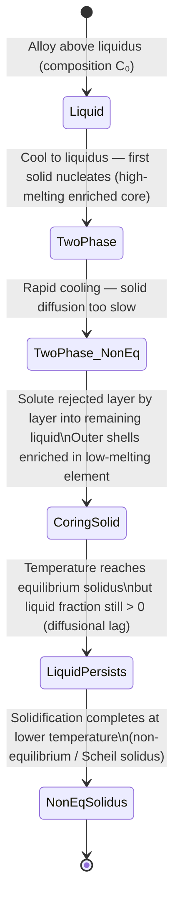
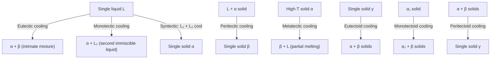
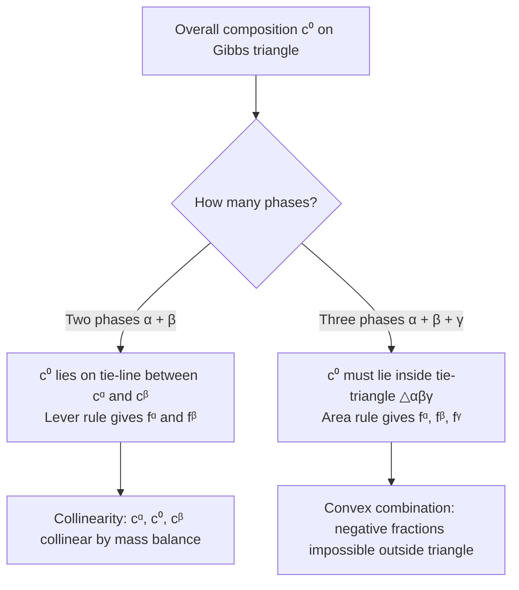
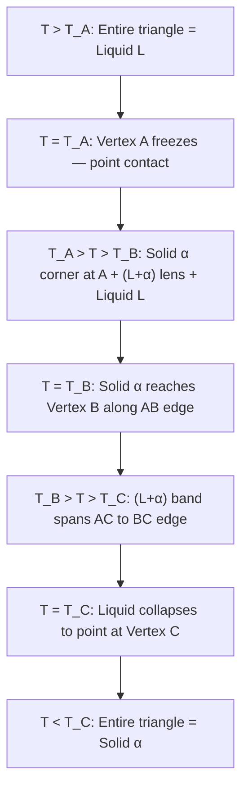

## Lecture 2: Heterogeneous Nucleation, Coring, and Non-Equilibrium Solidification

### 1. Underlying Theory & Foundations

#### A. Thermodynamic & Kinetic Principles

- **Heterogeneous nucleation** occurs on foreign substrates (mould walls, grain boundaries, impurity particles), lowering the activation energy barrier relative to homogeneous nucleation by reducing the volume of new solid–liquid interface that must be created.
- The contact angle $\theta$ is set by the balance of three interfacial tensions at the contact line, described by **Young's Equation**:
  $$\gamma_{\text{matrix-boundary}} = \gamma_{\text{precipitate-boundary}} + \gamma_{\text{precipitate-matrix}} \cos\theta$$
- The **wetting shape factor** $S(\theta)$ scales both the activation energy barrier and the critical volume for heterogeneous nucleation; it satisfies $0 \le S(\theta) \le 1$ for all physical contact angles $\theta \in [0^\circ, 180^\circ]$.
- **Coring** is a non-equilibrium microstructural phenomenon arising from diffusional asymmetry: liquid diffusion is rapid (liquid stays compositionally uniform) while solid-state diffusion is extremely slow, especially at lower temperatures.
- Under **continuous (non-equilibrium) cooling**, the average solid composition lags behind the equilibrium solidus. This **diffusional lag** shifts the effective solidus to lower temperatures and higher solute concentrations, causing liquid to persist below the equilibrium solidus line (**liquid persistence**).
- The **Scheil equation** models the limiting case of non-equilibrium solidification under the conditions: (1) no diffusion in the solid ($D_S = 0$), (2) complete mixing in the liquid, and (3) local equilibrium at the solid–liquid interface. Under these conditions the solute concentration in the solid increases continuously until a non-equilibrium eutectic or terminal phase forms.

#### B. Governing Formulations & Derivations

- **Critical radius of curvature** (identical for heterogeneous and homogeneous nucleation):
  $$r^*_{\text{het}}(\theta) = r^*_{\text{hom}} = -\frac{2\gamma_{SL}}{\Delta G_v}$$
  where $\gamma_{SL}$ is the solid–liquid interfacial free energy and $\Delta G_v$ is the volumetric free energy change driving solidification.

- **Activation energy barriers**:
  $$\Delta G^*_{\text{het}} = \Delta G^*_{\text{hom}} \cdot S(\theta), \qquad S(\theta) = \frac{(2+\cos\theta)(1-\cos\theta)^2}{4}$$

- **Parameter definitions**:
  - $\gamma_{SL}$ (precipitate–matrix interfacial energy): free energy per unit area of the boundary between the newly formed solid ($\beta$) and the parent liquid/matrix ($\alpha$).
  - $\gamma_{SI}$ / $\gamma_{\beta B}$ (precipitate–boundary interfacial energy): free energy per unit area between the precipitate and the foreign substrate or grain boundary.
  - $\gamma_{IL}$ / $\gamma_{\alpha B}$ (matrix–boundary interfacial energy): free energy per unit area of the original interface between the parent matrix and the substrate. When the precipitate nucleates, this area is destroyed and the energy is recovered as a credit.
  - Partition coefficient: $k = C_S / C_L$ (ratio of solid to liquid composition at the interface under local equilibrium).
  - Assumption for Scheil: $D_S = 0$ (zero diffusion in solid).

#### C. Determining Nucleation Type from Interfacial Energies

To determine whether homogeneous or heterogeneous nucleation dominates, evaluate the balance of interfacial tensions at the substrate using **Young's equation** and assess the resulting thermodynamic barrier.

##### General Step-by-Step Method

1. **Identify the phases and interfaces:**
    - Matrix / Parent phase: $\beta$
    - Nucleating phase: $\alpha$
    - Substrate: $\text{wall}$ ($w$)
    - Interfacial energies: $\gamma_{\alpha\beta}$ ($\alpha/\beta$ interphase boundary), $\gamma_{\alpha w}$ (new interface formed on wall), $\gamma_{\beta w}$ (existing interface destroyed on wall).

2. **Compute the apparent contact parameter:** Set up Young's force balance along the plane of the wall:
    $$\cos\theta = \frac{\gamma_{\beta w} - \gamma_{\alpha w}}{\gamma_{\alpha\beta}}$$

3. **Classify into the 3 thermodynamic regimes:**
    - **Regime 1: Partial Wetting** ($-1 < \cos\theta < 1$)
        - A stable physical contact angle exists ($0^\circ < \theta < 180^\circ$).
        - The shape factor is strictly between 0 and 1:
            $$S(\theta) = \frac{(2 + \cos\theta)(1 - \cos\theta)^2}{4} < 1$$
        - Because the activation barrier is scaled down ($\Delta G^*_{\text{het}} = \Delta G^*_{\text{hom}} \cdot S(\theta) < \Delta G^*_{\text{hom}}$), **heterogeneous nucleation is more likely**. The exponential kinetic factor $\exp(-\Delta G^*/kT)$ heavily favors the wall over the bulk, even with fewer wall sites.
    
    - **Regime 2: Complete Wetting / Barrierless Nucleation** ($\cos\theta \ge 1$)
        - Arises when $\gamma_{\beta w} - \gamma_{\alpha w} \ge \gamma_{\alpha\beta}$.
        - Replacing the $\beta/\text{wall}$ interface with $\alpha/\text{wall}$ plus $\alpha/\beta$ results in a net negative interfacial energy change:
            $$\Delta\gamma = \gamma_{\alpha w} + \gamma_{\alpha\beta} - \gamma_{\beta w} \le 0$$
        - In this regime, $\theta \to 0^\circ$ and $S(\theta) = 0 \implies \Delta G^*_{\text{het}} = 0$.
        - **Heterogeneous nucleation is overwhelmingly favored** because it occurs spontaneously and barrier-free on the wall.
    
    - **Regime 3: Complete Non-Wetting** ($\cos\theta \le -1$)
        - Arises when $\gamma_{\alpha w} - \gamma_{\beta w} \ge \gamma_{\alpha\beta}$.
        - The wall strongly repels $\alpha$; $\theta \to 180^\circ$ and $S(\theta) \to 1$.
        - The barrier on the wall is identical to the homogeneous barrier ($\Delta G^*_{\text{het}} \approx \Delta G^*_{\text{hom}}$).
        - With equal energy barriers, the outcome is decided by site density: bulk container sites ($N_v \sim 10^{28}\text{ m}^{-3}$) vastly outnumber surface wall sites ($N_s \sim 10^{19}\text{ m}^{-2}$).
        - **Homogeneous nucleation is more likely**.

##### Worked Example: Partial Wetting

Consider the following arbitrary values:
- $\gamma_{\alpha\beta} = 0.20\text{ J/m}^2$
- $\gamma_{\alpha w} = 0.35\text{ J/m}^2$
- $\gamma_{\beta w} = 0.45\text{ J/m}^2$

**Step 1: Calculate $\cos\theta$**
$$\cos\theta = \frac{0.45 - 0.35}{0.20} = \frac{0.10}{0.20} = 0.50$$

**Step 2: Determine $\theta$ and $S(\theta)$**
- $\theta = \arccos(0.50) = 60^\circ$
- Calculate the shape factor:
    $$S(60^\circ) = \frac{(2 + 0.50)(1 - 0.50)^2}{4} = \frac{2.50 \times 0.25}{4} = \frac{0.625}{4} = 0.15625$$

**Step 3: Conclusion**
- The activation barrier on the wall is only $\approx 15.6\%$ of the homogeneous barrier ($\Delta G^*_{\text{het}} \approx 0.156 \, \Delta G^*_{\text{hom}}$).
- Because the nucleation rate depends exponentially on $-\Delta G^*/kT$, this reduction in barrier height vastly outweighs the lower number of wall surface sites.
- **Heterogeneous nucleation is far more likely to occur.**

#### C. Phase & Microstructural Evolution

#### D. Literature References

- [[A Prince2.pdf]]
- [[P Gordon.pdf]]
- [[Phase Transformations in met...pdf]]

---

### 2. Professor's Summarizing Questions & Solutions

> [!question] Q1: Draw the graph of critical radius pertaining to heterogeneous nucleation as a function of the contact angle.
> > [!success]- Solution (Click to expand)
> > **Verdict / Core Takeaway:** The critical radius of curvature $r^*_{\text{het}}$ is **completely independent of the contact angle** $\theta$ — it is a horizontal line equal to $r^*_{\text{hom}}$ across all $\theta \in [0^\circ, 180^\circ]$.
> >
> > **Theoretical Justification:**
> > - Local equilibrium across the curved solid–liquid interface is governed solely by the balance between interfacial tension and bulk thermodynamic driving force, expressed as $r^* = -2\gamma_{SL}/\Delta G_v$.
> > - This expression contains no $\theta$ dependence; therefore the physical radius of curvature required for a stable nucleus is fixed regardless of substrate geometry.
> > - What **does** vary with $\theta$ is the **thermodynamic barrier factor** $S(\theta) = \frac{(2+\cos\theta)(1-\cos\theta)^2}{4}$, which scales both $\Delta G^*_{\text{het}}$ and the critical volume $V^*_{\text{het}}$.
> > - A two-panel graph therefore shows: (Left) $r^*_{\text{het}}/r^*_{\text{hom}} = 1.0$ — a flat horizontal line for all $\theta$. (Right) $S(\theta)$ — a smooth curve rising from $0$ at $\theta = 0^\circ$ to $1$ at $\theta = 180^\circ$.
> > - **Exam trap:** Do not confuse the invariance of the radius of curvature with the invariance of the activation energy barrier; the barrier does depend strongly on $\theta$ through $S(\theta)$.

> [!question] Q2: Are there ever three values of the precipitate-boundary, precipitate-matrix, and matrix-boundary interfacial energies for which heterogeneous nucleation is energetically less favourable than homogeneous nucleation?
> > [!success]- Solution (Click to expand)
> > **Verdict / Core Takeaway:** **No.** Heterogeneous nucleation is **never** energetically less favorable than homogeneous nucleation; $\Delta G^*_{\text{het}} \le \Delta G^*_{\text{hom}}$ always holds.
> >
> > **Theoretical Justification:**
> > - For any real, physical contact angle $\theta \in [0^\circ, 180^\circ]$ defined by Young's equation, the shape factor satisfies $0 \le S(\theta) \le 1$.
> > - **Complete wetting** ($\theta = 0^\circ$): $S(0^\circ) = 0$, so $\Delta G^*_{\text{het}} = 0$ — no activation barrier at all.
> > - **Complete non-wetting** ($\theta = 180^\circ$): $S(180^\circ) = 1$, so $\Delta G^*_{\text{het}} = \Delta G^*_{\text{hom}}$ — the worst case merely equals homogeneous nucleation.
> > - If the three interfacial energies were chosen such that $\gamma_{SI} > \gamma_{IL} + \gamma_{SL}$ (mathematically implying $\cos\theta < -1$, which is unphysical), the nucleus simply cannot contact the substrate and forms in the bulk instead — i.e., the system nucleates homogeneously. The activation barrier is capped at $\Delta G^*_{\text{hom}}$, not exceeded.
> > - Foreign surfaces can therefore only lower the energy barrier or, at worst, leave it unchanged; they can **never** raise it above the homogeneous value.
> > - **Exam trap:** The question invites you to imagine a pathological set of interfacial energies that "penalize" the substrate. The physical answer is that no such penalty exists — the nucleus detaches from the substrate and nucleates homogeneously instead.

> [!question] Q3: What is coring? Explain the detailed mechanism.
> > [!success]- Solution (Click to expand)
> > **Verdict / Core Takeaway:** Coring is a **non-equilibrium microstructural phenomenon** producing radial concentration gradients within individual solid grains of an isomorphous binary alloy, caused by insufficient solid-state diffusion during rapid cooling.
> >
> > ![[coring.png]]
> >
> > **Theoretical Justification:**
> > 1. **Initial nucleation at the liquidus:** When liquid of bulk composition $C_0$ is cooled to its liquidus, the first solid nuclei are **enriched in the higher-melting element** (as dictated by the equilibrium tie-line).
> > 2. **Diffusional asymmetry:** As cooling continues into the two-phase ($\alpha + L$) region, equilibrium requires both phases to track the solidus and liquidus curves. Liquid diffusion is rapid (effectively complete mixing), but **solid-state diffusion is extremely slow** — the early-frozen core cannot re-equilibrate its composition.
> > 3. **Layer-by-layer solute rejection:** Each new shell of solid that crystallizes onto the existing core rejects the low-melting solute into the remaining liquid, progressively enriching it.
> > 4. **Radial gradient formation:** Successive shells deposited at lower temperatures contain increasing amounts of the low-melting element, producing a continuous radial gradient: the **grain center (core)** is rich in the high-melting element; the **grain boundaries (perimeter)** are rich in the low-melting element.
> > 5. **Consequences:**
> >    - **Incipient melting:** Reheating a cored casting causes grain boundary regions (enriched in the lower-melting component) to melt well below the equilibrium solidus, forming thin liquid films that destroy mechanical integrity.
> >    - **Homogenization heat treatment:** Coring can be eliminated by holding the alloy just below the solidus for an extended period to allow solid-state diffusion to produce compositionally uniform grains.
> > - **Exam trap:** Coring is distinct from macrosegregation; it occurs within individual grains and is driven by the slow solid-state diffusivity, not by bulk fluid flow.

> [!question] Q4: Say true or false: In a binary system whose phase diagram is isomorphous, if an alloy from above the liquidus is continuously cooled, no liquid remains as soon as the temperature falls below the solidus line.
> > [!success]- Solution (Click to expand)
> > **Verdict / Core Takeaway:** **FALSE.**
> >
> > **Theoretical Justification:**
> > - **Diffusional lag and non-equilibrium solidus shift:** Continuous (rapid) cooling prevents complete diffusional readjustment within the solid. Early-formed solid retains its high-melting composition, and solute is progressively rejected into the remaining liquid. As a result, the **average solid composition lags behind the equilibrium solidus curve**.
> > - **Shift to lower temperatures and higher solute concentrations:** This lag effectively shifts the non-equilibrium solidus to lower temperatures relative to the equilibrium diagram.
> > - **Liquid persistence below equilibrium solidus:** When the temperature drops to or just below the equilibrium solidus line, a **significant fraction of liquid still remains**. Complete solidification is delayed and finishes only at the non-equilibrium (Scheil) solidus, which lies below the equilibrium solidus.
> > - **Condition for the statement to be true:** Only under **ideal equilibrium cooling** (infinitely slow cooling, complete atomic diffusion in the solid at every temperature step) would no liquid remain at the equilibrium solidus.
> > - **Exam trap:** Students often assume the equilibrium phase diagram describes behavior under any cooling rate. Continuous cooling is inherently non-equilibrium; the equilibrium solidus marks where solidification would complete only if cooling were infinitely slow.

## Lecture 3: Invariant Reactions, Gibbs Phase Rule & Phase Diagram Construction

### 1. Underlying Theory & Foundations

#### A. Thermodynamic & Kinetic Principles

- At constant pressure a binary system has **zero degrees of freedom** ($F = 0$) wherever three phases coexist simultaneously. These points or isotherms are called **invariant reactions** and appear as horizontal lines on the phase diagram at fixed temperature and fixed phase compositions.
- **Liquid-involving (_-tectic_) reactions** all feature liquid as one of the three coexisting phases; **solid-state (_-tectoid_) reactions** involve only solid phases.
- The **Gibbs Phase Rule** quantifies the variance of a heterogeneous system at equilibrium: $F = C - P + 2$ (general), reduced to $F = C - P + 1$ at constant pressure (condensed systems).
- Phase diagram construction is constrained by four strict topological rules: the rule of neighboring phase regions, Konovalov's extrema tangency rule, Schreinemakers' extension rule, and the non-zero solubility limit.

#### B. Governing Formulations & Derivations

- **Derivation of the Gibbs Phase Rule:**
  - Total intensive variables: $n = P(C - 1) + 2$ (compositional variables across $P$ phases plus $T$ and $P_\text{sys}$).
  - Thermodynamic equilibrium constraints (chemical potential equality for each component across all phases): $m = C(P - 1)$.
  - Degrees of freedom:
    $$F = n - m = [P(C-1) + 2] - [C(P-1)] = C - P + 2$$
  - **Condensed (isobaric) form** (pressure fixed at 1 atm):
    $$P + F = C + 1$$
- **Parameter definitions:**
  - $C$ = number of independent chemical components.
  - $P$ = number of coexisting phases.
  - $F$ = degrees of freedom (variance).
  - $\mu_i^\phi$ = chemical potential of component $i$ in phase $\phi$; equilibrium requires $\mu_i^\alpha = \mu_i^\beta = \cdots$ for all $i$.
  - $\Delta S_m = -R[X_A \ln X_A + X_B \ln X_B]$ = configurational entropy of mixing; its derivative diverges as $X_B \to 0$, enforcing non-zero solubility at all temperatures.

#### C. Phase & Microstructural Evolution

#### D. Literature References

- [[A Prince2.pdf]]
- [[P Gordon.pdf]]
- [[Phase Transformations in met...pdf]]

---

### 2. Professor's Summarizing Questions & Solutions

> [!question] Q1: List and describe all liquid-involving invariant reactions (_-tectic_ reactions) in binary systems, with reaction equations and textbook references.
> > [!success]- Solution (Click to expand)
> > **Verdict / Core Takeaway:** There are five liquid-involving invariant reactions in binary systems: eutectic, monotectic, metatectic, peritectic, and syntectic.
> >
> > **Theoretical Justification:**
> >
> > **A. Eutectic Reaction**
> > - **Reaction:** $L \underset{\text{heating}}{\overset{\text{cooling}}{\rightleftharpoons}} \alpha + \beta$
> > - A single liquid transforms upon cooling into two intimately mixed solid phases simultaneously. The word _eutectic_ derives from the Greek for "easily melted".
> > - **References:** Paul Gordon, Section 6.2, pp. 135–138, Figs. 6.4 & 6.5; A. Prince, Section 4.2, pp. 66–67, Fig. 46; Callister, Section 9.11, pp. 268–269, Figs. 9.7 & 9.8.
> >
> > **B. Monotectic Reaction**
> > - **Reaction:** $L_1 \underset{\text{heating}}{\overset{\text{cooling}}{\rightleftharpoons}} \alpha + L_2$
> > - A liquid $L_1$ decomposes upon cooling into a solid $\alpha$ and a second, immiscible liquid $L_2$ of different composition.
> > - **References:** Paul Gordon, pp. 163–168, Figs. 6.19(a) & 6.23; A. Prince, Section 5.2, pp. 98–100, Fig. 86.
> >
> > **C. Metatectic Reaction**
> > - **Reaction:** $\alpha \underset{\text{heating}}{\overset{\text{cooling}}{\rightleftharpoons}} \beta + L$
> > - A high-temperature solid $\alpha$ decomposes upon cooling into a new solid $\beta$ and a liquid $L$. Alloys undergoing this reaction partially melt upon cooling.
> > - **References:** Paul Gordon, p. 163, p. 165, Fig. 6.19(c); A. Prince, Chapter 7, p. 116, Figs. 103 & 104.
> >
> > **D. Peritectic Reaction**
> > - **Reaction:** $L + \alpha \underset{\text{heating}}{\overset{\text{cooling}}{\rightleftharpoons}} \beta$
> > - A liquid reacts with a pre-existing solid $\alpha$ upon cooling to form a single new solid $\beta$.
> > - **References:** Paul Gordon, Section 7.1, pp. 175–177, Figs. 7.1 & 7.3; A. Prince, Section 4.3, pp. 82–85, Figs. 65, 66 & 68; Callister, Section 9.14, p. 282, Fig. 9.21.
> >
> > **E. Syntectic Reaction**
> > - **Reaction:** $L_1 + L_2 \underset{\text{heating}}{\overset{\text{cooling}}{\rightleftharpoons}} \alpha$
> > - Two immiscible liquids react upon cooling to form a single solid $\alpha$. Rare; occurs in K–Zn, Na–Zn, and Pb–U systems.
> > - **References:** Paul Gordon, Section 7.4, pp. 183–184, Figs. 7.8(a) & (b); A. Prince, Section 5.3, p. 100, Figs. 87(a) & (b).

> [!question] Q2: List and describe all solid-state invariant reactions (_-tectoid_ reactions) in binary systems, with reaction equations and textbook references.
> > [!success]- Solution (Click to expand)
> > **Verdict / Core Takeaway:** There are three solid-state invariant reactions: eutectoid, monotectoid, and peritectoid.
> >
> > **Theoretical Justification:**
> >
> > **A. Eutectoid Reaction**
> > - **Reaction:** $\gamma \underset{\text{heating}}{\overset{\text{cooling}}{\rightleftharpoons}} \alpha + \beta$
> > - A single homogeneous solid $\gamma$ decomposes upon cooling into two distinct solid phases simultaneously. Classic example: austenite ($\gamma$) → pearlite ($\alpha + \text{Fe}_3\text{C}$) at 723–727 °C in steels.
> > - **References:** Paul Gordon, Section 6.3, pp. 163–168, Figs. 6.19(b), 6.21 & 6.23; A. Prince, Section 6.2, pp. 105–107, Fig. 90; Callister, Section 9.14, p. 282, Fig. 9.21; Section 9.18, pp. 291–294, Fig. 9.24.
> >
> > **B. Monotectoid Reaction**
> > - **Reaction:** $\alpha_1 \underset{\text{heating}}{\overset{\text{cooling}}{\rightleftharpoons}} \alpha_2 + \beta$
> > - A solid solution $\alpha_1$ decomposes upon cooling into a solid solution of the same crystal structure but different composition ($\alpha_2$) and another distinct solid phase ($\beta$). Geometric form mirrors the monotectic but all three phases are solid.
> > - **References:** Paul Gordon, p. 165; A. Prince, Section 6.3, p. 110, Fig. 94b (Al–Zn system, $\alpha'$ decomposition at 340 °C).
> >
> > **C. Peritectoid Reaction**
> > - **Reaction:** $\alpha + \beta \underset{\text{heating}}{\overset{\text{cooling}}{\rightleftharpoons}} \gamma$
> > - Two distinct solid phases react upon cooling to form a single new solid $\gamma$. Typically very sluggish due to slow solid-state diffusion.
> > - **References:** Paul Gordon, Section 7.4, p. 183, Fig. 7.7; A. Prince, Section 6.4, pp. 110–111, Figs. 95 & 96.
> >
> > **Summary Table:**
> >
> > | Reaction | Form (Cooling) | P. Gordon | A. Prince | Callister |
> > |:--|:--|:--|:--|:--|
> > | Eutectic | $L \rightleftharpoons \alpha + \beta$ | pp. 135–138, Figs. 6.4 & 6.5 | pp. 66–67, Fig. 46 | pp. 268–269, Figs. 9.7 & 9.8 |
> > | Monotectic | $L_1 \rightleftharpoons \alpha + L_2$ | pp. 163–168, Figs. 6.19a & 6.23 | pp. 98–100, Fig. 86 | — |
> > | Metatectic | $\alpha \rightleftharpoons \beta + L$ | p. 163, Fig. 6.19c | p. 116, Figs. 103 & 104 | — |
> > | Peritectic | $L + \alpha \rightleftharpoons \beta$ | pp. 175–177, Figs. 7.1 & 7.3 | pp. 82–85, Figs. 65 & 68 | p. 282, Fig. 9.21 |
> > | Syntectic | $L_1 + L_2 \rightleftharpoons \alpha$ | pp. 183–184, Figs. 7.8a & b | p. 100, Figs. 87a & b | — |
> > | Eutectoid | $\gamma \rightleftharpoons \alpha + \beta$ | pp. 163–168, Figs. 6.19b & 6.21 | p. 105, Fig. 90 | p. 282, Fig. 9.21; p. 294, Fig. 9.24 |
> > | Monotectoid | $\alpha_1 \rightleftharpoons \alpha_2 + \beta$ | p. 165 | p. 110, Fig. 94b | — |
> > | Peritectoid | $\alpha + \beta \rightleftharpoons \gamma$ | p. 183, Fig. 7.7 | pp. 110–111, Figs. 95 & 96 | — |

> [!question] Q3: Derive the Gibbs Phase Rule and state its condensed (isobaric) form.
> > [!success]- Solution (Click to expand)
> > **Verdict / Core Takeaway:** $F = C - P + 2$ (general); $P + F = C + 1$ (constant pressure).
> >
> > **Theoretical Justification:**
> >
> > **Step 1 — Define terms.** Consider $C$ independent chemical components distributed among $P$ coexisting phases. $F$ is the number of intensive variables (temperature, pressure, phase compositions) that can be varied without changing the number of phases.
> >
> > **Step 2 — Count total intensive variables ($n$).** Each phase requires $(C - 1)$ independent mole fractions (the $C$-th follows from $\sum X_i = 1$). Across $P$ phases plus $T$ and $P_\text{sys}$:
> > $$n = P(C - 1) + 2$$
> >
> > **Step 3 — Count equilibrium constraints ($m$).** Chemical equilibrium demands equal chemical potential of each component in all phases: $\mu_i^\alpha = \mu_i^\beta = \cdots = \mu_i^P$. For component $i$ this gives $(P-1)$ equations; for $C$ components:
> > $$m = C(P - 1)$$
> >
> > **Step 4 — Compute $F = n - m$:**
> > $$F = [P(C-1) + 2] - [C(P-1)] = PC - P + 2 - PC + C = C - P + 2$$
> > $$\boxed{P + F = C + 2}$$
> >
> > **Condensed form** (pressure fixed at 1 atm, consuming one degree of freedom):
> > $$\boxed{P + F = C + 1}$$

> [!question] Q4: State the four rules for constructing valid equilibrium phase diagrams and describe the explicit flaw that violates each rule.
> > [!success]- Solution (Click to expand)
> > **Verdict / Core Takeaway:** Four topological rules govern all valid binary phase diagrams; violating any one produces a physically impossible diagram.
> >
> > ![[flawed_phase_diagram_rules.png]]
> >
> > **Theoretical Justification:**
> >
> > **Rule 1 — Rule of Neighboring Phase Regions (Palatnik–Landau / Rhines Boundary Rule)**
> > - Single-phase regions must always be separated by a two-phase region containing those same two phases. Crossing any boundary line must change the number of coexisting phases by $\pm 1$.
> > - *Thermodynamic basis:* A direct single-phase-to-single-phase boundary implies a discontinuous jump in chemical potentials without equilibrium two-phase tangency — thermodynamically impossible.
> > - *Explicit flaw:* Drawing a single boundary line separating an $\alpha$ field directly from a $\beta$ field while omitting the intermediate $\alpha + \beta$ two-phase region.
> >
> > **Rule 2 — Konovalov's Rule / Extrema Tangency Rule**
> > - Where liquidus and solidus curves pass through a temperature maximum or minimum, both curves must meet at a **single point of identical composition** with a horizontal tangent ($dT/dX = 0$).
> > - *Thermodynamic basis:* At an extremum the solid and liquid free-energy curves have identical tangent slope and minimum, requiring $\mu_A^S = \mu_A^L$ and $\mu_B^S = \mu_B^L$ at the exact same composition.
> > - *Explicit flaw:* Drawing the liquidus minimum at a different composition from the solidus minimum (e.g., liquidus at 35% B, solidus at 50% B), as illustrated in P. Gordon, Figs. 4.22a & 4.22b.
> >
> > **Rule 3 — Schreinemakers' Extension Rule (Metastable Boundary Extension)**
> > - The metastable extension of phase boundaries past an invariant point must project **into two-phase regions**, never into single-phase regions.
> > - *Thermodynamic basis:* The metastable continuation of a phase equilibrium corresponds to the free-energy tangent construction across adjacent two-phase mixtures. Projecting into a single-phase region implies a metastable mixture has higher free energy than a single phase, violating free-energy minimization.
> > - *Explicit flaw:* Extending a liquidus or solvus boundary past a eutectic triple point so that the dashed metastable line projects into the $\alpha$ single-phase field instead of the $\alpha + \beta$ two-phase region.
> >
> > **Rule 4 — Non-Zero Solubility (Dilute Solution / Third-Law Limit)**
> > - Under true equilibrium, every component must have non-zero solubility in every other; a strictly vertical solvus at 0% or 100% solute is thermodynamically impossible.
> > - *Thermodynamic basis:* The derivative of the configurational entropy of mixing diverges as solute concentration approaches zero: $d(\Delta G_m)/dX_B \to -\infty$ as $X_B \to 0$. Adding even an infinitesimal amount of solute lowers the free energy, making strictly pure terminal phases unstable.
> > - *Explicit flaw:* Drawing a solvus as a strictly vertical line aligned with the pure component axis (0% B), implying zero solubility of B in A.

## Lecture 4: Ternary Phase Diagrams — Gibbs Triangle, Tie-Lines & Lever Rules

### 1. Underlying Theory & Foundations

#### A. Thermodynamic & Kinetic Principles

- A **ternary system** ($A$–$B$–$C$) is represented at constant temperature and pressure by the **Gibbs triangle**, a two-dimensional simplex embedded in the mole-fraction plane $c_A + c_B + c_C = 1$, $c_i \ge 0$.
- **Viviani's Theorem** (geometric foundation): In an equilateral triangle of altitude $h$, the sum of perpendicular distances from any interior point $P$ to the three sides equals $h$. The perpendicular distance $d_A$ from $P$ to side $BC$ is proportional to $c_A$ ($d_A = c_A \cdot h$), so lines parallel to $BC$ are iso-$c_A$ lines.
- **Two-phase equilibrium** on the Gibbs triangle is governed by the same mass-balance vector algebra as in binary systems: the overall composition must be a convex combination of the two phase compositions, forcing **collinearity** (all three points lie on a single tie-line).
- **Three-phase equilibrium** produces a **tie-triangle** $\triangle\alpha\beta\gamma$. The overall composition $\mathbf{c}^0$ must lie inside this triangle; phase fractions are given by the **Center of Gravity (Barycentric) Rule** — each fraction equals the area of the sub-triangle opposite that vertex divided by the total triangle area.

#### B. Governing Formulations & Derivations

- **Mole-fraction plane constraint:**
  $$c_A + c_B + c_C = 1, \quad c_A, c_B, c_C \ge 0$$

- **Direction vector of side $BC$** (used in the parallel-line proof):
  $$\vec{v}_{BC} = C - B = (0,0,1) - (0,1,0) = (0,-1,1)$$

- **Parametric line parallel to $BC$ from point $P_0 = (c_A^0, c_B^0, 0)$:**
  $$\vec{r}(t) = \left(c_A^0,\; c_B^0 - t,\; t\right), \quad 0 \le t \le c_B^0$$
  The first component $c_A(t) = c_A^0$ is constant for all $t$.

- **Two-phase mass balance (vector form):**
  $$m^0 \mathbf{c}^0 = m^\alpha \mathbf{c}^\alpha + m^\beta \mathbf{c}^\beta$$
  Dividing by $m^0$ and letting $f^\alpha = m^\alpha/m^0$, $f^\beta = 1 - f^\alpha$:
  $$\mathbf{c}^0 - \mathbf{c}^\beta = f^\alpha (\mathbf{c}^\alpha - \mathbf{c}^\beta)$$

- **Ternary lever rule** (distance-ratio and component-wise forms):
  $$f^\alpha = \frac{|\mathbf{c}^0 - \mathbf{c}^\beta|}{|\mathbf{c}^\alpha - \mathbf{c}^\beta|}, \qquad f^\beta = \frac{|\mathbf{c}^\alpha - \mathbf{c}^0|}{|\mathbf{c}^\alpha - \mathbf{c}^\beta|}$$
  Projecting onto component $A$:
  $$f^\alpha = \frac{c_A^0 - c_A^\beta}{c_A^\alpha - c_A^\beta}, \qquad f^\beta = \frac{c_A^\alpha - c_A^0}{c_A^\alpha - c_A^\beta}$$

- **Three-phase mass balance:**
  $$\mathbf{c}^0 = f^\alpha \mathbf{c}^\alpha + f^\beta \mathbf{c}^\beta + f^\gamma \mathbf{c}^\gamma, \qquad f^\alpha + f^\beta + f^\gamma = 1, \quad f^i \ge 0$$

- **Center of Gravity (Barycentric) Rule** — total tie-triangle area via determinant:
  $$\text{Area}(\triangle\alpha\beta\gamma) = \frac{1}{2}\begin{vmatrix} c_A^\alpha & c_B^\alpha & 1 \\ c_A^\beta & c_B^\beta & 1 \\ c_A^\gamma & c_B^\gamma & 1 \end{vmatrix}$$
  Phase fractions via Cramer's rule:
  $$f^\alpha = \frac{\text{Area}(\triangle 0\beta\gamma)}{\text{Area}(\triangle\alpha\beta\gamma)}, \quad f^\beta = \frac{\text{Area}(\triangle\alpha 0\gamma)}{\text{Area}(\triangle\alpha\beta\gamma)}, \quad f^\gamma = \frac{\text{Area}(\triangle\alpha\beta 0)}{\text{Area}(\triangle\alpha\beta\gamma)}$$

- **Parameter definitions:**
  - $c_A, c_B, c_C$ — mole fractions of components $A$, $B$, $C$ respectively.
  - $m^0, m^\alpha, m^\beta, m^\gamma$ — total moles and moles of each phase.
  - $f^i = m^i / m^0$ — mole fraction (phase fraction) of phase $i$.
  - $\mathbf{c}^0, \mathbf{c}^\alpha, \mathbf{c}^\beta, \mathbf{c}^\gamma$ — composition vectors in the Gibbs triangle.

#### C. Phase & Microstructural Evolution

#### D. Literature References

- [[A Prince2.pdf]]
- [[P Gordon.pdf]]
- [[Phase Transformations in met...pdf]]

---

### 2. Professor's Summarizing Questions & Solutions

> [!question] Q1: Show that on the Gibbs triangle, starting from a point on the $AB$ line, if a line is drawn parallel to the $BC$ line, the mole fraction of $A$ does not change for the entire line.
> > [!success]- Solution (Click to expand)
> > **Verdict / Core Takeaway:** The mole fraction $c_A$ is constant along any line parallel to side $BC$ of the Gibbs triangle.
> >
> > **Theoretical Justification:**
> >
> > ![[ternary_tieline_explanation.png]]
> >
> > **A. Vector Derivation in 3D Cartesian Coordinates**
> >
> > Consider a ternary system $A$–$B$–$C$ on the Gibbs triangle lying in the mole-fraction plane $c_A + c_B + c_C = 1$. The three pure-component vertices are $A = (1,0,0)$, $B = (0,1,0)$, $C = (0,0,1)$.
> >
> > 1. **Boundary $AB$:** Any point $P_0$ on the $AB$ baseline has $c_C = 0$, so $P_0 = (c_A^0, c_B^0, 0)$ with $c_A^0 + c_B^0 = 1$.
> > 2. **Direction vector of $BC$:** $\vec{v}_{BC} = C - B = (0,-1,1)$.
> > 3. **Parametric line parallel to $BC$ from $P_0$:**
> >    $$\vec{r}(t) = (c_A^0,\; c_B^0 - t,\; t), \quad 0 \le t \le c_B^0$$
> > 4. **Conclusion:** The first component of $\vec{r}(t)$ is $c_A(t) = c_A^0 = \text{constant}$. Therefore, along the entire line parallel to $BC$, the mole fraction of $A$ remains fixed at $c_A^0$.
> >
> > **B. Geometric Proof (Viviani's Distance Theorem)**
> >
> > - **Viviani's Theorem** states that the sum of perpendicular distances from any interior point $P$ to the three sides of an equilateral triangle of altitude $h$ equals $h$.
> > - The perpendicular distance $d_A$ from $P(c_A, c_B, c_C)$ to side $BC$ is directly proportional to $c_A$: $d_A = c_A \cdot h$.
> > - A line parallel to side $BC$ is by definition the locus of all points at constant perpendicular distance $d_A$ from $BC$. Because $d_A$ is constant along this line, $c_A$ does not change for the entire line.
> >
> > **Literature:** A. Prince, Chapter 8, Section 8.2, pp. 120–121, Figs. 105 & 106; Porter & Easterling, Chapter 1, Section 1.7, pp. 56–57, Fig. 1.40.

> [!question] Q2: If an alloy of overall composition $\mathbf{c}^0$ on the Gibbs triangle splits into two homogeneous phases $\alpha$ and $\beta$, show that all three compositions must lie on the same straight line.
> > [!success]- Solution (Click to expand)
> > **Verdict / Core Takeaway:** The overall composition $\mathbf{c}^0$ and the two phase compositions $\mathbf{c}^\alpha$ and $\mathbf{c}^\beta$ are collinear — they all lie on the same tie-line.
> >
> > ![[collinearity_and_lever_rule.png]]
> >
> > **Theoretical Justification:**
> >
> > Consider total moles $m^0$ and overall composition $\mathbf{c}^0 = (c_A^0, c_B^0, c_C^0)$ splitting into phases $\alpha$ and $\beta$ with mole amounts $m^\alpha$, $m^\beta$ and compositions $\mathbf{c}^\alpha$, $\mathbf{c}^\beta$.
> >
> > 1. **Total molar balance:** $m^0 = m^\alpha + m^\beta$.
> > 2. **Component mass balance (vector form):** $m^0 \mathbf{c}^0 = m^\alpha \mathbf{c}^\alpha + m^\beta \mathbf{c}^\beta$.
> > 3. Dividing by $m^0$, letting $f^\alpha = m^\alpha/m^0$ and $f^\beta = 1 - f^\alpha$:
> >    $$\mathbf{c}^0 = f^\alpha \mathbf{c}^\alpha + (1 - f^\alpha) \mathbf{c}^\beta$$
> >    $$\mathbf{c}^0 - \mathbf{c}^\beta = f^\alpha (\mathbf{c}^\alpha - \mathbf{c}^\beta)$$
> > 4. **Vector collinearity:** This states that the displacement vector $(\mathbf{c}^0 - \mathbf{c}^\beta)$ is a scalar multiple ($f^\alpha$) of $(\mathbf{c}^\alpha - \mathbf{c}^\beta)$. Therefore $\mathbf{c}^0$ lies on the line through $\mathbf{c}^\alpha$ and $\mathbf{c}^\beta$ — the **tie-line**.
> >
> > **Literature:** A. Prince, Chapter 8, Section 8.3, pp. 122–123, Fig. 108; P. Gordon, Chapter 4, Section 4.7, p. 64 & p. 91, Fig. 4.27; Callister, Chapter 9, Section 9.8, pp. 263–264, Fig. 9.3b.

> [!question] Q3: Derive the lever rule for ternary systems.
> > [!success]- Solution (Click to expand)
> > **Verdict / Core Takeaway:** The ternary lever rule gives phase fractions as distance ratios along the tie-line, directly from the two-phase collinearity relation.
> >
> > **Theoretical Justification:**
> >
> > From the collinearity relation: $\mathbf{c}^0 - \mathbf{c}^\beta = f^\alpha (\mathbf{c}^\alpha - \mathbf{c}^\beta)$.
> >
> > **A. Distance-Ratio Formulation (Euclidean Norm)**
> >
> > Taking the vector length along the tie-line:
> > $$|\mathbf{c}^0 - \mathbf{c}^\beta| = f^\alpha |\mathbf{c}^\alpha - \mathbf{c}^\beta|$$
> > $$f^\alpha = \frac{|\mathbf{c}^0 - \mathbf{c}^\beta|}{|\mathbf{c}^\alpha - \mathbf{c}^\beta|} = \frac{\text{Distance from } \mathbf{c}^0 \text{ to phase } \beta \text{ boundary}}{\text{Total tie-line length between } \alpha \text{ and } \beta}$$
> > $$f^\beta = \frac{|\mathbf{c}^\alpha - \mathbf{c}^0|}{|\mathbf{c}^\alpha - \mathbf{c}^\beta|} = \frac{\text{Distance from phase } \alpha \text{ boundary to } \mathbf{c}^0}{\text{Total tie-line length between } \alpha \text{ and } \beta}$$
> >
> > **B. Component-Wise Algebraic Formulation**
> >
> > Projecting along component $A$:
> > $$c_A^0 = f^\alpha c_A^\alpha + (1 - f^\alpha) c_A^\beta \implies c_A^0 - c_A^\beta = f^\alpha (c_A^\alpha - c_A^\beta)$$
> > $$f^\alpha = \frac{c_A^0 - c_A^\beta}{c_A^\alpha - c_A^\beta}, \qquad f^\beta = \frac{c_A^\alpha - c_A^0}{c_A^\alpha - c_A^\beta}$$
> >
> > **Literature:** A. Prince, Chapter 8, Section 8.3, p. 123, Fig. 108; Callister, Chapter 9, Section 9.8, pp. 264–265, Example 9.1; Porter & Easterling, Chapter 1, Section 1.7, p. 58, Fig. 1.41c.

> [!question] Q4: If an alloy of overall composition $\mathbf{c}^0$ splits into three homogeneous phases $\alpha$, $\beta$, $\gamma$, show that the starting composition must necessarily lie inside the triangle $\triangle\alpha\beta\gamma$.
> > [!success]- Solution (Click to expand)
> > **Verdict / Core Takeaway:** $\mathbf{c}^0$ must lie inside (or on the boundary of) the tie-triangle $\triangle\alpha\beta\gamma$ because physical phase fractions cannot be negative, and lying outside the triangle forces at least one negative fraction.
> >
> > ![[ternary_three_phase_triangle.png]]
> >
> > **Theoretical Justification:**
> >
> > Consider $\mathbf{c}^0$ splitting into three phases with moles $m^\alpha, m^\beta, m^\gamma$ and compositions $\mathbf{c}^\alpha, \mathbf{c}^\beta, \mathbf{c}^\gamma$.
> >
> > 1. **Mass conservation:**
> >    $$m^0 = m^\alpha + m^\beta + m^\gamma, \qquad m^0 \mathbf{c}^0 = m^\alpha \mathbf{c}^\alpha + m^\beta \mathbf{c}^\beta + m^\gamma \mathbf{c}^\gamma$$
> > 2. Dividing by $m^0$:
> >    $$\mathbf{c}^0 = f^\alpha \mathbf{c}^\alpha + f^\beta \mathbf{c}^\beta + f^\gamma \mathbf{c}^\gamma, \qquad f^\alpha + f^\beta + f^\gamma = 1, \quad f^i \ge 0$$
> > 3. **Convex combination property:** A point expressed as a linear combination of three vertices with non-negative coefficients summing to 1 is a **convex combination** — it lies inside or on the boundary of the triangle those vertices define.
> > 4. **Geometric result:** The set of all convex combinations of three non-collinear points in 2D is the closed triangle $\triangle\alpha\beta\gamma$.
> > 5. **Physical constraint:** If $\mathbf{c}^0$ were outside $\triangle\alpha\beta\gamma$, solving the mass balance equations would require at least one $f^i < 0$, which is physically impossible. Therefore $\mathbf{c}^0$ **must lie inside or on the boundary of $\triangle\alpha\beta\gamma$**.
> >
> > **Literature:** A. Prince, Chapter 8, Section 8.3, pp. 123–124, Figs. 109 & 110; Porter & Easterling, Chapter 1, Section 1.7, pp. 58–59, Fig. 1.42f & g.

> [!question] Q5: Derive the phase fractions $f^\alpha$, $f^\beta$, $f^\gamma$ for a three-phase equilibrium in a ternary system.
> > [!success]- Solution (Click to expand)
> > **Verdict / Core Takeaway:** The three phase fractions are found by solving the simultaneous mass balance equations; geometrically they equal the ratio of each sub-triangle area to the total tie-triangle area (Center of Gravity / Barycentric Rule).
> >
> > **Theoretical Justification:**
> >
> > Write the simultaneous mass balance equations:
> > $$f^\alpha + f^\beta + f^\gamma = 1$$
> > $$c_A^\alpha f^\alpha + c_A^\beta f^\beta + c_A^\gamma f^\gamma = c_A^0$$
> > $$c_B^\alpha f^\alpha + c_B^\beta f^\beta + c_B^\gamma f^\gamma = c_B^0$$
> >
> > **Solution via Cramer's Rule (Barycentric Coordinates)**
> >
> > The total area of the tie-triangle $\triangle\alpha\beta\gamma$:
> > $$\text{Area}(\triangle\alpha\beta\gamma) = \frac{1}{2}\begin{vmatrix} c_A^\alpha & c_B^\alpha & 1 \\ c_A^\beta & c_B^\beta & 1 \\ c_A^\gamma & c_B^\gamma & 1 \end{vmatrix}$$
> >
> > Applying Cramer's rule:
> > $$f^\alpha = \frac{\text{Area}(\triangle 0\beta\gamma)}{\text{Area}(\triangle\alpha\beta\gamma)} = \frac{\text{Area of sub-triangle opposite vertex } \alpha}{\text{Total area of } \triangle\alpha\beta\gamma}$$
> > $$f^\beta = \frac{\text{Area}(\triangle\alpha 0\gamma)}{\text{Area}(\triangle\alpha\beta\gamma)} = \frac{\text{Area of sub-triangle opposite vertex } \beta}{\text{Total area of } \triangle\alpha\beta\gamma}$$
> > $$f^\gamma = \frac{\text{Area}(\triangle\alpha\beta 0)}{\text{Area}(\triangle\alpha\beta\gamma)} = \frac{\text{Area of sub-triangle opposite vertex } \gamma}{\text{Total area of } \triangle\alpha\beta\gamma}$$
> >
> > This geometric formulation is the **Center of Gravity Rule** or **Barycentric Coordinates Rule** for three-phase equilibrium in ternary systems.
> >
> > **Literature:** A. Prince, Chapter 8, Section 8.3, pp. 123–124, Fig. 109; Porter & Easterling, Chapter 1, Section 1.7, p. 59, Fig. 1.42f & g.

## Lecture 5: Isomorphous Ternary Phase Diagrams — Isothermal Sections & Tie-Line Uniqueness

### 1. Underlying Theory & Foundations

#### A. Thermodynamic & Kinetic Principles

- An **isomorphous ternary system** ($A$–$B$–$C$) has complete mutual solubility in both liquid and solid states across all compositions. The 3D isobaric space model is a triangular prism with the Gibbs triangle as its base and temperature as the vertical axis.
- **Melting point ordering:** $T_A > T_B > T_C$. The **liquidus surface** (upper) and **solidus surface** (lower) are smooth surfaces meeting only at the three pure-component vertical edges.
- The two-phase ($L + \alpha$) region is the lens-shaped volume between the liquidus and solidus surfaces. Horizontal isothermal slices through this prism produce a sequence of 2D Gibbs-triangle sections showing how the single-phase and two-phase regions evolve with temperature.
- **Tie-line uniqueness** in a two-phase region follows from: (1) the common-tangent-plane construction on the Gibbs free-energy surfaces — there is exactly one common tangent plane at a given temperature per pair of coexisting compositions; and (2) the Gibbs Phase Rule — at fixed $T$ and $P$ in a ternary two-phase field, $F = 1$, leaving no additional freedom once $\mathbf{c}^0$ is specified.
- **Non-intersection of tie-lines** follows by contradiction: if two tie-lines intersected at $\mathbf{c}^*$, the system would require two simultaneous common tangent planes — violating the uniqueness of the Gibbs free-energy minimum — and would imply three phases coexisting at an arbitrary composition, violating the Phase Rule.

#### B. Governing Formulations & Derivations

- **Condensed Gibbs Phase Rule** (constant pressure, $C = 3$):
  $$P + F = C + 1 = 4$$
  - Single-phase ($P = 1$): $F = 3$ (trivariant — $T$, and two composition variables free).
  - Two-phase ($P = 2$): $F = 2$ (bivariant — at fixed $T$, one composition variable fixes all others).
  - Three-phase ($P = 3$): $F = 1$ (monovariant — at fixed $T$, all phase compositions are fixed at the three vertices of the tie-triangle).

- **Chemical equilibrium condition for two-phase coexistence** ($\alpha$ and $\beta$):
  $$\mu_A^\alpha = \mu_A^\beta, \qquad \mu_B^\alpha = \mu_B^\beta, \qquad \mu_C^\alpha = \mu_C^\beta$$
  Geometrically this is the **common tangent plane** touching both $G^\alpha(c_A, c_B)$ and $G^\beta(c_A, c_B)$ surfaces simultaneously.

- **Mass balance (tie-line constraint):**
  $$\mathbf{c}^0 = f^\alpha \mathbf{c}^\alpha + f^\beta \mathbf{c}^\beta, \qquad f^\alpha + f^\beta = 1$$

#### C. Phase & Microstructural Evolution

#### D. Literature References

- [[A Prince2.pdf]]
- [[P Gordon.pdf]]
- [[Phase Transformations in met...pdf]]

---

### 2. Professor's Summarizing Questions & Solutions

> [!question] Q1: Draw an isomorphous ternary phase diagram (3D space model).
> > [!success]- Solution (Click to expand)
> > **Verdict / Core Takeaway:** An isomorphous ternary phase diagram is a triangular prism with a smooth liquidus surface above and a smooth solidus surface below, enclosing a lens-shaped two-phase ($L + \alpha$) region.
> >
> > ![[isomorphous_ternary_isotherms.png]]
> >
> > **Theoretical Justification:**
> > - **Base:** The Gibbs concentration triangle $ABC$ with vertices at the three pure components.
> > - **Vertical axis:** Temperature $T$, with $T_A > T_B > T_C$.
> > - **Liquidus surface:** Smooth upper surface; every point on it is the temperature at which liquid of that ternary composition begins to freeze on cooling.
> > - **Solidus surface:** Smooth lower surface; every point on it is the temperature at which the last liquid disappears on cooling.
> > - **Two-phase ($L + \alpha$) region:** Lens-like volume between the two surfaces, containing horizontal tie-lines linking coexisting liquid and solid compositions.
> > - **Coincident points:** The liquidus and solidus surfaces meet only at the three pure-component vertical edges at $(T_A, A)$, $(T_B, B)$, and $(T_C, C)$.
> > - **References:** A. Prince, Chapter 8, Section 8.4, pp. 128–137, Fig. 111; Porter & Easterling, Chapter 1, Section 1.7, pp. 56–58, Fig. 1.41 & 1.42; P. Gordon, Chapter 4, Section 4.10, pp. 77–81.

> [!question] Q2: Draw the isothermal sections of an isomorphous ternary phase diagram for (i) $T > T_A$, (ii) $T = T_A$, (iii) $T_A > T > T_B$, (iv) $T = T_B$, (v) $T_B > T > T_C$, (vi) $T = T_C$, and (vii) $T < T_C$.
> > [!success]- Solution (Click to expand)
> > **Verdict / Core Takeaway:** As temperature drops from above $T_A$ to below $T_C$, the single-phase liquid region shrinks and is replaced by a growing two-phase lens and finally a complete single-phase solid.
> >
> > **Theoretical Justification:**
> >
> > **(i) $T > T_A$**
> > ![[isotherm_1_above_TA.png]]
> > - The isotherm lies above all three melting points. The entire Gibbs triangle is a single-phase **Liquid ($L$)**. No solid exists anywhere.
> >
> > **(ii) $T = T_A$**
> > ![[isotherm_2_at_TA.png]]
> > - The isothermal plane just touches the apex of the liquidus/solidus at pure vertex $A$. The triangle is filled with liquid ($L$), except at **Vertex $A$** where pure solid $\alpha$ is in point equilibrium with pure liquid $A$.
> >
> > **(iii) $T_A > T > T_B$**
> > ![[isotherm_3_TA_to_TB.png]]
> > - The isotherm intersects the lens-shaped two-phase region near corner $A$. Three zones appear:
> >   - **Corner $A$ region:** Small single-phase **Solid ($\alpha$)** zone.
> >   - **Interior:** Curved lens-shaped **Two-Phase ($L + \alpha$)** region with tie-lines linking the solidus boundary to the liquidus boundary.
> >   - **Remainder:** Single-phase **Liquid ($L$)** extending toward corners $B$ and $C$.
> >
> > **(iv) $T = T_B$**
> > ![[isotherm_4_at_TB.png]]
> > - The solid $\alpha$ region expands along the $AB$ binary edge and **touches Vertex $B$**. The two-phase ($L + \alpha$) region extends fully along the $AB$ baseline to $B$ while curving into the ternary interior. The liquid ($L$) region remains in the $C$-rich corner.
> >
> > **(v) $T_B > T > T_C$**
> > ![[isotherm_5_TB_to_TC.png]]
> > - The $AB$ binary edge is now 100% solid. A broad **Two-Phase ($L + \alpha$) band** stretches entirely across the Gibbs triangle from the $AC$ binary edge to the $BC$ binary edge. The solid ($\alpha$) region occupies the $AB$-rich side; liquid ($L$) occupies the $C$-rich corner.
> >
> > **(vi) $T = T_C$**
> > ![[isotherm_6_at_TC.png]]
> > - Solidification is nearly complete. The single-phase **Liquid ($L$)** region collapses to a single point at **Vertex $C$**. Virtually the entire triangle is single-phase **Solid ($\alpha$)**, with only a vanishingly thin ($L + \alpha$) boundary at corner $C$.
> >
> > **(vii) $T < T_C$**
> > ![[isotherm_7_below_TC.png]]
> > - Below all three melting points, solidification is complete for every possible composition. The entire Gibbs triangle is a single-phase homogeneous **Solid Solution ($\alpha$)**.
> >
> > **References:** A. Prince, Chapter 8, Section 8.4, pp. 128–137, Figs. 111 & 116; Porter & Easterling, Chapter 1, Section 1.7, pp. 56–58, Fig. 1.42; P. Gordon, Chapter 4, Section 4.10, pp. 77–81.

> [!question] Q3: Show that in the two-phase coexistence region of a ternary phase diagram, the tie-lines are chosen by the system itself — a composition splits into exactly one combination of coexisting phase compositions.
> > [!success]- Solution (Click to expand)
> > **Verdict / Core Takeaway:** The system uniquely selects exactly one tie-line for any overall composition $\mathbf{c}^0$ in a two-phase field, determined by the common tangent plane construction and enforced by the Gibbs Phase Rule.
> >
> > **Theoretical Justification:**
> >
> > **A. Thermodynamic Basis (Common Tangent Plane)**
> >
> > At fixed $T$ and $P$, each phase has a molar Gibbs free energy surface $G^\alpha(c_A, c_B)$ and $G^\beta(c_A, c_B)$ over the Gibbs triangle. Two-phase equilibrium requires equal chemical potentials in both phases:
> > $$\mu_A^\alpha = \mu_A^\beta, \qquad \mu_B^\alpha = \mu_B^\beta, \qquad \mu_C^\alpha = \mu_C^\beta$$
> > Geometrically this is a **common tangent plane** touching both free-energy surfaces simultaneously. The contact points fix $\mathbf{c}^\alpha$ and $\mathbf{c}^\beta$ uniquely — rolling this plane across the surfaces traces a continuous non-overlapping family of tie-lines spanning the two-phase region.
> >
> > **B. Uniqueness via Gibbs Phase Rule**
> >
> > In a ternary system ($C = 3$) at constant pressure with two phases ($P = 2$):
> > $$F = C - P + 1 = 3 - 2 + 1 = 2$$
> > At a fixed temperature $T$, $F = 1$ — specifying one composition variable in one phase automatically fixes all remaining composition variables in both phases. Therefore, the positions of $\mathbf{c}^\alpha$ and $\mathbf{c}^\beta$ on the phase boundaries are fully determined once $T$ and the location of $\mathbf{c}^0$ are given.
> >
> > **C. Mass Balance Uniqueness**
> >
> > By the collinearity result (Lecture 4, Q2), $\mathbf{c}^0$ must lie on the tie-line $\mathbf{c}^\alpha$–$\mathbf{c}^\beta$:
> > $$\mathbf{c}^0 = f^\alpha \mathbf{c}^\alpha + f^\beta \mathbf{c}^\beta, \qquad f^\alpha + f^\beta = 1$$
> > Since tie-lines in a two-phase field cannot intersect (proven in Q5), there passes exactly one tie-line through any interior point $\mathbf{c}^0$. Therefore the system selects **exactly one pair** ($\mathbf{c}^\alpha$, $\mathbf{c}^\beta$).
> >
> > **References:** A. Prince, Chapter 8, Sections 8.3 & 8.4, pp. 122–123, Fig. 108 & p. 128; Porter & Easterling, Chapter 1, Section 1.7, pp. 57–58, Fig. 1.41a, b, c.

> [!question] Q4: Frame the "BIG THREE" counterpart for the ternary phase diagram.
> > [!success]- Solution (Click to expand)
> > **Verdict / Core Takeaway:** The ternary "Big Three" asks the same questions as the binary version — phases present, their compositions, and their relative amounts — but the answers now use tie-lines, tie-triangles, the ternary lever rule, and the area (center-of-gravity) rule.
> >
> > **Theoretical Justification:**
> >
> > In binary phase diagrams the "Big Three" are: (1) What phases are present? (2) What are their compositions? (3) What are their relative amounts? Expanded to ternary systems on a 2D Gibbs-triangle isothermal section:
> >
> > **1. Phases Present** — determine from the phase field containing $\mathbf{c}^0$:
> > - Single-phase region ($P = 1$): one phase.
> > - Two-phase region ($P = 2$): two phases ($\alpha + \beta$).
> > - Three-phase tie-triangle ($P = 3$): three phases ($\alpha + \beta + \gamma$).
> >
> > **2. Phase Compositions** — read from the phase boundaries:
> > - Single-phase: composition equals $\mathbf{c}^0$ itself.
> > - Two-phase: construct the unique **tie-line** through $\mathbf{c}^0$; its endpoints on the phase boundaries give $\mathbf{c}^\alpha$ and $\mathbf{c}^\beta$.
> > - Three-phase: compositions are fixed at the **three vertices** $\mathbf{c}^\alpha$, $\mathbf{c}^\beta$, $\mathbf{c}^\gamma$ of the tie-triangle enclosing $\mathbf{c}^0$.
> >
> > **3. Relative Phase Amounts** — calculated from geometry:
> > - Single-phase: 100% of that phase.
> > - Two-phase: apply the **ternary lever rule** along the tie-line:
> >   $$f^\alpha = \frac{|\mathbf{c}^0 - \mathbf{c}^\beta|}{|\mathbf{c}^\alpha - \mathbf{c}^\beta|}, \qquad f^\beta = \frac{|\mathbf{c}^\alpha - \mathbf{c}^0|}{|\mathbf{c}^\alpha - \mathbf{c}^\beta|}$$
> > - Three-phase: apply the **Center of Gravity / Area Rule**:
> >   $$f^\alpha = \frac{\text{Area}(\triangle \mathbf{c}^0 \mathbf{c}^\beta \mathbf{c}^\gamma)}{\text{Area}(\triangle \mathbf{c}^\alpha \mathbf{c}^\beta \mathbf{c}^\gamma)}$$
> >   (and similarly for $f^\beta$ and $f^\gamma$).
> >
> > **References:** A. Prince, Chapter 8, Section 8.3, pp. 122–124, Figs. 108–110; Callister, Chapter 9, Sections 9.8 & 9.17, pp. 263–265 & 284–285; Porter & Easterling, Chapter 1, Section 1.7, pp. 56–59, Figs. 1.40–1.42.

> [!question] Q5: Show that two tie-lines of a coexistence region cannot intersect.
> > [!success]- Solution (Click to expand)
> > **Verdict / Core Takeaway:** Two tie-lines in a two-phase region cannot intersect because doing so would simultaneously violate thermodynamic uniqueness (two distinct Gibbs free-energy minima at the same state) and the Gibbs Phase Rule (three phases coexisting at an arbitrary bivariant composition).
> >
> > **Theoretical Justification (Proof by Contradiction)**
> >
> > 1. **Hypothesis:** Suppose two distinct tie-lines $T_1$ (linking $l_1$ and $s_1$) and $T_2$ (linking $l_2$ and $s_2$) intersect at interior point $\mathbf{c}^*$ within a two-phase field at constant $T$ and $P$.
> >
> > 2. **Thermodynamic violation:** A physical system at fixed $T$, $P$, $\mathbf{c}^*$ has a unique state of minimum Gibbs free energy ($dG = 0$). If both $T_1$ and $T_2$ were valid, the alloy would simultaneously equilibrate as $(l_1 + s_1)$ and $(l_2 + s_2)$, requiring two distinct common tangent planes. Two distinct common tangent planes cannot both be the global free-energy minimum — contradiction.
> >
> > 3. **Phase Rule violation:** At the intersection point $\mathbf{c}^*$, the compositions $l_1$, $l_2$, and a shared phase boundary point would imply three phases coexisting simultaneously. By the condensed Phase Rule:
> >    $$P + F = C + 1 \implies 3 + F = 4 \implies F = 1$$
> >    At fixed temperature, $F = 0$ — three phases can only coexist at the fixed vertices of a **tie-triangle**, not at an arbitrary interior point of a bivariant two-phase field. This is a direct contradiction.
> >
> > 4. **Conclusion:** Both contradictions are irresolvable, so the hypothesis is false. Tie-lines across a two-phase field form a continuous, **non-intersecting** sequence.
> >
> > **References:** A. Prince, Chapter 8, Section 8.4, p. 128, Item (3) & Fig. 115; P. Gordon, Chapter 3, Section 3.3, pp. 21–23.
