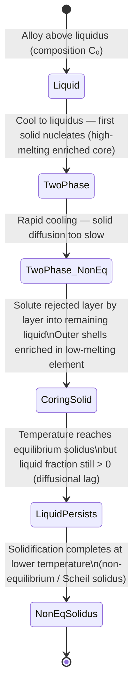
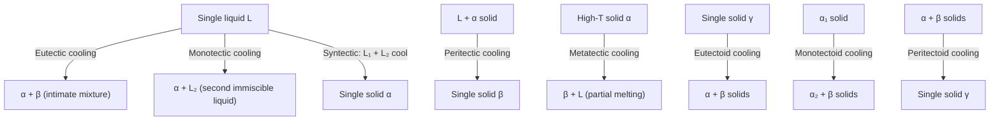

## Lecture 2: Heterogeneous Nucleation, Coring, and Non-Equilibrium Solidification

### 1. Underlying Theory & Foundations

#### A. Thermodynamic & Kinetic Principles

- **Heterogeneous nucleation** occurs on foreign substrates (mould walls, grain boundaries, impurity particles), lowering the activation energy barrier relative to homogeneous nucleation by reducing the volume of new solid–liquid interface that must be created.
- The contact angle $\theta$ is set by the balance of three interfacial tensions at the contact line, described by **Young's Equation**:
  $$\gamma_{\text{matrix-boundary}} = \gamma_{\text{precipitate-boundary}} + \gamma_{\text{precipitate-matrix}} \cos\theta$$
- The **wetting shape factor** $S(\theta)$ scales both the activation energy barrier and the critical volume for heterogeneous nucleation; it satisfies $0 \le S(\theta) \le 1$ for all physical contact angles $\theta \in [0^\circ, 180^\circ]$.
- **Coring** is a non-equilibrium microstructural phenomenon arising from diffusional asymmetry: liquid diffusion is rapid (liquid stays compositionally uniform) while solid-state diffusion is extremely slow, especially at lower temperatures.
- Under **continuous (non-equilibrium) cooling**, the average solid composition lags behind the equilibrium solidus. This **diffusional lag** shifts the effective solidus to lower temperatures and higher solute concentrations, causing liquid to persist below the equilibrium solidus line (**liquid persistence**).
- The **Scheil equation** models the limiting case of non-equilibrium solidification under the conditions: (1) no diffusion in the solid ($D_S = 0$), (2) complete mixing in the liquid, and (3) local equilibrium at the solid–liquid interface. Under these conditions the solute concentration in the solid increases continuously until a non-equilibrium eutectic or terminal phase forms.

#### B. Governing Formulations & Derivations

- **Critical radius of curvature** (identical for heterogeneous and homogeneous nucleation):
  $$r^*_{\text{het}}(\theta) = r^*_{\text{hom}} = -\frac{2\gamma_{SL}}{\Delta G_v}$$
  where $\gamma_{SL}$ is the solid–liquid interfacial free energy and $\Delta G_v$ is the volumetric free energy change driving solidification.

- **Activation energy barriers**:
  $$\Delta G^*_{\text{het}} = \Delta G^*_{\text{hom}} \cdot S(\theta), \qquad S(\theta) = \frac{(2+\cos\theta)(1-\cos\theta)^2}{4}$$

- **Parameter definitions**:
  - $\gamma_{SL}$ (precipitate–matrix interfacial energy): free energy per unit area of the boundary between the newly formed solid ($\beta$) and the parent liquid/matrix ($\alpha$).
  - $\gamma_{SI}$ / $\gamma_{\beta B}$ (precipitate–boundary interfacial energy): free energy per unit area between the precipitate and the foreign substrate or grain boundary.
  - $\gamma_{IL}$ / $\gamma_{\alpha B}$ (matrix–boundary interfacial energy): free energy per unit area of the original interface between the parent matrix and the substrate. When the precipitate nucleates, this area is destroyed and the energy is recovered as a credit.
  - Partition coefficient: $k = C_S / C_L$ (ratio of solid to liquid composition at the interface under local equilibrium).
  - Assumption for Scheil: $D_S = 0$ (zero diffusion in solid).

#### C. Phase & Microstructural Evolution

#### D. Literature References

- [[A Prince2.pdf]]
- [[P Gordon.pdf]]
- [[Phase Transformations in met...pdf]]

---

### 2. Professor's Summarizing Questions & Solutions

> [!question] Q1: Draw the graph of critical radius pertaining to heterogeneous nucleation as a function of the contact angle.
> > [!success]- Solution (Click to expand)
> > **Verdict / Core Takeaway:** The critical radius of curvature $r^*_{\text{het}}$ is **completely independent of the contact angle** $\theta$ — it is a horizontal line equal to $r^*_{\text{hom}}$ across all $\theta \in [0^\circ, 180^\circ]$.
> >
> > **Theoretical Justification:**
> > - Local equilibrium across the curved solid–liquid interface is governed solely by the balance between interfacial tension and bulk thermodynamic driving force, expressed as $r^* = -2\gamma_{SL}/\Delta G_v$.
> > - This expression contains no $\theta$ dependence; therefore the physical radius of curvature required for a stable nucleus is fixed regardless of substrate geometry.
> > - What **does** vary with $\theta$ is the **thermodynamic barrier factor** $S(\theta) = \frac{(2+\cos\theta)(1-\cos\theta)^2}{4}$, which scales both $\Delta G^*_{\text{het}}$ and the critical volume $V^*_{\text{het}}$.
> > - A two-panel graph therefore shows: (Left) $r^*_{\text{het}}/r^*_{\text{hom}} = 1.0$ — a flat horizontal line for all $\theta$. (Right) $S(\theta)$ — a smooth curve rising from $0$ at $\theta = 0^\circ$ to $1$ at $\theta = 180^\circ$.
> > - **Exam trap:** Do not confuse the invariance of the radius of curvature with the invariance of the activation energy barrier; the barrier does depend strongly on $\theta$ through $S(\theta)$.

> [!question] Q2: Are there ever three values of the precipitate-boundary, precipitate-matrix, and matrix-boundary interfacial energies for which heterogeneous nucleation is energetically less favourable than homogeneous nucleation?
> > [!success]- Solution (Click to expand)
> > **Verdict / Core Takeaway:** **No.** Heterogeneous nucleation is **never** energetically less favorable than homogeneous nucleation; $\Delta G^*_{\text{het}} \le \Delta G^*_{\text{hom}}$ always holds.
> >
> > **Theoretical Justification:**
> > - For any real, physical contact angle $\theta \in [0^\circ, 180^\circ]$ defined by Young's equation, the shape factor satisfies $0 \le S(\theta) \le 1$.
> > - **Complete wetting** ($\theta = 0^\circ$): $S(0^\circ) = 0$, so $\Delta G^*_{\text{het}} = 0$ — no activation barrier at all.
> > - **Complete non-wetting** ($\theta = 180^\circ$): $S(180^\circ) = 1$, so $\Delta G^*_{\text{het}} = \Delta G^*_{\text{hom}}$ — the worst case merely equals homogeneous nucleation.
> > - If the three interfacial energies were chosen such that $\gamma_{SI} > \gamma_{IL} + \gamma_{SL}$ (mathematically implying $\cos\theta < -1$, which is unphysical), the nucleus simply cannot contact the substrate and forms in the bulk instead — i.e., the system nucleates homogeneously. The activation barrier is capped at $\Delta G^*_{\text{hom}}$, not exceeded.
> > - Foreign surfaces can therefore only lower the energy barrier or, at worst, leave it unchanged; they can **never** raise it above the homogeneous value.
> > - **Exam trap:** The question invites you to imagine a pathological set of interfacial energies that "penalize" the substrate. The physical answer is that no such penalty exists — the nucleus detaches from the substrate and nucleates homogeneously instead.

> [!question] Q3: What is coring? Explain the detailed mechanism.
> > [!success]- Solution (Click to expand)
> > **Verdict / Core Takeaway:** Coring is a **non-equilibrium microstructural phenomenon** producing radial concentration gradients within individual solid grains of an isomorphous binary alloy, caused by insufficient solid-state diffusion during rapid cooling.
> >
> > ![[coring.png]]
> >
> > **Theoretical Justification:**
> > 1. **Initial nucleation at the liquidus:** When liquid of bulk composition $C_0$ is cooled to its liquidus, the first solid nuclei are **enriched in the higher-melting element** (as dictated by the equilibrium tie-line).
> > 2. **Diffusional asymmetry:** As cooling continues into the two-phase ($\alpha + L$) region, equilibrium requires both phases to track the solidus and liquidus curves. Liquid diffusion is rapid (effectively complete mixing), but **solid-state diffusion is extremely slow** — the early-frozen core cannot re-equilibrate its composition.
> > 3. **Layer-by-layer solute rejection:** Each new shell of solid that crystallizes onto the existing core rejects the low-melting solute into the remaining liquid, progressively enriching it.
> > 4. **Radial gradient formation:** Successive shells deposited at lower temperatures contain increasing amounts of the low-melting element, producing a continuous radial gradient: the **grain center (core)** is rich in the high-melting element; the **grain boundaries (perimeter)** are rich in the low-melting element.
> > 5. **Consequences:**
> >    - **Incipient melting:** Reheating a cored casting causes grain boundary regions (enriched in the lower-melting component) to melt well below the equilibrium solidus, forming thin liquid films that destroy mechanical integrity.
> >    - **Homogenization heat treatment:** Coring can be eliminated by holding the alloy just below the solidus for an extended period to allow solid-state diffusion to produce compositionally uniform grains.
> > - **Exam trap:** Coring is distinct from macrosegregation; it occurs within individual grains and is driven by the slow solid-state diffusivity, not by bulk fluid flow.

> [!question] Q4: Say true or false: In a binary system whose phase diagram is isomorphous, if an alloy from above the liquidus is continuously cooled, no liquid remains as soon as the temperature falls below the solidus line.
> > [!success]- Solution (Click to expand)
> > **Verdict / Core Takeaway:** **FALSE.**
> >
> > **Theoretical Justification:**
> > - **Diffusional lag and non-equilibrium solidus shift:** Continuous (rapid) cooling prevents complete diffusional readjustment within the solid. Early-formed solid retains its high-melting composition, and solute is progressively rejected into the remaining liquid. As a result, the **average solid composition lags behind the equilibrium solidus curve**.
> > - **Shift to lower temperatures and higher solute concentrations:** This lag effectively shifts the non-equilibrium solidus to lower temperatures relative to the equilibrium diagram.
> > - **Liquid persistence below equilibrium solidus:** When the temperature drops to or just below the equilibrium solidus line, a **significant fraction of liquid still remains**. Complete solidification is delayed and finishes only at the non-equilibrium (Scheil) solidus, which lies below the equilibrium solidus.
> > - **Condition for the statement to be true:** Only under **ideal equilibrium cooling** (infinitely slow cooling, complete atomic diffusion in the solid at every temperature step) would no liquid remain at the equilibrium solidus.
> > - **Exam trap:** Students often assume the equilibrium phase diagram describes behavior under any cooling rate. Continuous cooling is inherently non-equilibrium; the equilibrium solidus marks where solidification would complete only if cooling were infinitely slow.

## Lecture 3: Invariant Reactions, Gibbs Phase Rule & Phase Diagram Construction

### 1. Underlying Theory & Foundations

#### A. Thermodynamic & Kinetic Principles

- At constant pressure a binary system has **zero degrees of freedom** ($F = 0$) wherever three phases coexist simultaneously. These points or isotherms are called **invariant reactions** and appear as horizontal lines on the phase diagram at fixed temperature and fixed phase compositions.
- **Liquid-involving (_-tectic_) reactions** all feature liquid as one of the three coexisting phases; **solid-state (_-tectoid_) reactions** involve only solid phases.
- The **Gibbs Phase Rule** quantifies the variance of a heterogeneous system at equilibrium: $F = C - P + 2$ (general), reduced to $F = C - P + 1$ at constant pressure (condensed systems).
- Phase diagram construction is constrained by four strict topological rules: the rule of neighboring phase regions, Konovalov's extrema tangency rule, Schreinemakers' extension rule, and the non-zero solubility limit.

#### B. Governing Formulations & Derivations

- **Derivation of the Gibbs Phase Rule:**
  - Total intensive variables: $n = P(C - 1) + 2$ (compositional variables across $P$ phases plus $T$ and $P_\text{sys}$).
  - Thermodynamic equilibrium constraints (chemical potential equality for each component across all phases): $m = C(P - 1)$.
  - Degrees of freedom:
    $$F = n - m = [P(C-1) + 2] - [C(P-1)] = C - P + 2$$
  - **Condensed (isobaric) form** (pressure fixed at 1 atm):
    $$P + F = C + 1$$
- **Parameter definitions:**
  - $C$ = number of independent chemical components.
  - $P$ = number of coexisting phases.
  - $F$ = degrees of freedom (variance).
  - $\mu_i^\phi$ = chemical potential of component $i$ in phase $\phi$; equilibrium requires $\mu_i^\alpha = \mu_i^\beta = \cdots$ for all $i$.
  - $\Delta S_m = -R[X_A \ln X_A + X_B \ln X_B]$ = configurational entropy of mixing; its derivative diverges as $X_B \to 0$, enforcing non-zero solubility at all temperatures.

#### C. Phase & Microstructural Evolution

#### D. Literature References

- [[A Prince2.pdf]]
- [[P Gordon.pdf]]
- [[Phase Transformations in met...pdf]]

---

### 2. Professor's Summarizing Questions & Solutions

> [!question] Q1: List and describe all liquid-involving invariant reactions (_-tectic_ reactions) in binary systems, with reaction equations and textbook references.
> > [!success]- Solution (Click to expand)
> > **Verdict / Core Takeaway:** There are five liquid-involving invariant reactions in binary systems: eutectic, monotectic, metatectic, peritectic, and syntectic.
> >
> > **Theoretical Justification:**
> >
> > **A. Eutectic Reaction**
> > - **Reaction:** $L \underset{\text{heating}}{\overset{\text{cooling}}{\rightleftharpoons}} \alpha + \beta$
> > - A single liquid transforms upon cooling into two intimately mixed solid phases simultaneously. The word _eutectic_ derives from the Greek for "easily melted".
> > - **References:** Paul Gordon, Section 6.2, pp. 135–138, Figs. 6.4 & 6.5; A. Prince, Section 4.2, pp. 66–67, Fig. 46; Callister, Section 9.11, pp. 268–269, Figs. 9.7 & 9.8.
> >
> > **B. Monotectic Reaction**
> > - **Reaction:** $L_1 \underset{\text{heating}}{\overset{\text{cooling}}{\rightleftharpoons}} \alpha + L_2$
> > - A liquid $L_1$ decomposes upon cooling into a solid $\alpha$ and a second, immiscible liquid $L_2$ of different composition.
> > - **References:** Paul Gordon, pp. 163–168, Figs. 6.19(a) & 6.23; A. Prince, Section 5.2, pp. 98–100, Fig. 86.
> >
> > **C. Metatectic Reaction**
> > - **Reaction:** $\alpha \underset{\text{heating}}{\overset{\text{cooling}}{\rightleftharpoons}} \beta + L$
> > - A high-temperature solid $\alpha$ decomposes upon cooling into a new solid $\beta$ and a liquid $L$. Alloys undergoing this reaction partially melt upon cooling.
> > - **References:** Paul Gordon, p. 163, p. 165, Fig. 6.19(c); A. Prince, Chapter 7, p. 116, Figs. 103 & 104.
> >
> > **D. Peritectic Reaction**
> > - **Reaction:** $L + \alpha \underset{\text{heating}}{\overset{\text{cooling}}{\rightleftharpoons}} \beta$
> > - A liquid reacts with a pre-existing solid $\alpha$ upon cooling to form a single new solid $\beta$.
> > - **References:** Paul Gordon, Section 7.1, pp. 175–177, Figs. 7.1 & 7.3; A. Prince, Section 4.3, pp. 82–85, Figs. 65, 66 & 68; Callister, Section 9.14, p. 282, Fig. 9.21.
> >
> > **E. Syntectic Reaction**
> > - **Reaction:** $L_1 + L_2 \underset{\text{heating}}{\overset{\text{cooling}}{\rightleftharpoons}} \alpha$
> > - Two immiscible liquids react upon cooling to form a single solid $\alpha$. Rare; occurs in K–Zn, Na–Zn, and Pb–U systems.
> > - **References:** Paul Gordon, Section 7.4, pp. 183–184, Figs. 7.8(a) & (b); A. Prince, Section 5.3, p. 100, Figs. 87(a) & (b).

> [!question] Q2: List and describe all solid-state invariant reactions (_-tectoid_ reactions) in binary systems, with reaction equations and textbook references.
> > [!success]- Solution (Click to expand)
> > **Verdict / Core Takeaway:** There are three solid-state invariant reactions: eutectoid, monotectoid, and peritectoid.
> >
> > **Theoretical Justification:**
> >
> > **A. Eutectoid Reaction**
> > - **Reaction:** $\gamma \underset{\text{heating}}{\overset{\text{cooling}}{\rightleftharpoons}} \alpha + \beta$
> > - A single homogeneous solid $\gamma$ decomposes upon cooling into two distinct solid phases simultaneously. Classic example: austenite ($\gamma$) → pearlite ($\alpha + \text{Fe}_3\text{C}$) at 723–727 °C in steels.
> > - **References:** Paul Gordon, Section 6.3, pp. 163–168, Figs. 6.19(b), 6.21 & 6.23; A. Prince, Section 6.2, pp. 105–107, Fig. 90; Callister, Section 9.14, p. 282, Fig. 9.21; Section 9.18, pp. 291–294, Fig. 9.24.
> >
> > **B. Monotectoid Reaction**
> > - **Reaction:** $\alpha_1 \underset{\text{heating}}{\overset{\text{cooling}}{\rightleftharpoons}} \alpha_2 + \beta$
> > - A solid solution $\alpha_1$ decomposes upon cooling into a solid solution of the same crystal structure but different composition ($\alpha_2$) and another distinct solid phase ($\beta$). Geometric form mirrors the monotectic but all three phases are solid.
> > - **References:** Paul Gordon, p. 165; A. Prince, Section 6.3, p. 110, Fig. 94b (Al–Zn system, $\alpha'$ decomposition at 340 °C).
> >
> > **C. Peritectoid Reaction**
> > - **Reaction:** $\alpha + \beta \underset{\text{heating}}{\overset{\text{cooling}}{\rightleftharpoons}} \gamma$
> > - Two distinct solid phases react upon cooling to form a single new solid $\gamma$. Typically very sluggish due to slow solid-state diffusion.
> > - **References:** Paul Gordon, Section 7.4, p. 183, Fig. 7.7; A. Prince, Section 6.4, pp. 110–111, Figs. 95 & 96.
> >
> > **Summary Table:**
> >
> > | Reaction | Form (Cooling) | P. Gordon | A. Prince | Callister |
> > |:--|:--|:--|:--|:--|
> > | Eutectic | $L \rightleftharpoons \alpha + \beta$ | pp. 135–138, Figs. 6.4 & 6.5 | pp. 66–67, Fig. 46 | pp. 268–269, Figs. 9.7 & 9.8 |
> > | Monotectic | $L_1 \rightleftharpoons \alpha + L_2$ | pp. 163–168, Figs. 6.19a & 6.23 | pp. 98–100, Fig. 86 | — |
> > | Metatectic | $\alpha \rightleftharpoons \beta + L$ | p. 163, Fig. 6.19c | p. 116, Figs. 103 & 104 | — |
> > | Peritectic | $L + \alpha \rightleftharpoons \beta$ | pp. 175–177, Figs. 7.1 & 7.3 | pp. 82–85, Figs. 65 & 68 | p. 282, Fig. 9.21 |
> > | Syntectic | $L_1 + L_2 \rightleftharpoons \alpha$ | pp. 183–184, Figs. 7.8a & b | p. 100, Figs. 87a & b | — |
> > | Eutectoid | $\gamma \rightleftharpoons \alpha + \beta$ | pp. 163–168, Figs. 6.19b & 6.21 | p. 105, Fig. 90 | p. 282, Fig. 9.21; p. 294, Fig. 9.24 |
> > | Monotectoid | $\alpha_1 \rightleftharpoons \alpha_2 + \beta$ | p. 165 | p. 110, Fig. 94b | — |
> > | Peritectoid | $\alpha + \beta \rightleftharpoons \gamma$ | p. 183, Fig. 7.7 | pp. 110–111, Figs. 95 & 96 | — |

> [!question] Q3: Derive the Gibbs Phase Rule and state its condensed (isobaric) form.
> > [!success]- Solution (Click to expand)
> > **Verdict / Core Takeaway:** $F = C - P + 2$ (general); $P + F = C + 1$ (constant pressure).
> >
> > **Theoretical Justification:**
> >
> > **Step 1 — Define terms.** Consider $C$ independent chemical components distributed among $P$ coexisting phases. $F$ is the number of intensive variables (temperature, pressure, phase compositions) that can be varied without changing the number of phases.
> >
> > **Step 2 — Count total intensive variables ($n$).** Each phase requires $(C - 1)$ independent mole fractions (the $C$-th follows from $\sum X_i = 1$). Across $P$ phases plus $T$ and $P_\text{sys}$:
> > $$n = P(C - 1) + 2$$
> >
> > **Step 3 — Count equilibrium constraints ($m$).** Chemical equilibrium demands equal chemical potential of each component in all phases: $\mu_i^\alpha = \mu_i^\beta = \cdots = \mu_i^P$. For component $i$ this gives $(P-1)$ equations; for $C$ components:
> > $$m = C(P - 1)$$
> >
> > **Step 4 — Compute $F = n - m$:**
> > $$F = [P(C-1) + 2] - [C(P-1)] = PC - P + 2 - PC + C = C - P + 2$$
> > $$\boxed{P + F = C + 2}$$
> >
> > **Condensed form** (pressure fixed at 1 atm, consuming one degree of freedom):
> > $$\boxed{P + F = C + 1}$$

> [!question] Q4: State the four rules for constructing valid equilibrium phase diagrams and describe the explicit flaw that violates each rule.
> > [!success]- Solution (Click to expand)
> > **Verdict / Core Takeaway:** Four topological rules govern all valid binary phase diagrams; violating any one produces a physically impossible diagram.
> >
> > ![[flawed_phase_diagram_rules.png]]
> >
> > **Theoretical Justification:**
> >
> > **Rule 1 — Rule of Neighboring Phase Regions (Palatnik–Landau / Rhines Boundary Rule)**
> > - Single-phase regions must always be separated by a two-phase region containing those same two phases. Crossing any boundary line must change the number of coexisting phases by $\pm 1$.
> > - *Thermodynamic basis:* A direct single-phase-to-single-phase boundary implies a discontinuous jump in chemical potentials without equilibrium two-phase tangency — thermodynamically impossible.
> > - *Explicit flaw:* Drawing a single boundary line separating an $\alpha$ field directly from a $\beta$ field while omitting the intermediate $\alpha + \beta$ two-phase region.
> >
> > **Rule 2 — Konovalov's Rule / Extrema Tangency Rule**
> > - Where liquidus and solidus curves pass through a temperature maximum or minimum, both curves must meet at a **single point of identical composition** with a horizontal tangent ($dT/dX = 0$).
> > - *Thermodynamic basis:* At an extremum the solid and liquid free-energy curves have identical tangent slope and minimum, requiring $\mu_A^S = \mu_A^L$ and $\mu_B^S = \mu_B^L$ at the exact same composition.
> > - *Explicit flaw:* Drawing the liquidus minimum at a different composition from the solidus minimum (e.g., liquidus at 35% B, solidus at 50% B), as illustrated in P. Gordon, Figs. 4.22a & 4.22b.
> >
> > **Rule 3 — Schreinemakers' Extension Rule (Metastable Boundary Extension)**
> > - The metastable extension of phase boundaries past an invariant point must project **into two-phase regions**, never into single-phase regions.
> > - *Thermodynamic basis:* The metastable continuation of a phase equilibrium corresponds to the free-energy tangent construction across adjacent two-phase mixtures. Projecting into a single-phase region implies a metastable mixture has higher free energy than a single phase, violating free-energy minimization.
> > - *Explicit flaw:* Extending a liquidus or solvus boundary past a eutectic triple point so that the dashed metastable line projects into the $\alpha$ single-phase field instead of the $\alpha + \beta$ two-phase region.
> >
> > **Rule 4 — Non-Zero Solubility (Dilute Solution / Third-Law Limit)**
> > - Under true equilibrium, every component must have non-zero solubility in every other; a strictly vertical solvus at 0% or 100% solute is thermodynamically impossible.
> > - *Thermodynamic basis:* The derivative of the configurational entropy of mixing diverges as solute concentration approaches zero: $d(\Delta G_m)/dX_B \to -\infty$ as $X_B \to 0$. Adding even an infinitesimal amount of solute lowers the free energy, making strictly pure terminal phases unstable.
> > - *Explicit flaw:* Drawing a solvus as a strictly vertical line aligned with the pure component axis (0% B), implying zero solubility of B in A.

